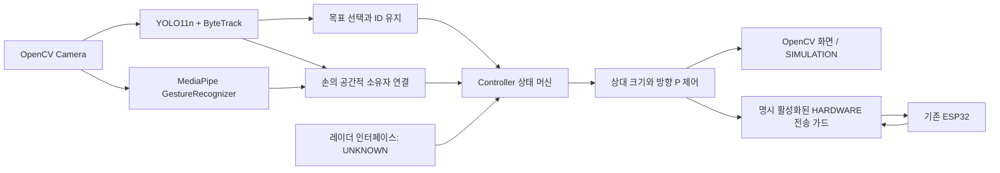

# 제어 기반 및 실시간 검증 대시보드 설계

## 현재 수동 시험 정책

현재 대시보드의 실제 하드웨어 연결은 `communication/motor_test.py`의 MotorTestClient만 사용한다. 공통 UdpClient의 session/seq/수신 검증/socket/스레드를 재사용하며 패킷 선택과 관측 기록만 분리했다. 기존 자동 추종·제스처 제어기는 SIMULATION에서 유지하되 하드웨어 시험 중 submit을 무시하고 A/R 경로를 차단한다. OpenCV 하드웨어 진입도 거부한다.

무구동 연결은 STOP → 해당 STOP 이후의 새 정지 텔레메트리 증명 → stationary heartbeat 순서다. 모터 시험은 바퀴 띄움 확인과 별도 승인, 완전한 휠·엔코더 정보, fresh STOPPED가 필요하다. 기본 2.5cm/s·0.2rad/s, 0.8초, 10Hz이며 최대 시간은 2초다. 독립 스레드가 deadline, 250ms GUI 생존 lease, 500ms telemetry 나이, fault를 감시하고 STOP 후 비활성화한다. 카메라가 없는 벤치 시험도 가능하며 카메라 timestamp로 GUI 생존을 위장하지 않는다.

Heartbeat는 이동 중·정지 확인 대기·안전 latch 중에는 사용하지 않는다. 실제 회전은 명령 처리 증명(session/seq/state/echo), 엔코더 변화·부호, 수동 육안 관찰로 구분한다. 별도 ACK 패킷은 없으며 `acknowledged_command`는 이전 코드와 테스트를 보존하기 위한 seq 매칭 별칭일 뿐이다. 현재 UI는 ACK 성공이라고 표시하지 않는다. 자세한 계약과 기록은 [MOTOR_TEST_GUIDE.md](MOTOR_TEST_GUIDE.md), 현재 검증은 [MOTOR_TEST_VALIDATION.md](MOTOR_TEST_VALIDATION.md)를 참조한다. 아래 내용은 이전 단계 기반과 함께 읽어야 한다.

## 현재 대시보드 확장

기존 제어·검출·추적·펌웨어는 재사용한다. 배치 실행의 기본 UI는 PySide6이며, 명시 `--ui opencv`와 기존 Python 진입 기본값은 호환 경로로 남긴다. `visualization/dashboard.py`가 Qt 탭·버튼·렌더링·그래프를, `dashboard_runtime.py`가 worker와 제어·스냅샷 조립을, `monitoring.py`가 단위 환산·검증 기록·비동기 JSONL을 소유한다.

Camera worker → 최신 슬롯(1개) → Vision worker → 최신 결과 슬롯(1개) → GUI 50ms QTimer의 상태 머신 → 안전 명령 순서다. GUI 스레드에서 카메라 read, AI 추론, 소켓 recv, 로그 flush를 실행하지 않는다. 느린 처리 중 오래된 프레임 큐를 쌓지 않는다. GUI가 멈추어도 UDP worker가 마지막으로 받은 perception lease의 실제 나이를 확인하며 STOP으로 전환한다. 오래된 결과로 lease 시간을 갱신하지 않는다.

Raw 관측은 차단 여부와 무관하게 보존하지만, 제어 입력은 기존 단일 인물·목표 소유권 제한을 통과해야 한다. Controller에 진단 값과 긴급 정지 latch를 추가했으며 기존 30개 테스트를 유지한다. 요청 명령은 제한 전 출력이고 안전 명령과 구분한다. PAUSED/FAULT에서도 요청은 진단 목적으로 표시될 수 있으며 전송 가능성을 의미하지 않는다.

UDP snapshot은 성공한 sendto 패킷, 수신 나이·유효성, ACK seq에 매칭된 송신 패킷, STOP 이후 확인 여부를 구분한다. `cmd_vx/cmd_vy/cmd_w`는 펌웨어가 보고한 희망 명령이며 제한 이후 본체 속도는 현재 펌웨어에 없다. `wheel_target/wheel_speed`가 실제 바퀴 목표/측정 피드백이다. cm/s를 설정 반지름 2.9cm로 환산한 RPM에는 환산 표시를 붙인다.

로그는 10Hz 상태와 사용자 입력·상태 전이·적용 제스처 사건을 기록한다. queue가 가득 차거나 writer 오류가 보고되면 긴급 정지를 latch한다. 송신 성공이나 정지 텔레메트리 확인을 물리 주행 성공으로 승격하지 않는다. 테스트 결과는 기본 NOT TESTED, 사용자 수행 확인과 관찰 메모가 있어야 PASS/FAIL을 저장한다. 자세한 스키마·제한은 [대시보드 안내](DASHBOARD_GUIDE.md), 실제 증거는 [최신 검증](DASHBOARD_VALIDATION.md)에 있다.

아래는 재사용한 1차 제어 기반이다.

요청 범위는 Windows 웹캠 → 사람 선택·추적 → 목표 손 제스처 → 상대 크기 추종 명령 → 화면 시뮬레이션이다. 기본 실행에는 UDP 소켓이 없다. ESP32의 운동학·PID·엔코더·워치독을 재사용하며 상위 제어만 Python으로 추가했다. 원본 ZIP과 기존 로봇의 동작 설정은 보존한다.

## 선택한 접근

- YOLO11n + ByteTrack: 기존 설치 Ultralytics API를 사용하고 CPU에서 별도 ReID 모델 없이 동작한다. `tracker="bytetrack.yaml"`를 명시해 라이브러리 기본 추적기의 변경에 영향을 받지 않는다.
- BoT-SORT: 이동 카메라 보정·외형 기반 연결이 유용하나 1차 검증에서 복잡도와 연산을 늘린다. 2차 비교 대상으로 남긴다.
- MediaPipe Tasks GestureRecognizer: 공식 7개 제스처 모델에서 4개를 사용한다. 수작업 손가락 각도 분류기를 만들지 않는다.
- 별도 사용자 ID 재식별은 구현하지 않는다. ID가 사라지면 기존 ID를 보유한 채 정지하며 다른 사람으로 교체하지 않는다. 재선택은 사용자가 화면에서 한다.

위 선택과 수치는 구현상의 제안이며 실측 성능이나 사용자 신원 인증을 의미하지 않는다.

## 데이터 흐름과 파일 책임

`models.py`는 단위가 명확한 불변 관측·명령 자료형이다. `vision/camera.py`만 카메라 입출력을 담당한다. `person_detector.py`는 검출과 ByteTrack 호출, `person_tracker.py`는 선택만 담당한다. `gesture_recognizer.py`는 같은 프레임의 손목과 손바닥 관절 5개가 유일하게 포함되는 사람 박스를 연결한다. 겹치는 사람·불명확한 소유자·충돌하는 제스처는 명령에서 제외한다. 목표 박스가 다른 사람과 겹치면 추종도 정지한다.

공간적 박스 포함만으로 다른 사람의 뻗은 팔을 완전히 구별할 수 없으므로 **1차 런타임은 사람이 여러 명이면 모든 손 제스처 명령을 비활성화**한다. 다인 목표 선택·추적과 키보드 제어는 가능하다. 손 연결 유틸리티는 구현했지만 다인 제스처 제어는 포즈 손목 연결과 실측 검증 뒤 활성화하는 범위로 남긴다. 사람이 검출되지 않거나 누락되는 상황까지 신원 소유권을 보장하지 않는다.

`control/state_machine.py`가 활성화·정지·재개를 소유하고, `follow_controller.py`가 계산과 제한만 담당한다. 별도의 추상 SafetyManager 없이 상태 머신에 안전 검사를 모아 작은 구조를 유지했다. `communication/esp32_udp.py`만 소켓을 소유한다. `radar_interface.py`는 미연결을 `None/False`로 반환한다. 미연결 관측을 실제 안전 입력으로 연결하면 `OBSTACLE_STOP`이며, 1차 시뮬레이션은 레이더 관측 없이 실행하고 화면에는 UNKNOWN을 표시한다.

현재 거리 대용값 계산은 `control/distance_estimator.py`의 `relative_height_ratio`로 분리했다. FollowController는 이 함수와 같은 `(target, frame_height) -> dimensionless proxy` callable을 주입받을 수 있다. 실제 거리 센서를 연결할 때에는 새 관측값의 유효성·단위와 목표값 의미도 함께 검증해야 한다.

## 상태와 재개

| 조건 | 상태 | 이동 허용 |
|---|---|---|
| 선택 없음 | SEARCHING | 아니오 |
| 한 사람 후보 또는 클릭 선택 | TARGET_SELECTED | 아니오 |
| Enter 확정 | TRACKING | 아니오 |
| A 활성화 후 R 또는 승인된 Open Palm | FOLLOWING | 예 |
| 승인된 Thumb Up/Down | GESTURE_OVERRIDE | 상대 크기 목표값을 한 단계 변경 |
| P, 승인된 정지 제스처, 긴급 정지 | PAUSED | 아니오 |
| 목표 누락·박스 오류·겹침·급변 | TARGET_LOST | 아니오 |
| 레이더 위험·입력 이상·필수 센서 부재 | OBSTACLE_STOP | 아니오 |
| 카메라 오류·오래된 인식·통신·ESP32 fault | FAULT | 아니오 |

안전 정지는 속도를 즉시 0으로 만든다. 조건이 정상으로 돌아와도 이전 이동 상태로 자동 복귀하지 않는다. FAULT·긴급 정지는 활성화도 해제하므로 A와 새 재개가 필요하다. TARGET_LOST·OBSTACLE_STOP은 새 R 또는 손을 내렸다가 다시 유지한 재개 제스처가 필요하다. 위험 중부터 계속 들고 있던 Open Palm으로 재출발하지 않는다. 정지 제스처가 승인되어 유지되는 동안 재개 키보다 우선한다.

제스처는 기본 0.75 이상, 0.6초 이상, 최소 3개 프레임, 프레임 간격 0.25초 이하가 모두 필요하다. 같은 제스처 유지로 거리 설정을 반복 변경하지 않는다. 인식 없음은 기존 상태를 유지하며, PAUSED는 계속 PAUSED다. 손 검출 실패는 사람 검출 실패와 구분한다.

## 추종과 안전 경계

정규화 수평 오차를 지수 필터링한 뒤 deadband·P 제어·각속도 제한·가속도 제한을 적용한다. 박스 높이/영상 높이를 상대 거리 대용값으로 사용하며 실제 거리값은 만들지 않는다. 목표 상대 높이는 기본 0.60, 허용 오차는 0.06이다. Thumb Up은 0.08 증가(더 가까움), Thumb Down은 감소(더 멂)시킨다. 큰 회전 오차에서는 전진을 억제한다. 소프트웨어 출력은 최대 5cm/s·0.5rad/s, 좌우 병진은 0이다. 긴급 정지는 가속도 제한을 우회한다.

HARDWARE는 명시 CLI 인자 + 설정의 부호 검증 확인 + fresh STOPPED 텔레메트리 + A + 재개가 모두 필요하다. 후진은 레이더가 있다고 주장하는 입력만으로 해제할 수 없으며 1차에서는 차단한다. SIMULATION의 음수 속도는 계산만 표시한다.

전송 스레드는 50ms 주기로 동작한다. 최종 영상 타임스탬프가 250ms 이상 오래되면 STOP을 보내고 활성화를 해제한다. 영상 읽기와 두 모델 처리 중에는 타임스탬프를 갱신하지 않는다. 텔레메트리는 700ms가 지나면 무효다. 가드 실패 뒤 자동 재활성화하지 않는다. Python은 heartbeat를 전송하지 않으며 정지 상태는 typed STOP을 반복한다.

스레드는 운영체제·Python 전체 정지·UDP 손실을 극복하는 실시간 안전장치가 아니다. ESP32 300ms 워치독과 물리 비상 정지 수단도 필요하다. 화면의 긴급 정지는 소프트웨어 정지다. 기존 UDP는 인증·암호화가 없으므로 신뢰된 분리 네트워크가 전제다.

프레임 타임스탬프는 센서 촬영시각이 아니라 호스트가 읽기를 시작한 시각이다. 백엔드 내부 버퍼 지연이나 카메라가 동일 영상을 새 프레임으로 내보내는 고장까지 검증한 것은 아니다.

## 2차 범위

레이더 실제 모델·출력 형식을 확인한 어댑터, 후방 센서 범위와 제동 거리 실측, 사람 포즈 손목 기반 연결, 가림·ID 교체 검증, Raspberry Pi 카메라 어댑터와 성능 측정을 순서대로 진행한다. Pi 전용 카메라 제품을 가정하지 않는다.
