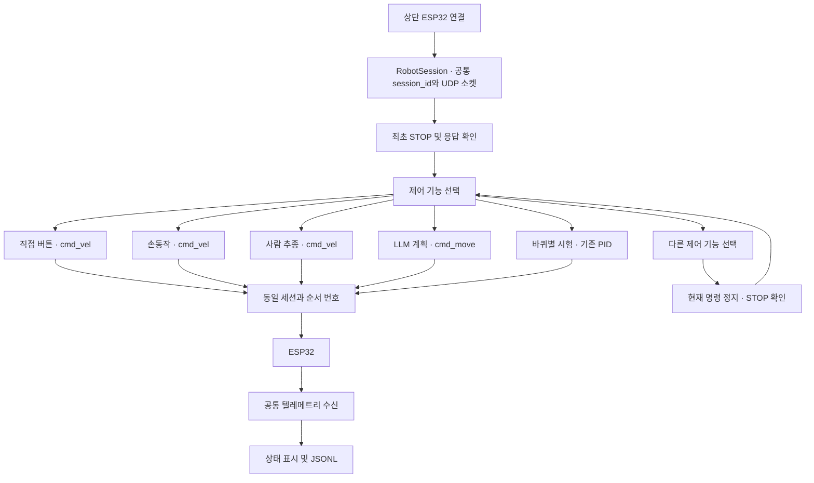

# D.I.G. 중앙제어 구현 결과

2026-11-18 기준입니다. 기존 워크플로우의 제안 구조를 실행 코드에 반영했습니다.

이후 watchdog 분리와 엔코더 복구를 구현했습니다. 현재 통신 작업 및 펌웨어 후보는 [Watchdog·엔코더 수정 결과](C:/Users/jugon/Desktop/NEW_ROBOT_START/docs/WATCHDOG_ENCODER_FIX_IMPLEMENTATION.md)를 참고하세요.

## 실행과 화면

프로젝트의 `run_simulation.bat`를 실행합니다. 최초 화면은 시뮬레이션입니다. 상단에 ESP32 IP를 입력하고 **ESP32 연결**을 한 번 누르면 공통 연결을 시작합니다. 운영 화면에 별도 승인 체크박스나 바퀴 고정 확인 단계는 없습니다.

| 공간 | 화면 | 사용 방법 |
| --- | --- | --- |
| 중앙제어 | 직접 제어 | 방향 버튼을 누르는 동안 이동하고 놓으면 정지 |
| 중앙제어 | 손동작 제어 | 설정된 제스처가 유지되는 동안 구동, 주먹 또는 손 소실에서 정지 |
| 중앙제어 | 사람 추종 | 카메라에서 대상을 선택하고 추종 시작을 누름, 기존 제스처로 재개·정지·거리 조절 |
| 중앙제어 | 자연어 제어 | 계획 생성 후 실행, 같은 연결에서 다음 계획도 바로 실행 |
| 테스트·진단 | 연결, 모터·텔레메트리, 카메라·추론 | 통신과 구동 상태 관찰 |
| 테스트·진단 | 검증·로그, 바퀴 시험 기록 | M1·M2·M3 시험, 사용자 관찰 및 결과 기록 |
| 테스트·진단 | 인식·추종 설정 | 프레임 유효시간, 인식 유지, 해상도 등 조정 |

공통 긴급정지는 모든 화면 상단에 있습니다. 직접 제어 버튼 해제와 화면 전환에서도 정지를 요청합니다. 자연어 계획 취소는 즉시정지 처리로 연결됩니다. 테스트·진단의 읽기 전용 화면을 보는 동안에도 기존 실행 결과를 관찰할 수 있습니다.

## 공통 연결 워크플로우



RobotSession은 기존 MotorTestClient의 바퀴 시험 기록과 HandDriveClient의 제스처 속도 처리를 재사용합니다. 직접 구동, 손동작, 추종, 바퀴 시험의 송신은 같은 연결에서 처리합니다.

자연어 실행기는 공통 통신 작업의 큐로 목표와 STOP을 요청합니다. 소켓과 실제 전송 seq는 공통 작업이 계속 소유하고 heartbeat도 독립적으로 송신합니다. 계획이 끝나도 소켓과 세션을 유지하고 다음 기능이나 계획에서 순서 번호를 이어갑니다.

모드 전환은 현재 명령을 정지하고 새 STOP의 응답을 확인한 다음 완료합니다. 다른 모드에서 이동을 요청해도 전환이 끝나기 전까지 명령을 보내지 않습니다. 긴급정지가 들어오면 대기 중인 전환도 취소합니다.

## LLM 입력

대시보드는 자연어를 먼저 모델에 전달하고, 응답 이후 입력 원문과 행동을 대조합니다. 정지 단독 명령은 로컬에서 처리합니다.

예를 들어 다음 문장을 지원합니다.

```text
로봇아 먼저 앞으로 15cm만 가 주고 오른쪽으로 10cm 이동해 줘 부탁해
```

검증된 행동은 전진 15cm, 우측 10cm 순서입니다. 호칭·부탁 표현과 일부 구어체를 정규화해 명시된 방향과 거리의 순서를 확인합니다. 이를 통해 지원하는 문장 표현은 넓어졌습니다.

행동 범위는 기존 Pydantic 스키마에 따릅니다. 현재 이동은 네 방향, 구간별 5~50cm, 최대 4행동, 합계 100cm 이하이며 기본 거리 이동 속도는 5cm/s입니다. 각도 회전·시간 이동·임의 물체 접근은 추가 행동 스키마와 완료 판정이 필요합니다. 이번 변경에서 이를 구현했다고 간주하지 않습니다.

CLI의 기존 원문 검사와 독립 실행 경로도 유지합니다. 대시보드의 대화체 정규화는 별도 진입 함수에서 처리합니다.

## 즉시정지와 장치 조건

운영자가 조작하는 안전 기능은 공통 긴급정지에 모았습니다. 정상 명령을 시작할 때의 반복 승인과 구동 확인 대화상자는 제거했습니다.

ESP32의 유효한 NETWORK 응답, 동일 세션·부팅·순서 번호, 구동 가능한 Fault 상태는 통신 조건으로 계속 확인합니다. 인식 기반 구동에서는 새 영상과 유효한 인식을 사용합니다. 기존 속도 제한, 모터 PID 및 보정, 펌웨어 watchdog도 적용됩니다.

특히 ENCODER_JUMP가 래치된 장치는 현재 펌웨어에서 이동 명령을 처리하지 않습니다. 이번 변경은 해당 오류를 해제하거나 무시하는 기능을 추가하지 않았습니다. 원인 측정은 기존 엔코더 조사 절차를 따라야 합니다.

PC의 즉시정지는 UDP 명령입니다. 수신이 확인되지 않으면 화면에서 미확인으로 표시합니다. 이 버튼과 장치의 watchdog·Fault는 서로 다른 계층에서 작동합니다.

## 검증

- 기존 기준선은 130개 테스트입니다. 원본 체크아웃은 로컬 secrets.h 때문에 기존 배포본 검사 한 개가 실패하는 상태였습니다.
- 공통 세션, 모드 전환, 직접 누름·해제, 바퀴별 시험, 자연어 순차 실행, 즉시정지 이후 추가 이동 차단, GUI의 공통 연결 사용 및 반복 계획을 모의 ESP32로 검사했습니다.
- 대화체 입력의 방향·거리·순서 대조와 기존 모호한 문장·거부 사례를 검사했습니다.
- 960×700과 1320×920에서 중앙제어 4개 화면 및 테스트·진단 6개 화면을 합성 미리보기로 렌더링했습니다.
- Python compileall 및 일반 dashboard-preview 진입점의 기동·종료 검사를 실행했습니다.
- 기존 로컬 자격 증명을 제외한 격리 사본에서 전체 회귀 결과는 아래 검증 기록에 남깁니다. 펌웨어 및 원본 ZIP의 무결성 검사도 포함됩니다.

격리 사본에서 **전체 140개 테스트를 통과했습니다.** 전체 출력은 `.tmp/central-control-redesign/regression.txt`에 저장했습니다. 실제 대시보드가 UDP 8889를 점유한 중간 검사에서는 포트 배타성 시험이 실패해, 기존 창을 정상 종료한 뒤 전체 검사를 완료했습니다. 이 문서에서 명시한 소프트웨어 검증과 실제 로봇 주행은 별도입니다. 실제 NVIDIA API 재호출, 펌웨어 업로드, 실물 모터 구동은 이번 구현 검증에서 수행하지 않았습니다.

## 변경 파일

- `python_controller/communication/robot_session.py`에 공통 세션과 거리 실행 소켓 공유를 구현했습니다.
- `python_controller/communication/esp32_udp.py`에서 공통 세션의 거리 텔레메트리 상태를 수용할 수 있게 했습니다. 기존 클라이언트의 허용 상태는 그대로 적용됩니다.
- `python_controller/communication/motor_test.py`에서 직접 구동과 바퀴 시험 기록을 함께 사용할 때의 상태 표시를 처리했습니다.
- `python_controller/execution/motion_executor.py`에 공통 Protocol 주입 경로를 추가했습니다.
- `python_controller/llm/central_control.py`에서 대시보드 계획 생성과 공유 세션 실행을 연결했습니다.
- `python_controller/planning/dashboard_command.py`에 대화체 정규화와 원문 대조 경로를 구현했습니다.
- `python_controller/dashboard_runtime.py`에 연결·기능 전환·공통 실행 흐름을 구현했습니다.
- `python_controller/visualization/dashboard.py`, `follow_control.py`, `natural_control.py`에 새 화면과 공통 연결 조작을 적용했습니다.
- `python_controller/main.py`에서 중앙제어 진입점 설명을 갱신했습니다.
- `tests/test_robot_session.py`, `tests/test_dashboard_language.py`를 추가했고, 기존 GUI 테스트를 변경된 화면 흐름에 맞췄습니다.

이전 독립 자연어 실행기·승인 경로의 호환성 테스트도 유지합니다. 새 중앙제어 GUI 경로는 별도 통합 테스트로 확인합니다.
