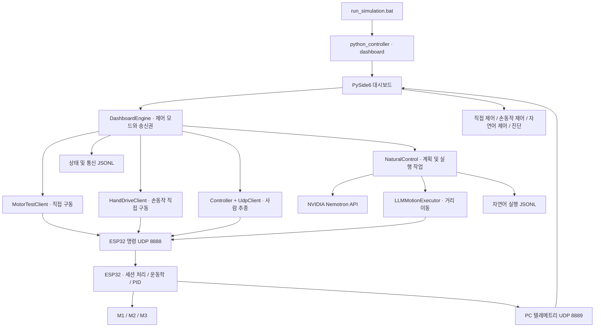
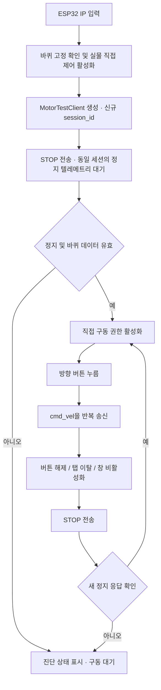
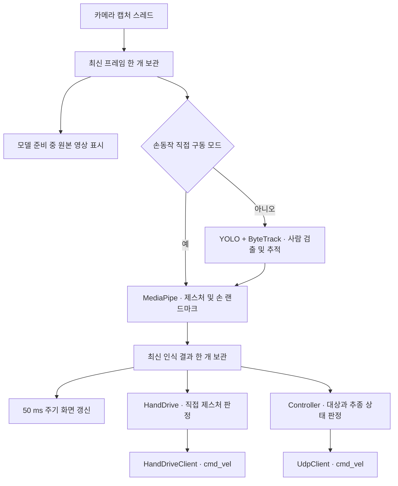
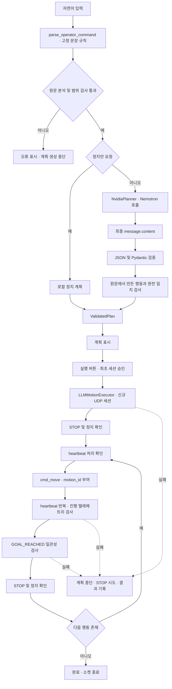
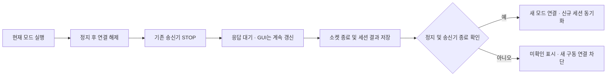
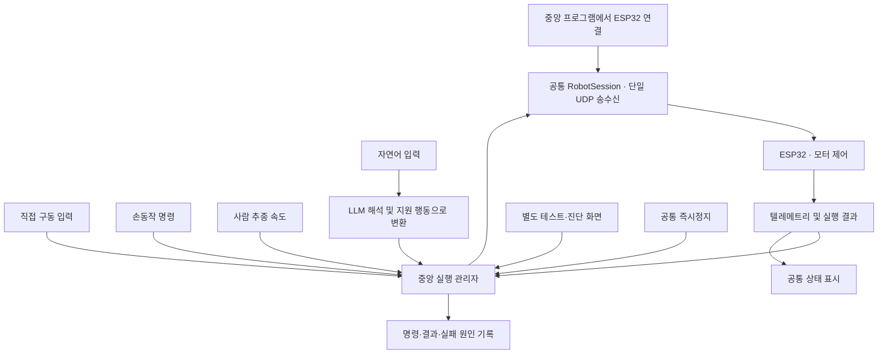

# D.I.G. 중앙제어 동작 워크플로우

작성일은 2026-11-18입니다. 현재 NEW_ROBOT_START의 Python 및 ESP32 소스를 기준으로 작성했습니다. 실제 보드에 업로드된 바이너리와 소스의 일치 여부는 이번 문서 작성에서 확인하지 않았습니다.

제안 구조는 이후 구현했습니다. **현재 적용된 중앙제어·테스트 화면과 공통 세션 흐름은 [중앙제어 구현 결과](C:/Users/jugon/Desktop/NEW_ROBOT_START/docs/CENTRAL_CONTROL_IMPLEMENTATION.md)에 기록했습니다.** 아래 2~8절은 변경 전 구조를 보존한 분석 기록입니다.

현재 PC 코드는 중앙 감독 작업과 UDP 송수신 작업을 독립적으로 실행합니다. 직접 구동, 손동작, 사람 추종, LLM 거리 실행이 공통 세션을 사용하며, 모드 전환에는 해당 세션의 STOP 응답이 필요합니다. 거리 실행기는 명령 큐에 목표를 등록하고 텔레메트리로 완료를 확인합니다. V2 펌웨어 후보에서는 통신 감시와 속도 명령 유효기간을 분리하고, 테스트·진단에서 엔코더 상태와 복구 가능 여부를 확인할 수 있습니다. [현재 제어 흐름과 V2 시험 결과](C:/Users/jugon/Desktop/NEW_ROBOT_START/docs/WATCHDOG_ENCODER_FIX_IMPLEMENTATION.md)

## 1. 사용자가 요청한 개편 방향

중앙제어 프로그램에서 직접 제어, 손동작, 사람 추종, LLM 명령을 바로 시험할 수 있게 합니다. 모터별 시험, 검증 결과 입력, 배선 확인, 교정과 로그 분석은 별도 테스트 공간으로 옮깁니다.

운영 화면의 조작은 연결, 제어 기능 선택, 명령 실행, 즉시정지 중심으로 단순화합니다. 사용자는 반복 승인과 여러 단계의 준비 조건을 줄이고, LLM 제어를 자유롭게 개선할 수 있는 환경을 요청했습니다. 안전 관련 사용자 조작은 공통 즉시정지 버튼 하나로 모으는 방향입니다.

이 문서의 2~8절에는 변경 전 동작을, 9절에는 이후 구현의 기준이 된 제안 구조를 기술합니다.

## 2. 변경 전 전체 구조



대시보드는 송신권을 중앙에서 조정합니다. 실제 UDP 송수신과 세션은 각 모드의 클라이언트가 소유합니다. 같은 프로그램에서 동시에 둘 이상의 실물 제어 클라이언트를 시작하면 연결을 거부합니다. 실제 UDP 소켓은 8889 수신 포트를 사용하고 Windows에서 배타적 바인딩을 적용합니다.

기본 실행은 SIMULATION입니다. 일반 카메라를 사용하는 시뮬레이션과 합성 미리보기는 서로 다릅니다. 합성 미리보기의 실물 연결은 차단됩니다.

현재 내부 모드 식별자는 다음과 같습니다.

| 내부 모드 | 처리 주체 | 주요 명령 |
| --- | --- | --- |
| SIMULATION | Controller 및 화면 | 속도 계산과 표시 |
| MANUAL_MOTOR_TEST | MotorTestClient | 직접 버튼 및 바퀴 시험의 cmd_vel |
| GESTURE_DIRECT | HandDriveClient | 손동작으로 결정한 cmd_vel |
| GESTURE_FOLLOW | Controller, UdpClient | 추종 속도를 담은 cmd_vel |
| LLM_COMMAND | NaturalControl, LLMMotionExecutor | cmd_move, heartbeat, stop |

## 3. 현재 화면과 테스트 기능의 위치

| 화면 | 실제 포함된 기능 | 현재 구조상 문제 |
| --- | --- | --- |
| 직접 제어 | IP 입력, 실물 활성화, 방향 버튼, M1·M2·M3, RPM·PWM·카운트 | 일상 구동과 공중 바퀴 시험이 같은 MotorTestClient 및 준비 문구를 사용함 |
| 손동작 제어 | 손동작 직접 구동, 사람 추종, 카메라, 인식 설정 | 사람 추종에는 대상 선택·확정·재개 상태가 별도로 존재함 |
| 자연어 제어 | 입력, 계획 생성, 최초 승인, 실행, 취소, 결과 | API 호출 전 문장 규칙부터 실행 완료까지 여러 차단 조건이 존재함 |
| 진단 | 연결, 모터 텔레메트리, 영상 추론, 검증·로그, 바퀴 시험 기록 | 검증 결과 입력과 테스트 기능이 진단 아래에 분산됨 |

별도 테스트 화면은 아직 독립된 최상위 작업 공간으로 구현되지 않았습니다. 직접 제어도 내부적으로 MANUAL_MOTOR_TEST라는 모드명을 사용합니다. 이 이름은 ESP32의 시리얼 MANUAL_TEST 모드와 구별해야 합니다. 현재 대시보드의 직접 구동 패킷은 ESP32 NETWORK 모드에서 처리됩니다.

## 4. 직접 제어



방향은 전진, 후진, 좌이동, 우이동, 좌회전, 우회전입니다. 기본 직선 속도는 2.5 cm/s, 각속도는 0.2 rad/s이며, 이동 명령은 100 ms 주기로 송신합니다. 누르고 있는 명령에는 고정 종료 시간이 없습니다. 버튼 해제나 중단 조건이 명령을 종료합니다.

M1·M2·M3 버튼은 기존 몸체 속도 역변환으로 선택 바퀴의 목표 속도를 만듭니다. 같은 UDP cmd_vel과 바퀴 PID를 사용합니다. 실제로 선택 바퀴만 도는지와 몸체 움직임은 현장 확인이 필요합니다.

이 모드는 매번 방향 버튼을 누를 때 새 승인 체크를 요구하지 않습니다. 다만 직전 STOP 응답이 확인되고 GUI 생존 상태와 바퀴 텔레메트리가 유효해야 다음 명령을 시작합니다.

## 5. 카메라·손동작·사람 추종



카메라 캡처와 인식은 별도 스레드입니다. 원본 영상은 인식 결과를 기다리는 동안에도 표시됩니다. 원본 프레임만 들어오는 상태에서는 제어용 인식 결과를 생성하지 않습니다.

손동작 직접 구동은 제어권을 활성화한 뒤 YOLO 처리를 건너뜁니다. 같은 시각의 한 손 인식을 신뢰도, 연속 프레임, 유지시간으로 평가합니다. 기본값은 신뢰도 0.70, 서로 다른 프레임 2개, 유지시간 0.25초입니다.

| 제스처 | 직접 구동 기본 동작 | 사람 추종 동작 |
| --- | --- | --- |
| Open_Palm | 전진 | 추종 재개 |
| Closed_Fist | 즉시 정지 | 추종 정지 |
| Thumb_Up | 좌이동 | 목표 추종 거리 감소 |
| Thumb_Down | 우이동 | 목표 추종 거리 증가 |

손동작 직접 구동의 최초 준비는 새 세션 정지 확인 뒤 손 내림 또는 주먹 인식을 요구합니다. 손 소실, 인식 불가, 신뢰도 부족, 여러 손에서는 정지 명령을 생성합니다. 재인식 후에도 직전 STOP 응답을 확인해야 다시 움직입니다. 카메라 갱신 실패로 권한이 해제되면 재연결이 필요합니다.

사람 추종은 카메라에서 목표 선택, 목표 확정, 제어 준비, 손바닥 재개 순서로 진행합니다. UI의 실물 추종 활성화 경로는 최초 STOP 확인과 중립 손동작 후 제어 준비를 자동으로 요청합니다. 내부 상태 머신에는 준비와 재개가 여전히 독립 상태로 남아 있습니다.

추종 속도는 대상 박스의 화면 내 높이 비율과 좌우 중심 오차로 계산합니다. 실제 거리 단위로 보정된 거리 측정은 아닙니다. 실물 추종에서는 후진을 제한하고 측면 속도는 0을 사용합니다. 대상 ID 소실, 급격한 박스 변화, 다른 사람과의 겹침, 영상 시간 초과가 추종을 중단시킬 수 있습니다.

## 6. LLM 자연어 제어



현재 LLM 호출 전에 Python 정규식으로 문장 전체를 분석해야 합니다. 따라서 Nemotron이 이해할 수 있는 문장도 이 단계에서 거부될 수 있습니다. 예를 들어 회전 각도, 시간 동안 이동, 물체에 접근, 지속 추종 같은 요청은 현재 행동 스키마가 지원하지 않습니다.

| 검사 위치 | 현재 조건 | 실패 시 결과 |
| --- | --- | --- |
| 원문 분석 | 입력 350자 이하, 지정된 방향·숫자·단위·접속 표현 | API 호출 전에 거부 |
| 행동 스키마 | move 또는 stop, 이동 방향 4종, 추가 필드 금지 | 계획 거부 |
| 이동 정책 | 한 이동 5~50 cm, 최대 4행동, 총 이동 100 cm 이하 | 계획 거부 |
| 원문 대조 | 방향·거리·순서가 원문 분석 결과와 일치 | 계획 거부 |
| 실행 시작 | 유효 계획, 최초 실물 승인, 다른 제어권 해제 | 실행 대기 또는 거부 |
| 실행 감시 | 세션·부팅·순서·응답 시간·Fault·motion_id | 중단 및 STOP |
| 완료 판정 | 거리와 잔여량 일치, 횡오차, 과주행, 속도·PWM·명령 정지 | 다음 행동 차단 |

NVIDIA Base URL, 모델, API 키는 .env 및 환경변수에서 읽습니다. Nemotron 3 Ultra 모델 식별자는 `nvidia/nemotron-3-ultra-550b-a55b`이며 어댑터는 해당 모델에 temperature 0.2, max_tokens 1024, enable_thinking false, stream false를 사용합니다. 실행 시 선택 모델은 NVIDIA_MODEL 설정에 따릅니다. reasoning_content는 행동으로 사용하지 않습니다.

계획 생성과 실행은 백그라운드 작업입니다. 현재 기본 이동은 5 cm/s, heartbeat는 100 ms 주기입니다. GUI가 살아 있는지도 실행 작업에서 확인합니다. 방향이 여러 개면 한 구간을 완료하고 STOP을 확인한 뒤 다음 구간을 시작합니다.

같은 주소에서 성공한 다음 계획에는 최초 승인을 재사용합니다. 새 계획마다 UDP 실행 세션과 소켓은 다시 생성됩니다. CLI의 EXECUTE·READY 입력 절차와 대시보드의 승인 절차는 서로 다른 진입 경로입니다.

## 7. 모드 전환과 즉시정지



탭을 보는 것과 제어권을 바꾸는 것은 별도 동작입니다. 직접 제어 중 다른 탭으로 이동하면 버튼 구동은 끝나지만 기존 연결은 정지 상태로 남습니다. 다른 실물 모드를 활성화하려면 연결 해제를 거칩니다.

긴급정지는 Dashboard.action → DashboardEngine.request('ESTOP')로 전달됩니다. 직접·손동작·추종 클라이언트는 이동 권한을 해제하고 STOP을 송신합니다. 자연어 실행은 취소 신호를 받고 다음 실행 검사에서 이동을 중단한 뒤 STOP을 시도합니다. 즉시정지는 모델 API 응답을 기다릴 필요가 없습니다.

PC 버튼에서 전송하는 정지는 UDP 명령입니다. 통신 단절이나 ESP32 정지 상황에서는 버튼을 눌러도 STOP 전달이 확인되지 않을 수 있습니다. 현재 펌웨어의 300 ms 네트워크 watchdog이 PC나 Wi-Fi가 끊긴 경우의 정지도 담당합니다. 화면에서 정지 버튼만 남기는 변경과 ESP32의 watchdog·Fault 동작 변경은 각각 별도의 구현입니다.

## 8. 실제 구동을 막는 조건과 담당 계층

| 계층 | 대표 조건 | 현재 기본값 또는 동작 | 관련 소스 |
| --- | --- | --- | --- |
| UI | 실물 활성화, 계획 실행, 중복 연결 | 실물 승인 및 모드별 활성화 | visualization/dashboard.py, natural_control.py |
| 중앙 관리 | 기존 소켓 종료와 STOP 확인, 세션 충돌 | 조건 불충족 시 전환 차단 | dashboard_runtime.py |
| 인식 | 영상 나이, 손 유지, 대상 유효성 | 기본 영상 유효시간 250 ms | control/hand_drive.py, control/state_machine.py |
| Python 속도 | 직접·손동작, 추종, LLM | 각각 기본 2.5 / 최대 5 / 5 cm/s | communication/motor_test.py, control/follow_controller.py, execution/motion_executor.py |
| 자연어 정책 | 문장 패턴, 거리, 순서, 행동 종류 | 원문 검사와 모델 계획 대조 | planning/schema.py, planning/validator.py |
| UDP | 세션, 부팅 ID, 순서, 응답 나이 | 불일치·시간 초과 시 정지 | communication/esp32_udp.py, execution/llm_telemetry.py |
| ESP32 | 모드, handshake, Fault, watchdog | 네트워크 명령 300 ms 시간 초과 | network_protocol.cpp, safety_telemetry.cpp |
| ESP32 운동 제어 | 속도, 가속, 엔코더·오도메트리·정체 오류 | 제어 주기 10 ms, 바퀴 한도 20 cm/s | robot_config.h, motor_encoder.cpp, kinematics_motion.cpp |

PC에서 승인을 생략해도 펌웨어의 모드·속도·Fault 조건은 계속 적용됩니다. ENCODER_JUMP는 현재 ESP32가 래치하는 Fault입니다. 중앙 프로그램만 바꿔서 이 상태의 이동을 허용할 수는 없습니다.

텔레메트리는 기본 200 ms 주기입니다. GOAL_REACHED는 엔코더 기반 완료 보고입니다. 실제 바닥 이동 거리와의 일치는 실물 측정이 필요합니다.

## 9. 개편 설계

운영과 테스트를 분리하는 구현은 다음 설계를 기준으로 합니다.

```text
D.I.G. 중앙제어
├─ 공통 표시
│  └─ ESP32 연결 · 현재 제어 기능 · 모터 상태 · 즉시정지
├─ 중앙제어
│  ├─ 직접 구동
│  ├─ 손동작 구동
│  ├─ 사람 추종
│  └─ LLM 명령
└─ 테스트·진단
   ├─ M1·M2·M3 및 PID 시험
   ├─ 배선·엔코더·보정 확인
   ├─ 연결·세션·STOP 진단
   ├─ LLM 입력·응답·계획 비교
   └─ 시험 결과와 로그
```



구현 항목은 다음과 같습니다.

1. 직접 구동을 MotorTestClient에서 분리하고, 바퀴별 시험과 결과 기록을 테스트 공간으로 이동합니다.
2. 중앙 연결이 단일 UDP 송신기·수신기·session_id를 소유하도록 바꿉니다. 제어 기능 변경은 같은 연결 안에서 현재 명령을 끝내고 다음 명령의 소유권을 넘깁니다.
3. 운영 화면의 반복 승인과 공중 바퀴 시험 준비 절차를 정리하고, 연결 후 명령을 실행할 수 있는 흐름으로 만듭니다.
4. 자연어의 고정 문장 패턴 선검사를 재설계합니다. LLM이 반환할 행동 종류와 실제 ESP32가 수행할 수 있는 명령을 대응시킵니다. 거리·속도·행동 수 제한의 변경 위치는 Python 정책과 펌웨어로 나누어 반영합니다.
5. 제어 모드마다 다른 상태 문구를 공통 실행 상태로 모읍니다. 대기, 실행 중, 정지 요청 중, 완료, 오류를 같은 위치에 표시합니다.
6. 즉시정지를 모든 입력보다 우선 처리하고, 직전 명령이 취소된 결과와 ESP32의 정지 응답을 표시합니다.

정규식 선검사 제거와 행동 스키마 확장은 함께 검토해야 합니다. 예를 들어 시간 이동은 종료 시점 관리가 필요하고, 회전 각도 명령은 현재 각속도 명령에 더해 회전 완료 판단이 필요합니다. 지원 행동과 완료 판단을 정의해야 LLM 평가에서 문장 해석 오류와 로봇 실행 오류를 구분할 수 있습니다.

## 10. 현재 코드 확인 경로

- [실행 시작점](C:/Users/jugon/Desktop/NEW_ROBOT_START/run_simulation.bat)
- [화면 및 사용자 입력](C:/Users/jugon/Desktop/NEW_ROBOT_START/python_controller/visualization/dashboard.py)
- [중앙 제어권과 모드 전환](C:/Users/jugon/Desktop/NEW_ROBOT_START/python_controller/dashboard_runtime.py)
- [직접 구동 및 바퀴 시험](C:/Users/jugon/Desktop/NEW_ROBOT_START/python_controller/communication/motor_test.py)
- [손동작 직접 구동](C:/Users/jugon/Desktop/NEW_ROBOT_START/python_controller/control/hand_drive.py)
- [사람 추종 상태 머신](C:/Users/jugon/Desktop/NEW_ROBOT_START/python_controller/control/state_machine.py)
- [LLM 계획 생성 진입점](C:/Users/jugon/Desktop/NEW_ROBOT_START/python_controller/llm_cli.py)
- [자연어 원문 및 행동 정책](C:/Users/jugon/Desktop/NEW_ROBOT_START/python_controller/planning/validator.py)
- [자연어 비동기 작업](C:/Users/jugon/Desktop/NEW_ROBOT_START/python_controller/llm/central_control.py)
- [거리 이동과 순차 실행](C:/Users/jugon/Desktop/NEW_ROBOT_START/python_controller/execution/motion_executor.py)
- [UDP 속도 명령 및 응답 검증](C:/Users/jugon/Desktop/NEW_ROBOT_START/python_controller/communication/esp32_udp.py)
- [ESP32 세션 및 명령 수락](C:/Users/jugon/Desktop/NEW_ROBOT_START/esp32_firmware/esp32_omni_controller/network_protocol.cpp)
- [ESP32 제어 상수](C:/Users/jugon/Desktop/NEW_ROBOT_START/esp32_firmware/esp32_omni_controller/robot_config.h)

문서는 위 소스의 흐름과 기본 설정을 대조하여 작성했습니다. 이후 구현의 변경 파일과 소프트웨어 시험 결과는 중앙제어 구현 결과 문서를 참고하세요.
