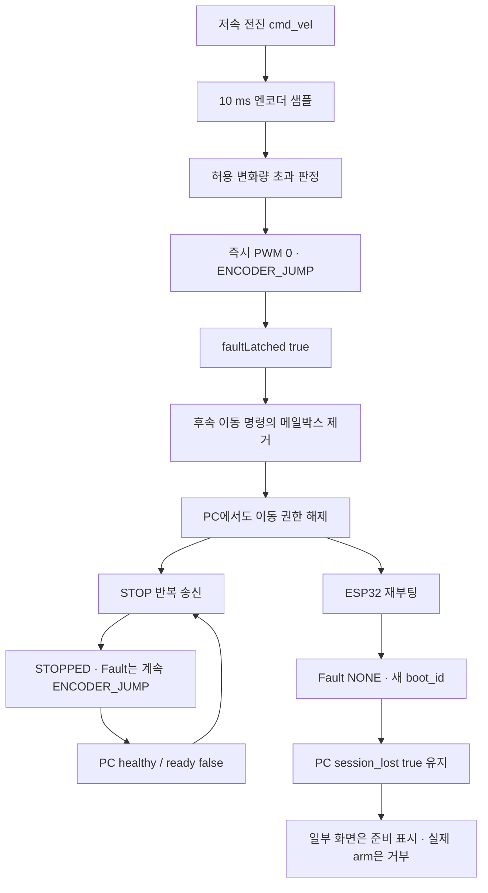
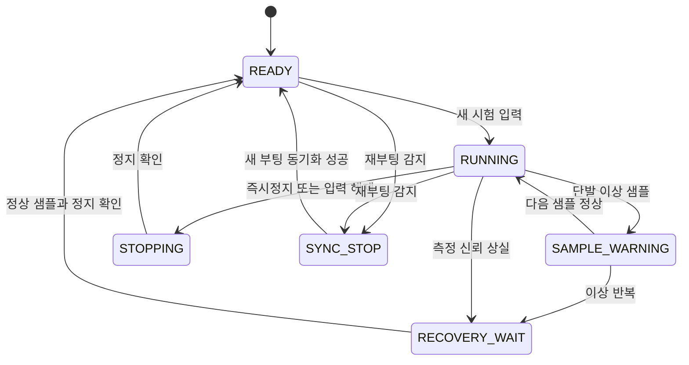

# 엔코더 오류와 시험 중단 복구 설계

2026-11-18에 제공된 화면, `logs/20261118_121343_793779/events.jsonl`, 현재 Python 및 ESP32 소스를 대조했습니다. 이 문서는 원인 분석과 수정 설계입니다. 실행 코드 변경, Fault 해제 패킷 전송, 펌웨어 업로드, 실물 구동은 이번 조사에 포함하지 않았습니다.

이후 별도 요청에 따라 PC와 펌웨어 후보를 수정했습니다. [구현 결과와 검증](C:/Users/jugon/Desktop/NEW_ROBOT_START/docs/WATCHDOG_ENCODER_FIX_IMPLEMENTATION.md)을 참고하세요. 아래 내용은 당시의 원인 분석과 설계 근거를 보존한 기록입니다.

Heartbeat 100 ms·통신 watchdog 600 ms의 시험 후보와 명령 수명 분리는 [Heartbeat·명령 유효시간 설계](C:/Users/jugon/Desktop/NEW_ROBOT_START/docs/HEARTBEAT_AND_COMMAND_LIFETIME_DESIGN.md)에 별도로 정리했습니다. ENCODER_JUMP의 원인·복구 변경과 나누어 검증합니다.

## 1. 확인된 원인

실제 ESP32 Fault는 **ENCODER_JUMP**입니다. 대시보드가 이를 명령 시간 초과와 묶어 `ESP32_FAULT_OR_COMMAND_STALE`로 표시하면서 구체적인 원인이 가려졌습니다.

첫 Fault 시점의 `command_age_ms`는 201이었고, 펌웨어 네트워크 watchdog 설정은 300 ms입니다. 수신 Fault 필드도 ENCODER_JUMP로 명시되어 있습니다.

| 시각 KST | 관측 |
| --- | --- |
| 12:17:26.036 | 정상 STOPPED, Fault NONE. boot_id 2445586305, session_id 2519479679 |
| 12:17:27.541 | PC가 전진 2.5 cm/s의 cmd_vel, seq 15 송신 |
| 12:17:27.667 | seq 16 송신. 직전 텔레메트리 엔코더는 [3313,3696,3172] |
| 12:17:27.796 | seq 17 송신 |
| 12:17:27.861 | ESP32가 FAULT / ENCODER_JUMP 보고. last_seq 15, 명령 나이 201 ms, 카운트 [3313,3718,3181], PWM [0,0,0] |
| 12:17:27.861 | PC가 STOP seq 18 송신 |
| 12:17:28.244 | STOPPED / ENCODER_JUMP, last_seq 19. 명령·PWM은 0, 보고 속도는 거의 0 |
| 12:19:10.757 | boot_id가 516132671로 변경. 카운트 0, Fault NONE. PC는 ESP32_REBOOT를 기록 |
| 12:19:18경 | Fault NONE, STOP 응답 확인 상태에서도 session_lost true가 유지되어 구동 준비가 차단됨 |

전진 명령 송신부터 첫 Fault 수신까지 약 0.32초입니다. 엔코더 변화는 관측됐으나, 200 ms 주기의 텔레메트리에는 오류를 발생시킨 10 ms 제어 틱의 원시 변화량이 없습니다. 오류 바퀴, 펄스 노이즈, CPR 설정, 실제 순간 속도 중 원인을 확정할 수 없습니다.

## 2. 현재 정지가 지속되는 과정



ESP32의 `raiseFault()`는 ENCODER_JUMP를 래치 오류로 분류합니다. 일반 STOP은 출력을 끄지만 이 래치를 해제하지 않습니다. 후속 이동 명령을 수신해도 `handleAcceptedCommand()`가 모션 메일박스를 비웁니다.

현재 펌웨어에는 `reset_fault` 명령이 존재합니다. 래치 오류에서는 reset_fault로 복구를 승인하고 후속 STOP 또는 heartbeat의 handshake를 거쳐 해제하는 경로가 있습니다. 현재 중앙제어 화면은 이 복구 경로를 제공하지 않습니다. 같은 오류가 계속 발생하는 상태에서 반복 리셋하면 다시 래치되므로 원인과 복구 가능 상태를 확인해야 합니다.

Python의 `TelemetryGuard.healthy()`는 Fault NONE을 요구합니다. 그 결과 정지 응답에 Fault가 남아 있으면 정지 출력 확인도 함께 실패로 표시됩니다. 12:17:28.244 응답은 출력 정지를 뒷받침하지만 UI에는 정지 응답 미검증으로 남았습니다.

## 3. PC에서도 확인된 상태 관리 문제

재부팅 후 다음 상태 조합을 모의 UDP로 재현했습니다.

```json
{
  "fault": "NONE",
  "stop_verified": true,
  "session_lost": true,
  "connected": false,
  "ready": false
}
```

이 상태에서 `RobotSession.select_mode()`는 stop_verified만 확인해 모드 변경을 허용합니다. 반면 `UdpClient.arm()`은 session_lost 때문에 거부합니다. 손동작 화면은 중립 손동작을 기다리는 메시지를 표시할 수 있습니다.

따라서 ESP32의 래치 정책과 함께 PC의 복구·표시도 수정해야 합니다. 모드 준비 표시가 실제 구동 가능 상태와 일치해야 합니다.

## 4. 목표 동작

시험 중 단발성 측정 이상 때문에 영구 잠금이 걸리는 빈도를 줄입니다. 측정이 정상으로 돌아오면 재부팅과 연결 해제 없이 다음 시험 입력을 받을 수 있게 합니다. 이전 이동 명령의 자동 재실행은 하지 않습니다.

운영 화면의 공통 즉시정지를 유지하고, 시험 정책과 임계값 관찰은 테스트·진단 화면에 배치합니다. 사용자가 같은 시험을 반복할 때 승인 창이나 복잡한 복구 순서를 반복하지 않도록 합니다.

## 5. 1단계 수정 설계 — 원인 표시와 재부팅 복구

### 정확한 원인 표시

- 장치 Fault, PC 통신 오류, 명령 시간 초과를 별도 필드로 표시합니다.
- 상태 영역에 ENCODER_JUMP, 오류 바퀴, 발생 시각, 복구 가능 여부를 표시합니다.
- `WAITING_FOR_NEUTRAL_HAND`는 연결·세션이 정상이며 실제로 손동작만 기다리는 경우에 사용합니다.
- 모든 모드의 준비 판정은 동일한 중앙 판정을 사용합니다.

### 출력 정지와 구동 준비 분리

정지 확인은 같은 송신 주소·포트, session_id, boot_id, 전진하는 uptime과 송신 기록에 존재하는 새 STOP 순서 번호를 대조합니다. 명령·PWM이 모두 0이고 보고 속도가 정지 범위에 있을 때 출력 정지를 확인합니다. state는 STOPPED 또는 FAULT를 허용합니다.

Fault 코드가 남아 있어도 출력 정지 자체는 표시할 수 있습니다. 구동 준비는 별도로 Fault·세션·응답 유효성을 확인합니다. 오류 응답 전체를 정상 응답으로 간주하지 않습니다.

### 재부팅 동기화

1. boot_id 변경을 감지하면 현재 입력과 진행 중인 LLM 계획을 취소합니다.
2. 기존 목표와 motion_id를 폐기하고 STOP 전용 동기화로 전환합니다.
3. 새 부팅의 정지 응답과 카운터를 확인합니다. 이전 부팅의 지연 응답은 제외합니다.
4. 동기화가 성공한 경우에만 session_lost를 해제합니다.
5. 다음 새 버튼 누름·새 제스처 시작·새 계획 실행을 받습니다.

현재의 session_lost 검사를 단순 삭제하는 수정은 이 흐름을 대체하지 못합니다. 모드 선택, 버튼 활성화, arm이 같은 세션 상태를 사용하도록 정리해야 합니다.

## 6. 2단계 수정 설계 — 시험용 엔코더 이상 처리

### 오류 순간 데이터 확보

현재 ENCODER_JUMP 판정을 발생시킨 샘플을 덮어쓰기 전에 저장합니다.

| 필드 | 의미 |
| --- | --- |
| fault_motor_mask | 어떤 바퀴가 점프 판정을 받았는지 |
| fault_raw_dt_us, fault_used_dt_us | 실제 샘플 시간과 제어에 사용한 시간 |
| fault_previous_count, fault_current_count | 판정 직전·직후의 원시 카운트 |
| fault_delta_count, fault_delta_limit | 실제 변화량과 해당 틱 임계값 |
| fault_wheel_target, fault_wheel_speed, fault_pwm_before | 정지시키기 직전의 목표·측정·출력 |
| encoder_valid, bad_sample_count, good_sample_count | 측정 품질 및 회복 상태 |
| fault_latched, encoder_policy | 지속 잠금 여부와 실제 적용 정책 |

짧은 고정 길이 버퍼에 최근 샘플을 보관하고 첫 이상 발생 전후를 유지합니다. 인터럽트 안에서 출력하거나 통신하는 방식은 사용하지 않습니다.

소스 기준 설정은 x1 898 counts/rev, 바퀴 반경 2.9 cm, 바퀴 속도 한도 20 cm/s, 여유 계수 3입니다. 10 ms에서 계산되는 점프 한도는 약 30카운트입니다. 이 값의 오탐 여부는 오류 틱 데이터와 바퀴 한 회전 실측을 대조해야 판단할 수 있습니다.

### 단발 경고와 반복 이상 구분

다음은 구현·검증할 시험 정책의 제안입니다. 실제 보드에 적용된 설정은 아닙니다.

| 상황 | 시험용 처리 | 복구 |
| --- | --- | --- |
| 저속 cmd_vel 중 단발 이상 샘플 | 샘플 제외 및 경고, 해당 틱의 PID 적분·출력 증가 금지 | 정상 샘플 회복 시 경고 해제 |
| 짧은 구간에서 이상이 반복되거나 측정이 계속 무효 | 현재 명령 중단, 복구 대기 상태 | 정상 측정 회복 후 다음 새 입력 허용 |
| 정지 중 카운트가 반복해서 튐 | 배선·노이즈 경고 및 이동 준비 보류 | 신호 안정 확인 후 복구 |
| cmd_move 중 거리 측정의 신뢰가 깨짐 | 해당 목표를 중단하고 불완료로 기록 | 새 계획 실행으로 재시험 |

단발 샘플에서 속도를 0으로 대입하면 PID가 큰 오차로 해석해 출력을 올릴 수 있습니다. 샘플 제외와 PID 상태 처리를 함께 구현합니다. 시험용 단발 필터는 직전 제한 출력을 최대 한 제어 틱만 유지하는 방식부터 검증하며, 측정 무효가 이어지는 동안 출력을 계속 유지하는 동작은 허용하지 않습니다.

경고 단계에서 제외한 이동량은 거리 적분에 정상 측정으로 넣지 않습니다. 특히 LLM 거리 이동에서는 신뢰할 수 없는 오도메트리로 GOAL_REACHED를 생성하지 않습니다.

반복 판정 횟수와 회복 샘플 수는 테스트 화면에서 조정·기록할 수 있게 합니다. 최초 값은 실제 샘플 기록을 본 뒤 결정합니다. 테스트 중 자동으로 속도나 PWM을 올리는 동작은 추가하지 않습니다.

### 시험 정책 전환

정책 전환은 현재 출력을 정지한 상태에서 적용합니다. ESP32가 적용한 정책을 텔레메트리에 되돌려주도록 합니다. 기존 펌웨어가 정책 변경을 지원하지 않으면 UI도 미지원으로 표시해야 합니다. PC 화면에서만 설정을 바꾸고 실제 장치에도 적용됐다고 표시해서는 안 됩니다.

통신 watchdog, 즉시정지, 물리적 출력 한도는 계속 작동합니다. 엔코더 시험 정책과 이 항목은 각각 독립적으로 관리합니다. 이번 증상은 ENCODER_JUMP 처리의 개선 대상입니다.

## 7. 상태 전이



cmd_move에서 측정 신뢰가 상실되면 현재 계획은 실패로 종료합니다. READY 복귀는 그 계획의 자동 재출발을 의미하지 않습니다.

## 8. 변경 대상과 검증 순서

| 순서 | 변경 대상 | 확인할 결과 |
| --- | --- | --- |
| 1 | esp32_udp.py, robot_session.py, dashboard_runtime.py | 출력 정지와 구동 준비 분리, 재부팅 복구, 모드·화면 상태 일치 |
| 2 | dashboard.py 및 관련 패널 | 실제 Fault 표시, 명확한 복구 상태 |
| 3 | motor_encoder.cpp/.h, safety_telemetry.cpp/.h, 제어 틱 코드 | 오류 순간 기록 및 시험용 단발 샘플 처리 |
| 4 | 테스트 설정·프로토콜·텔레메트리 | 실제 정책 확인, 기존 펌웨어 미지원 처리 |

먼저 모의 텔레메트리로 Fault 상태 정지 확인, boot_id 변경, 오래된 패킷, 재부팅 후 자동 재출발 방지, 단발·반복 이상을 검사합니다. 펌웨어 후보는 별도로 빌드하고 기존 버전과 변경을 비교합니다.

실물 검증에서는 정지 상태 카운트, 손으로 바퀴 한 회전, M1·M2·M3 저속 구동의 원시 샘플을 순서대로 확인합니다. 이 결과로 임계값·필터·배선 중 실제 수정 대상을 결정합니다.

## 9. 이번 조사 결과의 범위

ESP32의 ENCODER_JUMP 래치와 재부팅 후 PC 세션 차단은 확인됐습니다. PC의 정지 확인·세션 상실 상태 불일치는 실물 소켓 없이 모의 응답으로 재현했습니다.

엔코더 신호의 물리적 원인은 미확정입니다. 단발 경고 정책이 현재 하드웨어에서 적합한지도 아직 검증하지 않았습니다. 이번 단계에서는 분석과 설계 문서만 작성했습니다.
