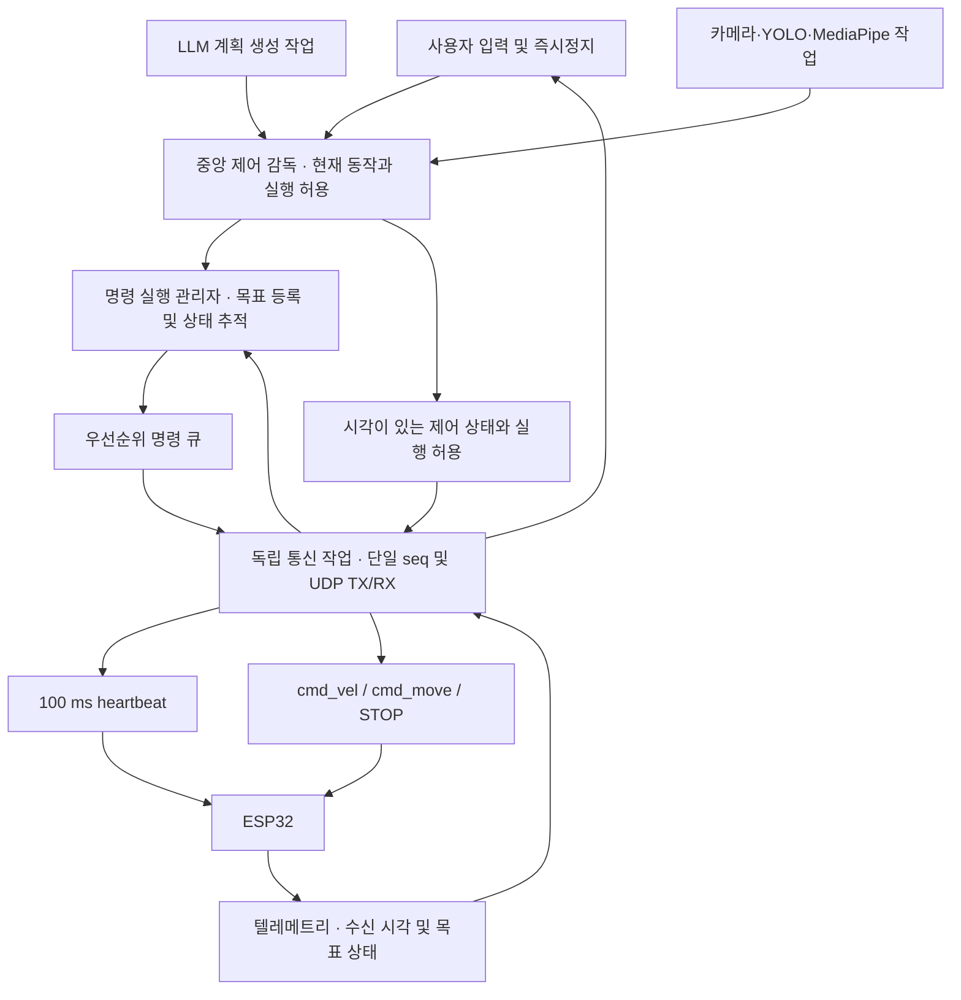

# Heartbeat·명령 유효시간·상위 제어 상태 분리 설계

2026-11-18 초기 설계 검토입니다. 사용자가 제시한 heartbeat 100 ms와 통신 watchdog 600 ms를 실물 검증 전 시험값으로 검토했습니다.

이후 PC 수정과 별도 control_v2 펌웨어 후보를 구현·빌드했습니다. [구현 결과](verification/WATCHDOG_ENCODER_FIX_IMPLEMENTATION.md)에 적용 범위와 검증 기록을 남겼습니다. 실제 보드 업로드는 수행하지 않았습니다. 아래는 구현의 기준이 된 설계 기록입니다.

## 1. 현재 구현과 수정 범위

현재 ESP32는 cmd_move를 등록하면 목표 거리와 속도를 자체 추적합니다. Python의 거리 실행기는 목표를 보낸 후 heartbeat를 반복 송신합니다. ESP32의 acceptCommand는 heartbeat를 포함한 유효 명령을 수신하면 lastAcceptedAtMs를 갱신합니다. 따라서 현재도 heartbeat가 정상 수신되면 매번 cmd_move를 다시 보낼 필요는 없습니다.

현재의 결합은 다음과 같습니다.

| 위치 | 현재 구현 | 수정 시 고려 |
| --- | --- | --- |
| ESP32 명령 수락 | STOP, heartbeat, cmd_vel, cmd_move 등이 같은 lastAcceptedAtMs 갱신 | 통신 생존과 속도 명령 갱신 시각 분리 |
| ESP32 watchdog | 네트워크 이동 중 마지막 수락 명령이 300 ms를 넘으면 CMD_TIMEOUT | 통신 watchdog 600 ms 시험 후보, 속도 명령 TTL 별도 |
| RobotSession | 거리 실행 중 주기 송수신 스레드를 일시 정지하고 실행기에 소켓 사용권 전달 | 항상 실행되는 통신 작업으로 TX/RX 소유권 통합 |
| LLMMotionExecutor | 목표 추적·수신 대기·100 ms heartbeat를 같은 루프에서 처리 | 목표 실행 상태와 heartbeat 스케줄 분리 |
| Python 거리 실행 | WATCHDOG_S 0.30 및 HEARTBEAT_DEADLINE 검사 | 독립 통신 작업의 실제 송신 상태를 평가 |
| 일반 텔레메트리 검사 | command_age_ms가 300 초과면 오류 | 새 의미의 heartbeat_age_ms와 velocity_age_ms 사용 |
| 거리 텔레메트리 검사 | command_age_ms가 300 초과면 거부 | 거리 목표의 오래된 등록 시각과 통신 만료를 구별 |
| 상위 제어 상태 | GUI poll 및 operator_alive에 기본 250 ms 유효시간 적용 | LLM·영상 추론·렌더링과 독립된 제어 감독 상태로 재설계 |

명령 시간과 watchdog을 숫자 하나로 바꾸는 수정으로는 이 결합이 풀리지 않습니다.

## 2. 실행 구조



기존 RobotSession의 연결과 세션을 재사용하되, 소켓을 거리 실행기로 넘기는 구조를 끝냅니다. 통신 작업 하나가 모든 송신 순서 번호, 명령 재전송, heartbeat, 수신을 소유합니다. 거리 실행기는 이 작업에 목표를 등록하고 검증된 응답을 구독합니다.

즉시정지는 큐에서 최우선입니다. STOP이 수락되면 이전 목표와 전송 대기 이동 명령을 취소합니다. STOP 이후 같은 실행 토큰의 지연 명령은 폐기합니다.

## 3. 분리할 시각과 의미

ESP32의 로컬 단조 시계로 다음 시각을 관리합니다.

| 시각 또는 식별자 | 갱신 조건 | 용도 |
| --- | --- | --- |
| last_heartbeat_rx_ms | 현재 세션의 새 순서 번호를 가진 유효 heartbeat | 통신 유지 판단 |
| last_velocity_rx_ms | 현재 세션에서 수락한 cmd_vel | 최신 속도 명령 TTL |
| goal_started_ms | 신규 motion_id의 cmd_move 수락 | 목표 전체 실행시간 검사 |
| active_motion_id | 신규 거리 목표 수락, 완료 또는 취소 | heartbeat가 허용하는 목표 대조 |
| execution_token | 새로운 명령 실행 단위 | 취소된 동작의 재등장 방지 |

같은 heartbeat는 cmd_vel의 유효시간을 연장하지 않습니다. 거리 목표는 등록 시각이 오래됐다는 이유만으로 만료시키지 않으며, 통신 생존·실행 허용·목표 자체의 시간 한도를 적용합니다.

기존 command_age_ms는 현재 마지막 수락 패킷의 나이입니다. 이 필드를 목표 시작 후 경과시간으로 조용히 재정의하지 않습니다. 새 텔레메트리에 각 나이와 실제 적용 설정을 명시합니다.

## 4. cmd_vel과 cmd_move

| 항목 | cmd_vel | cmd_move |
| --- | --- | --- |
| 의미 | 최신 속도 명령 | 거리·속도·방향 목표 등록 |
| PC 송신 | 유효한 입력 동안 주기적으로 갱신 | 목표 등록 후 상태 추적 |
| ESP32 실행 | 마지막 유효 속도 사용 | 엔코더와 PID로 목표 자체 추적 |
| heartbeat 역할 | 통신과 제어 상태 확인 | 통신 및 해당 목표의 실행 허용 확인 |
| 명령 만료 | velocity TTL 만료 시 출력 정지 | heartbeat 만료, 실행 허용 취소 또는 목표 시간 초과 시 정지 |
| 완료 | 입력 해제 또는 STOP | 목표 도달 시 자체 정지 |

직접 버튼 해제, 카메라 갱신 중단, 대상 상실은 각 입력의 유효성 사건입니다. heartbeat가 정상이라는 이유로 이전 속도를 계속 유효하게 만들지 않습니다.

LLM이 계획을 생성하는 동안에는 새 이동의 실행 허용을 발행하지 않습니다. 계획을 확정해 실행할 때 해당 목표에 대한 허용을 발행합니다.

## 5. 시험 후보 설정

| 설정 | 후보 | 검토 상태 |
| --- | --- | --- |
| Heartbeat 송신 주기 | 100 ms | 사용자 제안 |
| 통신 heartbeat 만료 | 600 ms | 사용자 제안, 실물 검증 전 |
| cmd_vel 갱신 주기 | 현재 100 ms를 시작점으로 사용 | 실제 간격과 유실 측정 필요 |
| cmd_vel TTL | 300 ms를 초기 비교 후보로 사용 | 600 ms 통신 만료와 독립, 실측 후 결정 |
| 상위 제어 상태의 유효시간 | 별도 파라미터로 관리 | 기존 250 ms GUI poll 의존을 제거하고 실측 후 결정 |
| 목표 전체 실행시간 | 목표 거리·속도·감속·허용 여유로 산출 | 통신 timeout과 별도 |

600/100은 6배입니다. UDP의 연속 유실·송신 지연·태스크 지연이 함께 존재할 수 있으므로 이 비율만으로 허용 유실 횟수나 신뢰성을 확정하지 않습니다.

600 ms는 마지막 유효 heartbeat 수신 이후의 만료 기준입니다. 실제 PWM 차단까지는 ESP32의 감시 태스크 실행 지연이 더해집니다. 바퀴의 물리적 정지는 기구의 관성도 영향을 줍니다. 화면에서 이를 물리 정지 지연 상한 600 ms로 확정 표시하지 않습니다.

현재 10 ms 제어 주기를 정상적으로 지키는 경우 만료 판정과 PWM 차단은 다음 감시·제어 기회에 일어나야 합니다. 태스크 자체가 멈추는 경우의 시간 보장은 별도 장치 watchdog 검토와 측정이 필요합니다.

## 6. 상위 제어기가 멈추고 heartbeat만 살아 있는 경우

heartbeat는 연결을 알리는 정보와 이동 허용 정보를 함께 전달합니다. 후보 필드는 다음과 같습니다.

```json
{
  "type": "heartbeat",
  "session_id": 123,
  "seq": 45,
  "controller_alive": true,
  "motion_permit": true,
  "motion_id": 7,
  "execution_token": 12
}
```

이 형식은 신규 설계 예시이며 현재 펌웨어의 지원 형식은 아닙니다.

controller_alive와 motion_permit은 독립 통신 스레드가 자신의 생존만 보고 참으로 만들면 안 됩니다. 중앙 감독 작업의 최신 진행 시각, 현재 실행 작업의 정상 상태, 취소 여부를 읽어 계산합니다. 이전에 저장된 참 값을 계속 전송하지 않습니다.

- LLM 계획 생성이 오래 걸림 → 통신은 유지하며 새 목표의 motion_permit은 false.
- 영상 추론이 오래 걸림 → 통신은 유지. 인식 의존 속도 명령은 해당 입력 TTL에 따라 만료.
- 중앙 감독 또는 실행 작업의 상태가 오래됨 → STOP을 우선 송신하고 motion_permit false.
- PC 전체 또는 통신 작업이 멈춤 → ESP32의 heartbeat 만료로 정지.

motion_permit false는 현재 목표를 취소합니다. 이후 true heartbeat가 와도 취소된 목표를 되살리지 않습니다. 새 실행 토큰의 명령을 다시 등록해야 합니다.

상위 제어 상태의 유효시간을 T, ESP32 통신 만료를 H라고 하면, 마지막 정상 감독 상태 이후 정지까지는 검출과 전송 실패에 따라 T와 H가 함께 영향을 줍니다. heartbeat만 계속 살아 있는 경우를 포함한 전체 정지 지연은 별도 시험으로 측정합니다.

LLM API timeout, GUI 렌더링 지연, 카메라 처리시간을 하나의 상위 제어 장애로 판정하지 않습니다. 움직임을 허용한 상태를 누가 갱신하고 있는지 명확히 구분합니다.

## 7. 목표 재전송과 순서 번호

cmd_move의 목표 등록은 motion_id와 내용으로 멱등 처리합니다. 현재 펌웨어도 같은 motion_id와 같은 내용을 다시 받으면 진행률을 초기화하지 않는 경로가 있습니다.

공통 통신 작업이 heartbeat를 먼저 보낸 뒤에는 이전 seq의 재전송이 거부될 수 있습니다. 새 구조의 재전송은 새 전송 seq와 동일 motion_id·동일 목표 내용을 사용하고, 이미 완료되거나 취소된 실행 토큰은 재실행하지 않도록 명세합니다.

같은 motion_id로 거리·방향·속도를 바꾼 패킷, 다른 세션의 heartbeat, 오래된 seq, 다른 실행 토큰은 현재 목표의 실행 허용을 갱신할 수 없습니다. legacy 패킷의 처리도 새 수명 규칙을 우회하지 않도록 정의해야 합니다.

## 8. 텔레메트리와 기록

heartbeat_age_ms, velocity_age_ms, goal_elapsed_ms, active_motion_id, execution_token, controller_alive, motion_permit, applied_heartbeat_timeout_ms, applied_velocity_ttl_ms를 보고합니다.

PC에서는 송신 예정·실제 송신 시각, 송신 간격, 일치 수신 패킷과 응답 나이, 현재 감독 상태 나이, 중단 사유를 기록합니다. ESP32에서는 heartbeat 수신 간격과 최대 간격, 만료 검출 시각, PWM 0 적용 시각을 기록합니다.

PC와 ESP32의 단조 시계는 서로 다른 기준입니다. 동기화 없이 양쪽 timestamp를 직접 빼서 편도 지연으로 표시하지 않습니다. 같은 장치 내 간격과 PC 송신부터 응답 수신까지의 시간을 각각 집계합니다.

실행한 장치가 새 프로토콜과 설정을 보고할 때만 해당 파라미터를 활성화합니다. 300 ms 장치에 PC 화면만 600 ms로 표시되는 상태를 방지합니다. 이전 펌웨어는 기존 처리 또는 미지원 표시를 사용합니다.

## 9. 이번에 확인한 로그의 시간 분포

`logs/20261118_121343_793779/events.jsonl`에서 다음 표본을 확인했습니다. 로그가 기록 중인 동안 추출했으므로 이후 파일에는 추가 행이 있을 수 있습니다.

| 표본 | 수 | P50 | P95 | 최댓값 |
| --- | --- | --- | --- | --- |
| PC UDP 송신 간격 | 3017 | 116.54 ms | 131.46 ms | 23038.08 ms |
| cmd_vel 송신 직전 간격 | 7 | 123.16 ms | 126.76 ms | 129.14 ms |
| Fault NONE 응답의 command_age_ms | 264 | 165 ms | 194 ms | 217 ms |

23초 간격은 12:17:23의 STOP 송신에서 관측됐고, 직전 상태는 응답 수신 0개·armed false였습니다. 주행 중 heartbeat 최대 지연으로 해석할 수 없습니다. cmd_vel 표본 7개로 600 ms의 적합성을 판정하기도 어렵습니다.

command_age_ms는 ESP32가 만든 응답 안의 마지막 수락 패킷 나이이며, PC가 관측한 순수 네트워크 편도 지연과 다릅니다. 새 구조에서는 heartbeat 수신 간격 자체를 추가 수집합니다.

## 10. 시험 항목과 적용 순서

1. PC와 ESP32 시간 의미, 프로토콜 버전 및 기능 지원을 먼저 정의합니다.
2. 공통 통신 작업으로 모든 UDP TX/RX와 seq 생성을 통합합니다.
3. ESP32에서 heartbeat, velocity TTL, 목표 실행시간을 분리합니다.
4. Python의 두 텔레메트리 검사와 거리 실행기의 300 ms 조건, 기존 250 ms GUI 감시를 새 의미에 맞춥니다.
5. ENCODER_JUMP 진단·복구는 별도 변경으로 검증합니다.

모의 시험에는 다음을 포함합니다.

- 30 cm 목표를 한 번 등록하고 여러 초 동안 heartbeat만으로 정상 완료.
- cmd_vel 갱신 중단 후 heartbeat만 계속 도착하면 velocity TTL에 따라 정지.
- heartbeat에 지연·유실을 주입해 만료 전 유지와 만료 후 정지를 구분.
- LLM 또는 YOLO 작업을 지연시켜도 통신 작업이 제시간에 실행.
- 중앙 감독을 정지하고 통신 스레드만 남겨도 motion_permit이 만료.
- 다른 목표의 heartbeat, 재전송, 순서 역전, 목표 완료·취소 후 지연 패킷 차단.
- 상하위 설정 불일치, 펌웨어 미지원, 재부팅 및 세션 변경 처리.
- ENCODER_JUMP 발생 여부와 heartbeat 만료 사유를 각각 구분.

실물 시험에서는 P50·P95·P99·최대 heartbeat 수신 간격, 연속 유실, 만료부터 PWM 0까지의 시간, 실제 바퀴 정지 지연과 이동 거리를 기록합니다. 시험 후보 펌웨어는 별도로 관리하고 빌드 결과를 확인한 뒤 사용자 승인 절차에 따라 적용합니다.

## 11. 코드 변경 대상

| 영역 | 파일 |
| --- | --- |
| 공통 통신과 세션 | python_controller/communication/robot_session.py, esp32_udp.py |
| 목표 실행과 상태 구독 | python_controller/execution/motion_executor.py |
| 텔레메트리 의미와 timeout | python_controller/execution/llm_telemetry.py, llm_cli.py |
| 상위 상태 감독 | python_controller/dashboard_runtime.py, llm/central_control.py |
| 설정과 화면 | python_controller/config, visualization/dashboard.py |
| 명령 필드와 수락 상태 | esp32_firmware/esp32_omni_controller/network_protocol.h/.cpp |
| 감시 및 텔레메트리 | esp32_firmware/esp32_omni_controller/safety_telemetry.h/.cpp |
| 시험 후보 상수와 제어 틱 | esp32_firmware/esp32_omni_controller/robot_config.h, esp32_omni_controller.ino |

이 검토에서는 소스 대조와 기존 로그의 시간 집계를 수행했습니다. 새로운 코드·펌웨어 시험은 수행하지 않았습니다.
