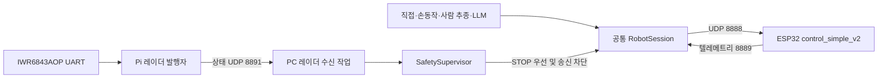

# 레이더 우선 정지와 복합 명령

사용자 요청을 실행 기준으로 삼았다. 첨부 계획과 `corki_7.txt`는 프로토콜과 UART 판정의 출처다. 구형 Pi 카메라 UDP 중계, ESP32 직접 송신, 위험 중 전진 허용은 새 경로에 포함하지 않는다.

| 순서 | 변경 범위 | 검증 |
| --- | --- | --- |
| 1 | 로컬 회전 스키마와 `control_simple_v2.ino` 기준선 확인 | Git 상태와 소스 해시 대조 |
| 2 | `pi_radar/publisher.py`에서 UART 프레임 검증과 상태 발행 | 모의 UART 분할, 빈 프레임, 이상, USB 오류 |
| 3 | 레이더 UDP 수신기와 공통 Supervisor를 `RobotSession` 및 GUI에 연결 | 초기 UNKNOWN, 수신 만료, 부팅 변경, 역순, 재허용 |
| 4 | 송신 직전 검사와 LLM 취소를 기존 세션에 연결 | 수동·제스처·추종·LLM 모의 UDP와 대기 명령 폐기 |
| 5 | 기존 검증기로 한국어 절·단위·방향 정규화 확장 | 기대 3단계 순서·수치 일치, 회전 포함 실행 차단 |
| 6 | 각도 실행의 계측 조건 명시 | 실측과 소프트웨어 검증 결과 분리 |

## 실행 구성

[레이더 연결 및 실행 방법](RADAR_OPERATION_GUIDE.md)에 Pi 발행자 복사, `bpmCfg` 오류 대응, 대시보드 확인 순서를 정리했다.

1. Pi에 `pyserial`을 설치하고 장비에서 사용하는 실제 `profile_3d_aop_evade_040m_fov30.cfg`를 준비한다. 첨부 원본에는 이 cfg와 UART 캡처가 없었다. 발행자는 CLI 명령의 `Done` 응답을 확인한다. 포트와 응답 형식은 실물에서 확인해야 한다.
2. Pi에서 `python -m pi_radar.publisher --pc <PC_IP> --profile <CFG_PATH>`를 실행한다. 기본 CLI 포트는 `/dev/ttyUSB0` 115200 baud, 데이터 포트는 `/dev/ttyUSB1` 921600 baud다. 포트가 다르면 `--cli-port`, `--data-port`를 사용한다. Pi의 이전 ESP32 제어 프로그램이나 서비스는 현장에서 종료한다.
3. PC 중앙 대시보드의 **ESP32 연결 → 레이더 Pi**에 Pi의 IPv4를 입력하고 **Pi 주소 저장**을 누른다. ESP32 연결 중에는 정지 후 연결을 해제하고 바꾼다. 주소와 만료 시간은 Git에서 제외한 `settings/radar.json`의 `radar.source_ip`, `radar.timeout_s`에 저장하며 다음 대시보드 실행 때 자동으로 읽는다. 명시적 `--config`가 같은 필드를 지정하면 해당 실행에서는 그 값이 우선한다. PC UDP 8891의 수신 경로를 열고 ESP32를 중앙 대시보드에서 연결한다. Pi 발행자의 `--pc`에는 Pi 주소가 아닌 PC의 LAN IPv4를 넣는다.
4. 유효한 `CLEAR`와 새 ESP32 STOP 응답이 표시되면 **레이더 해제 확인 · 새 이동 허용**을 누른다. 이후 이동 입력 또는 LLM 계획 실행을 새로 선택한다. 손동작 직접 제어는 재허용 이후 중립 또는 주먹을 보고 나서 새로운 제스처를 받는다. 자연어 CLI는 미리보기에 사용할 수 있다. 실제 송신기는 레이더가 연결된 중앙 대시보드가 소유한다.

## 상태와 송신 우선순위

Pi는 약 50 ms마다 상태를 발행하고 상태 전환 시 발행 작업을 깨운다. 메시지 필드는 `type=radar_status`, `protocol_version=1`, 양의 `boot_id`, 단조 증가 `seq`, `state`, `sensor_valid`, `min_distance_m`, `danger_points`, `hazard_epoch`다. Pi가 UNKNOWN 또는 EVADE로 바뀔 때 `hazard_epoch`가 증가한다. 위험 패킷이 유실되고 다음 CLEAR가 도착해도 PC는 바뀐 번호로 위험 전환을 감지한다.

원본의 magic, 40바이트 헤더, XYZ·속도 float TLV와 0.15–0.40 m 내 3점 이상 2프레임 판정을 가져왔다. 길이·포인트 수가 모순되거나 비정상 수치가 있으면 유효 프레임으로 인정하지 않는다. 위험점 0인 검증된 프레임이 두 번 연속 도착해야 CLEAR가 된다. 센서 수집이 250 ms 멈추거나 USB·CFG 오류가 생기면 UNKNOWN이다. PC 수신 시각은 PC monotonic 기준이며, 300 ms 만료값은 초기 시험값이다. 설정된 Pi 주소로 송신자를 제한한다. 소스 주소 제한은 인증을 제공하지 않으므로 신뢰된 로컬망이 전제다.

| 상황 | 동작 |
| --- | --- |
| 초기, 주소 미설정, USB 오류, UDP 만료, Pi 재시작, EVADE | 이동 차단 래치와 STOP. 대기 입력과 LLM 잔여 계획 취소 |
| 동일 부팅의 역순·중복 또는 지나간 부팅 패킷 | 무시. 수신 유효시간을 연장하지 않음 |
| CLEAR 회복 | 래치 유지. 새 STOP 응답 확인과 운영자 재허용 뒤 새 입력만 수락 |
| 위험과 이동 송신 경쟁 | `RobotSession`이 일반 큐보다 STOP을 먼저 처리. `cmd_vel`, `cmd_move`, 이동을 허용하는 heartbeat는 최종 송신 직전에 같은 잠금으로 검사 |
| 정지 응답 미수신 | 대시보드와 실행 기록에 STOP 미확인 표시 |

PC 레이더 수신과 ESP32 송신은 GUI와 별도 작업이다. 이미 네트워크에 넘긴 이전 패킷은 회수할 수 없으므로 실제 STOP 전달 시각 및 물리 정지는 별도 실측 대상이다.

## 확인 결과와 남은 실물 시험

- 제공 원본 기반 `control_simple_v2.ino` SHA-256은 `b4bed0ce9a364ba2bc78e54e8f178620efd4c68c2dd8d74f5208523c8bbcc25a`다. 이 통합에서 펌웨어 코드를 수정하지 않았다. 작업은 기존 로컬 변경 위에 적용되어 있다.
- 모의 UART에서 조각난 프레임, 유효한 빈 프레임, 위험점 두 프레임, 비정상 수치, USB 예외를 검증했다. PC 모의·루프백에서 수신 만료, 역순·이전 부팅의 패킷, 송신자 제한, Pi 재부팅과 CLEAR만 받은 위험 전환을 확인했다.
- 모의 ESP32와 실제 `RobotSession` 코드로 직접 구동, 바퀴 시험, 손동작 후진, 사람 추종을 확인했다. 대기 중 이동과 LLM 첫 이동 도중 및 이동 사이에 레이더가 개입하면 이후 이동과 허용 heartbeat가 송신되지 않았다.
- 실제 NVIDIA API dry-run은 `nvidia/nemotron-3-ultra-550b-a55b`로 실행했다. 모델 호출 시작부터 계획 승인 전 검증 완료까지 약 3.8초였고, **전진 5 cm → 후진 5 cm → 좌회전 360°**가 순서대로 표시됐다. 원본 실행 로그는 PC의 로컬 `logs/llm/`에 있다.
- 별도 모의 모델 시험에서 붙여 쓴 단위, 연결어, 한 바퀴와 반 바퀴, 좌·우 방향 구분, 모델의 순서 변경 거부를 확인했다. 회전이 있는 계획은 UDP 연결 전 전체 실행을 차단한다.
- 실물에서는 cfg의 TLV 구조 및 좌표계, 센서 설치 방향과 감지 범위, 장애물 종류별 미검출·오검출, 레이더 수신 지연, ESP32 STOP 응답, PWM 0 시각과 실제 정지 거리까지 분리해 측정한다. 40 cm는 현재 판정 기준이다.
- 각도 실행 전 출력축 CPR·모터 방향·좌우 속도 편차를 측정한다. 엔코더 기구학 또는 IMU의 누적 yaw를 외부 기준과 대조하며 양방향 90°·180°·360°에서 오차와 정지 구간을 기록한다. 각도 완료 보고에는 목표·누적 각도·각속도·정지 상태·토큰이 필요하다.

초기 통합 시점의 전체 회귀 테스트 175개가 통과했다. UDP 수신 작업과 포트 독점 검사는 별도 루프백 포트를 사용했다. 이후 실제 Pi의 상태 패킷이 PC에 도착했고, CLI의 `bpmCfg` 응답 확인에서 설정이 중단되는 것을 관찰했다. 호환 프로파일에서의 상태 전환과 실제 모터 정지 반응은 추가 검증 대상이다.
