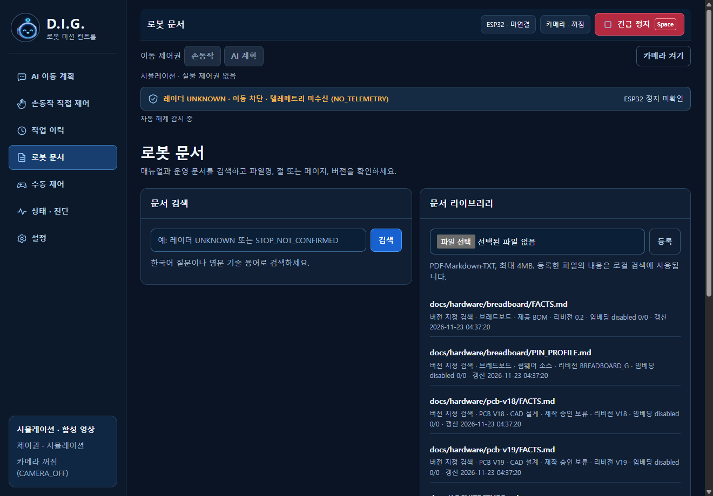
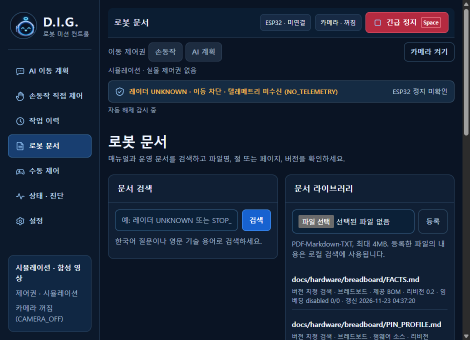
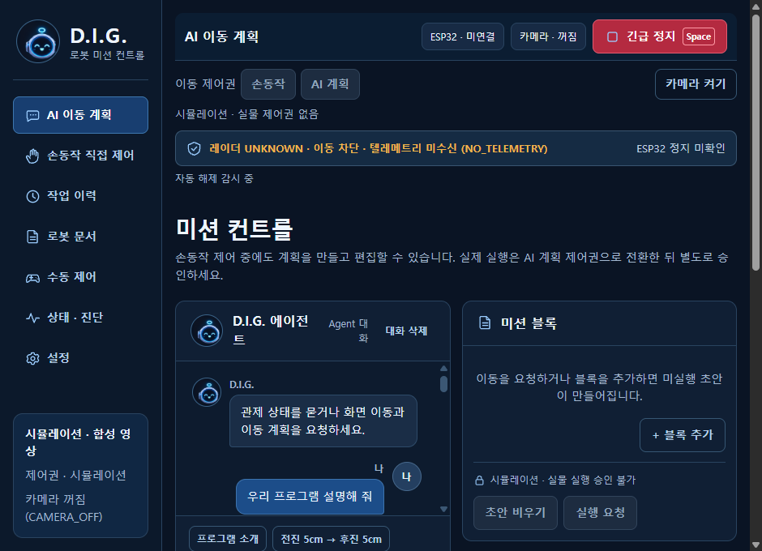

# Robot Knowledge RAG v2 구현 및 검증

작업 기준: LAST_DANCE, 기존 변경 보존 snapshot `35a253b629d61bcb81558ed56a2afd0c03e44da3`. 이번 RAG 변경은 RobotSession·펌웨어·실행기·레이더·STOP·긴급 정지·미션 승인 정책을 수정하지 않는다.

## 데이터 흐름

MD/PDF/TXT → 구조 추출 → E5 실제 토크나이저 청킹 → SQLite FTS·청크 캐시 → 백그라운드 E5 임베딩 → 범위별 BM25+벡터 → RRF → 선택형 BGE 리랭커 → 근거 6개 → 선택형 Nemotron 설명 → 서버 원문 인용 검증 → 웹 출처 카드.

## 실행과 설정

기본 검색은 기존 FTS다. 아래 설정은 `.env` 또는 프로세스 환경으로 지정한다. 사용자 참고문서는 현재 별도 클라우드 동의 기능을 추가하지 않았으므로 계속 로컬에서 처리한다.

```text
DIG_KNOWLEDGE_VECTOR=1
DIG_KNOWLEDGE_RERANK=0
DIG_KNOWLEDGE_CLOUD=0
DIG_KNOWLEDGE_TIMEOUT_S=90
DIG_KNOWLEDGE_RERANK_TIMEOUT_S=15
DIG_KNOWLEDGE_MAX_TOKENS=2048
```

허용된 Git 프로젝트 문서의 Nemotron 답변은 기존 명시 설정 `DIG_KNOWLEDGE_CLOUD=1`에서만 사용한다. 이 설정도 사용자 업로드의 외부 전송을 허용하지 않는다.

```powershell
.\.venv\Scripts\python.exe -m pip install -r requirements-knowledge-vector.txt
.\.venv\Scripts\python.exe -m python_controller.knowledge.install_models --download
.\.venv\Scripts\python.exe -m pip install -r requirements-knowledge-reranker.txt
.\.venv\Scripts\python.exe -m python_controller.knowledge.install_models --download --reranker
.\.venv\Scripts\python.exe -m python_controller.knowledge.evaluate --vector --output .tmp/rag-v2-report.json
```

Reranker는 `--reranker --candidates 10|20|40`로 평가한다. 실행 중 모델을 다운로드하지 않는다. 제한시간 초과·오류·다른 요청 처리 중이면 하이브리드 순서를 사용하고 `rerank_status`를 반환한다.

## DB 마이그레이션과 증분 색인

- 기존 documents/chunks/embeddings/FTS 구조를 유지하는 additive migration이다. 문서에 chunker/embedding 상태·진행률·실패·갱신 시각, 청크에 제목 경로·내용 해시·토큰 수·분할 경고·활성 여부를 추가한다.
- chunk_group_cache는 동일 절의 분할 결과를 재사용하고, embedding_cache는 passage 입력 해시+모델/리비전별 float32 벡터를 재사용한다. 변경 문서 전체는 구조를 다시 읽지만 같은 절을 다시 토큰 분할하거나 임베딩하지 않는다.
- 새 청크가 완성된 후 한 transaction으로 FTS 활성 청크/문서 버전을 바꾼다. 이전 일반 문서 인용 ID는 보존한다. 기존 철회된 하드웨어 근거 삭제 정책은 유지한다.
- 벡터 사용 시 새 청크를 staging 상태로 보관하고 배경 임베딩 완료 후 FTS와 dense를 같은 transaction으로 전환한다. 준비 중에는 이전 완성 버전을 유지한다. 늦게 끝난 이전 작업은 최신 버전을 덮어쓰지 못한다. 임베딩 실패 시 실패 상태를 표시하고 FTS만 가능한 버전으로 전환한다.
- 질의마다 하나의 WAL 읽기 snapshot에서 lexical/dense/출처를 조회한다. 모델 추론 중 SQLite 쓰기 transaction을 잡지 않는다.
- 미완료·실패 임베딩은 다음 라이브러리 초기화 시 다시 예약한다. E5 추론은 컨트롤러의 GIL과 분리된 로컬 프로세스에서 실행한다.

## 검색 평가

60개 사례 중 검색 정답 문서가 지정된 48개를 평가했다. 나머지는 실시간 상태/일반 대화/불명확 버전/근거 부족 등 별도 경로 사례다. 자동 작성한 초기 평가셋으로 전문가 정답 검토와 충분한 다회 측정이 추가로 필요하다.

| 구성 | Recall@5 | Recall@20 | MRR@10 | nDCG@5 | P50 ms | P95 ms |
|---|---:|---:|---:|---:|---:|---:|
| fts | 0.875 | 0.958 | 0.687 | 0.725 | 125.2 | 851.1 |
| hybrid | 0.917 | 1.000 | 0.706 | 0.751 | 220.8 | 1219.5 |

인용 정확도는 ID·경로·해시 일치율이며 현재 양쪽 1.0이다. 지정한 근거 부족 사례의 응답 보류 정확도도 양쪽 1.0이다. 자연어 주장의 의미적 충실도를 뜻하지 않는다. answer_faithfulness는 미측정으로 남겼다. 평가 시간에는 로컬 발췌 답변 검사가 포함되며 동시 부하·cold start 영향이 있다.

기존 9개 동일 질문의 Top-3 비교: 기존 FTS 6/9, hybrid 5/9 → v2 FTS 7/9, hybrid 6/9. 양쪽 모두 버전이 모호한 질문 1개는 확인 요청이다. 새 60개 수치와 직접 혼합 비교하지 않는다. 작은 기존 평가에서는 FTS가 여전히 우세하므로 벡터를 강제로 기본 활성화하지 않는다.

## 실제 BGE CPU 시험

`BAAI/bge-reranker-v2-m3`, 2 CPU threads, 후보 수별 3개 질문의 warm 추론을 측정했다. 모델 cold load와 전체 파이프라인 시간은 별도이며, P95는 작은 표본의 최대값 수준이다.

| 후보 | 질문 수 | P50 ms | P95 ms | 관측 RSS 최대 bytes |
|---|---:|---:|---:|---:|
| 10 | 3 | 14076.8 | 14742.5 | 2700025856 |
| 20 | 3 | 24523.3 | 25066.0 | 2700382208 |
| 40 | 3 | 49616.4 | 52793.8 | 2186940416 |

이 PC에서는 후보 20개만으로 약 22~25초가 필요했다. 기본 15초 서비스 deadline보다 길고 메모리 사용도 커서 리랭커는 기본 비활성화다. 60개 전체 C 구성의 학습 리랭커 품질 개선은 입증하지 않았다. 필요하면 리랭커 전용 제한을 늘려 별도 비교해야 한다.

## 답변·권한 경계

Nemotron은 설명 블록과 검색 출처 ID/서버가 만든 원문 구절 번호를 반환한다. 서버는 구절 번호를 실제 원문으로 해석하고 현재 검색 청크의 ID 및 연속 문자열을 검증한다. 잘못된 인용 블록은 버리고 로컬 발췌로 폴백한다. 정확한 인용 연결이 답변 문장 전체의 의미적 타당성을 보장하지 않으므로 별도 평가가 필요하다.

문서/모델 답변은 approval ticket, 모터 송신, 레이더 해제, 긴급 정지 해제에 접근하지 않는다. 실시간 상태는 기존 facade, 이동은 기존 미실행 composer/review 경로를 사용한다. 단순 문서 조회와 모델 작업은 control_lock 밖의 worker에서 실행한다.

## 검증 기록

- 기존 RAG/Agent 기준선: 61 passed, 1 skipped, 132 subtests.
- 최종 통합 회귀: 335 passed, 2 skipped, 2 deselected, 458 subtests. 환경 검사(로컬 secrets 파일 존재·UDP 8889 점유 시험)는 별도 제외했다.
- 후속 RAG/하드웨어 범위 검사: 76 passed, 1 skipped, 154 subtests. 최종 추가 변경의 재검사 결과는 아래 갱신 기록에 남긴다.
- 브라우저: 1320×920/940×680 문서 목록·임베딩 메타데이터, 실제 합성 채팅과 출처, JavaScript 예외 없음, 세션 미연결·카메라 꺼짐.
- 합성 제어 부하: E5 프로세스 분리 후 관측 최대 tick 간격 약 75ms. 실물·실카메라·YOLO/MediaPipe 동시 부하의 시간 보장은 미검증이다.
- 실 Nemotron: 20초 및 첫 90초 시도는 timeout, 약 38초 재시도의 임의 생략부호 인용은 검증에서 거절됐다. 서버 원문 구절 번호 방식으로 재검증한 결과 약 23.29초에 자연어 답변과 검증된 인용 3개를 반환했다. 사용자가 허용한 Qt 프로젝트 발췌만 전송했고 사용자 등록 문서는 제외했다.
- 최종 원자적 전환·정확한 인용·제한시간 등 집중 검사: 13 passed.
- 실제 8766 재시작 후 ESP32 미연결, 세션 닫힘, CAMERA_OFF 확인. “홍승조가 누구야”에 MD 내용과 검증된 출처 반환 확인. 교체 전 SQLite backup 보관.

## 화면







## 남은 제한

- 임베딩은 명시 활성화 시 생성한다. 토크나이저가 없으면 기존 문자 청킹·FTS가 유지되고 경고 metadata가 남는다.
- 코드·표의 긴 구조는 분할 경고로 드러내며, 일반 문단은 통째로 유지한다. overlap은 긴 단일 줄의 토큰 분할에 적용하며 모든 문단에 강제하지 않는다.
- 사용자 파일 삭제를 자동 감시하거나 실행 중 MD 변경을 hot reload하지 않는다. 초기화/재등록 때 반영한다.
- 생성 답변의 의미적 충실도, 실카메라 동시 부하, 50+ 질문 전체 reranker 품질 평가는 미완료다.
- 운용 서버 교체는 사용자의 로봇 정지·전원 또는 연결 해제 확인 후 진행했다. 장치 재연결은 자동 요청하지 않는다.
