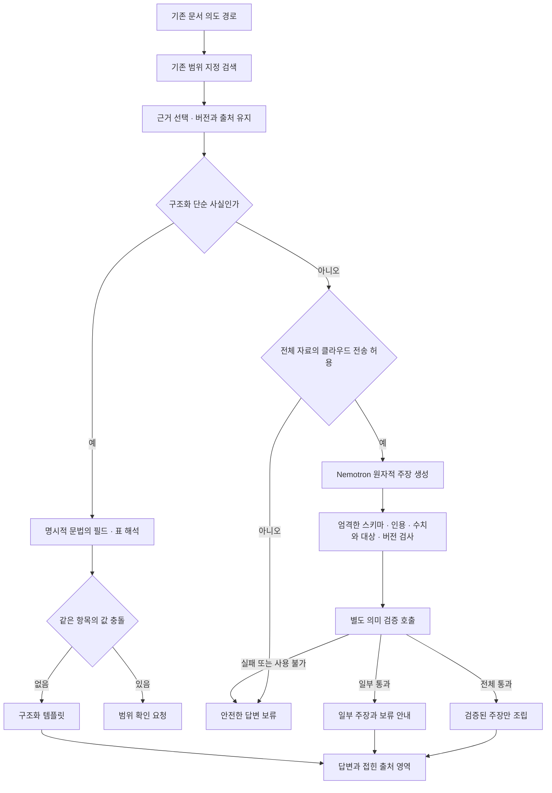

# D.I.G. Phase 1 — Grounded Conversational RAG v3

작성일: 2026-11-26 (Asia/Seoul). 기준 커밋: `8861848`. 이번 변경은 로컬 작업이며 원격 푸시·main 병합·기존 관제 재시작·실물 구동을 하지 않는다.

## 1. 기존 시스템 분석

UnifiedAgent의 background thread가 ConversationGraph의 docs 노드를 실행한다. 기존 SQLite FTS/BM25, 선택형 E5/RRF/BGE, 문서 리비전·하드웨어 프로파일은 그대로 사용한다. 문서/검색에는 실행 권한이 없다. 일반 대화 스트리밍과 미션 검증·승인은 별도 경로다.

v2 `answer.py`는 하드웨어 질문에서 body를 직접 반환하고, 오프라인·비공개 자료·API 실패 시 원문 문장을 기본 fallback으로 반환했다. 클라우드 설명의 support가 실제 인용문인지 확인했지만, 그 인용이 주장 전체를 함의하는지는 확인하지 않았다. Web은 출처 버튼을 펼쳐 표시했고 Qt 대화 패널은 출처 메타데이터를 사용하지 않았다.

## 2. 문제의 근본 원인

검색 결과를 사용자 답변으로 겸용했고, 출처 존재 확인과 의미 검증이 같은 성공 조건으로 취급됐다. 별도의 자유 생성 reply를 허용하면 검증한 인용 밖의 수치·안전 성능을 추가할 수 있었다. 따라서 프롬프트만 바꾸지 않고 근거, 주장, 검증, 출력의 책임을 분리했다.

## 3. v3 아키텍처

명시적 원문 요청은 별도의 `citation_only` 경로다. 일반 채팅 fallback에는 원문 청크를 넣지 않는다. 출처 클릭은 기존 원문 API/라이브러리 열람을 사용한다.

## 4. 변경 파일과 이유

| 파일 | 책임 |
|---|---|
| `knowledge/evidence.py` | 최대 6개 검색 결과, 8,000자 근거 후보 한도, 원문 후보·메타데이터 보존, 지시문/코드 필터, 현재 활성 출처 재확인, 전체 검색 범위 클라우드 정책 |
| `knowledge/generation.py` | Nemotron claim 생성과 별도 semantic judge, 최대 2회 호출, 공유 deadline, 0 재시도 |
| `knowledge/verifier.py` | strict Pydantic 계약, 인용/현재 리비전 검사, 수치·단위·부품·부정·조건·설계 상태·버전 검사, 교체 가능한 semantic 인터페이스 |
| `knowledge/facts.py` | 사용자 소개 필드·배터리 전압·GPIO 표·BOM 수량·명시된 승인 플래그의 제한된 문법, 상충 값 보류 |
| `knowledge/rendering.py` | 통과한 claim 텍스트의 직접 조립, 최종 reply 일치 검사, speech_text와 출처 분리 |
| `knowledge/answer.py` | 기존 진입점 유지, 범위·개인정보·적응형 비용·fallback 순서 조정 |
| `llm/agent_graph.py` | RAG 응답 메타데이터 전달·턴 간 잔여 데이터 초기화 |
| `llm/unified_agent.py` | 메시지에 서버 메타데이터 보존, 무효화된 generation의 늦은 RAG 답변 폐기 |
| `web/app.js`, `web/style.css` | 기본 접힌 출처, 관련 주장·인용문, 서버 검증 상태 표시 |
| `visualization/agent_panel.py` | Qt 출처 선택/원문 열람과 기본 접힘, 검증 상태 구분 |
| `knowledge/answer_metrics.py`, `knowledge/evaluate.py` | 기존 검색 평가와 별도의 주석 기반 답변 지표 |
| `.env.example` | RAG 의미 검증 방식 문서화; 실제 `.env`와 기존 cloud=0 기본값 유지 |
| 관련 tests | v3 방어 테스트, metadata/STOP/늦은 응답/UI, 기존 원문 출력 기대를 출처 열람 검증으로 변경 |

검색·인덱스·청킹·벡터/리랭커 구현 및 DB 스키마는 이번 Phase에서 재구현하지 않는다.

## 5. 생성·검증·답변 흐름

1. 기존 범위를 해석하고 검색한다. 모호한 하드웨어는 기존 확인 요청을 유지한다.
2. 원문 문단/조건을 중간에서 잘라 의미를 바꾸지 않고 후보 번호를 만든다. 필터는 방어 계층일 뿐 모든 prompt injection을 탐지한다는 보장이 아니다.
3. 단순한 구조화 조회는 명시적 필드/표 문법으로 답한다. 일반 문단을 정규식으로 요약한 뒤 의미 검증 완료라고 표시하지 않는다.
4. 자유 생성은 전체 검색 결과가 `project_doc`이고 cloud가 명시적으로 활성화된 경우에만 가능하다.
5. 모델의 ID/인덱스를 strict 타입으로 검사하고 서버 ID로 다시 번호를 부여한다. 모델이 준 confidence/verified/추가 필드, 범위 밖 출처, 철회된 출처는 거절한다.
6. 숫자는 단위별 Decimal 변환과 근거 절 안의 부품/대상 결합을 검사한다. 지원 단위는 mm/cm/m, ms/s/초, V, A/mA, mm/s/cm/s/m/s다. 포트·GPIO·상태 코드·부품 식별자를 보존한다. 부정·예외·비교 방향·설계 한정이 빠진 주장은 보류한다.
7. 결정론적 검사는 의미 함의 판정이 아니다. 남은 주장에 별도 의미 검증을 적용한다. 연결된 supports만 긍정 근거가 될 수 있으며, 다른 동일 프로파일 자료는 충돌 탐지용 context로만 준다.
8. ENTAILMENT만 통과한다. CONTRADICTION/NEUTRAL/UNAVAILABLE은 답변에서 제외한다. 검증 후에도 출처가 활성 상태인지 다시 확인한다.
9. 최종 답변은 검증된 텍스트를 그대로 조립한다. 별도의 재서술 모델 호출은 없다. 조립 결과가 달라지면 최종 검증에서 거절한다.

임의의 신뢰 점수나 RRF 점수를 진실 확률로 사용하지 않는다. 결정론적 검사가 모든 자연어의 수치 대상 결합을 완전히 파싱하는 것은 아니다. 복잡한 관계는 의미 검증에 의존하며 실패 가능성이 남는다.

## 6. 선택한 의미 검증 방식

기존 NVIDIA Nemotron에 별도의 판정 프롬프트로 호출한다. `SemanticVerifier` 인터페이스는 입력별 ENTAILMENT/CONTRADICTION/NEUTRAL/UNAVAILABLE 결과를 받는다. 로컬 NLI 모델이나 추가 리랭커를 기본 설치·로딩하지 않아 메모리 비용과 한국어 미검증 임계값을 피한다.

생성기와 검증기가 같은 모델이므로 오류가 상관될 수 있다. 이는 독립적인 정답 보증이나 한국어 NLI 정확도 입증이 아니다. 별도 임계값의 정확성 보장은 선언하지 않았다. 향후 독립 모델을 같은 인터페이스에 연결하고 한국어 기술 문장에 대해 보정할 수 있다.

## 7. 비용과 지연의 절충

- 구조화 단순 조회: 대형 모델 호출 0회.
- 자유 생성 설명: 생성 1회 + 남은 유효 주장의 batch 의미 검증 최대 1회.
- `DIG_KNOWLEDGE_TIMEOUT_S` 기본 90초를 두 호출이 공유한다. 첫 생성은 전체 예산의 최대 60%(기본 54초), judge는 남은 예산만 사용한다. 검색 시간은 이 모델 호출 예산 외에 추가된다.
- `max_retries=0`; 재검색/repair 반복은 없다. 검증기가 `off`면 자유 생성 호출도 생략한다.
- `DIG_KNOWLEDGE_CLOUD=0`은 그대로다. 로컬 생성 모델이 없으므로 오프라인에서 임의 기술 설명을 자유 생성하지 않는다. 원문을 붙이는 대신 보류하는 질문이 늘 수 있다.

## 8. 개선 전후 예시

같은 합성 프로필을 격리 DB에서 v2 커밋 코드와 v3 코드로 각각 실행한 결과를 `verification/rag_v3/measurements.json`에 보관한다.

질문: `테스트인물은 누구야`

- v2: “문서에서 찾은 관련 원문입니다…” 뒤에 `테스트인물 / 직업: 연구원 / 전공: 전기전자 / 역할: 문서 정리` 출력.
- v3: 사용자 제공 소개 기준임을 표시하고 직업·전공·역할을 구분한 템플릿 설명. `answer_mode=template`, `verification_status=structured`; 외부 사실 검증이나 자연어 의미 검증 완료로 표시하지 않음.

질문: `문서: TESTLINK 설명`

- v2: `ESP32 receives UDP commands from the controller.` 원문 출력.
- v3 (cloud=0): 관련 문서는 있지만 설명을 검증하지 못해 보류한다는 안내와 접힌 출처. 임의 한국어 번역을 생성하지 않음.
- v3 (생성기/판정기 mock 통합 시험): “ESP32는 관제에서 UDP 명령을 받아요.”와 분리된 실제 출처/claim 연결. 이 예시는 실제 모델 품질 측정이 아니다.

## 9–10. 신규·기존 테스트 결과

최신 결과와 실패/재검사 기록은 [검증 기록](verification/RAG_V3_VALIDATION.md)을 참조한다. 최초 red 3개를 확인한 뒤 구현했다. 기존 기준선은 80 passed, 1 skipped, 154 subtests였다.

기존 테스트의 원문 본문 기대는 source API/라이브러리 열람 기대와 보류/템플릿 상태 검증으로 바꿨다. 버전 분리·개인정보·정지·승인 검사를 제거하지 않았다. 30개 요구 사례의 테스트 매핑과 실제 UI 증거는 검증 기록에 구분했다.

## 11. 측정과 미측정

합성 로컬 SQLite/FTS, 각 경로 warm 10회, 원격 호출 없는 환경에서 측정했다.

| 경로 | P50 ms | P95 ms |
|---|---:|---:|
| 구조화 템플릿 | 11.405 | 154.79 |
| 안전한 답변 보류 | 14.705 | 94.19 |

표본 10개라 P95는 최대 관측값이다. 동시 시스템 부하와 Windows 스케줄링 영향이 있다. 로봇 실시간 응답 보장, 실제 Nemotron 두 호출 지연·토큰 비용·한국어 의미 정확도·자연스러움, 실제 카메라/YOLO 동시 부하는 이번 Phase에서 측정하지 않았다. v2의 약 23초 성공 사례를 v3 성능으로 재사용하지 않는다.

## 12. 개인정보와 안전 경계

사용자 등록 문서와 파생 인용·요약은 생성기와 judge 어느 쪽에도 보내지 않는다. 혼합 검색이면 전체 자유 생성 경로가 차단된다. 운영 로그는 mode/status/지연/고정 실패 코드만 기록한다. 키·원문·모델 반환문·사용자 이름은 기록하지 않는다. 테스트 산출물은 명시적인 합성 자료와 기존 사용자 제공 소개 UI 자료다.

기존 worker에서 실행하고 control_lock 내부 모델 호출은 추가하지 않았다. STOP 도중 검증을 기다리지 않고 generation 무효화를 유지한다. RAG 결과에서 모터 송신·승인권·센서 우회로로 이어지는 호출은 없다. 펌웨어·UDP·RobotSession·모터/PID/엔코더·레이더·EStop·승인/lease·프로파일 코드는 변경하지 않았다. 기존 관제는 재시작하지 않았다. UI QA는 별도 18767 합성 서버에서 하고 종료했다.

## 13. 남은 한계

- 의미 judge도 오판할 수 있다. 실제 한국어 기술 문장의 독립 정답 주석과 보정이 필요하다.
- 결정론적 부정·조건·수치 검사는 보수적이라 참인 설명도 보류할 수 있다. 의미적 충실도가 완전히 보장되는 것은 아니다.
- 오프라인 템플릿은 정해진 문법만 지원한다. 인물 자유 서술, 임의 하드웨어 설명과 긴 기술 비교는 보류될 수 있고 출처에서 확인할 수 있다.
- 서로 다른 프로파일을 하나의 claim으로 합치지 않는다. 복잡한 비교는 프로파일별 claim이 모두 통과해야 한다.
- 문서의 사실 자체가 틀리면 근거 충실성과 현실 정확도는 다를 수 있다. 실시간 상태·실물 승인으로 승격하지 않는다.
- 검증 전 스트리밍을 하지 않아 첫 답변까지 더 기다릴 수 있다. 수치화된 품질 개선은 아직 주장하지 않는다.

## 14. Phase 2 준비

`score_answer`/`summarize_answers`와 기존 evaluate 경로를 연결했다. 실험군 A(v2), B(자연어+인용), C(claim 검증)의 응답을 같은 형태로 주석할 수 있다. 자동으로 과거 시스템을 실서비스에 켜는 옵션은 추가하지 않았다.

필요 주석: 모든 사실 claim의 supported/citation_correct/numerical_correct/entity_correct/version_correct와 gold fact ID, 질문별 expected fact IDs, should_abstain, relevance/naturalness 평가. 주석 없는 의미 지표는 null이다. 사실 주장이 0개인 답변은 faithfulness 100%로 처리하지 않는다. Coverage 및 Abstention Accuracy를 함께 계산한다. Copy Rate는 45자 이상 연속 원문 중복을 별도 집계하고 명시적 인용은 제외한다. 전문 부품명 같은 짧은 정확 문자열만으로 복사로 판정하지 않는다. 현재 token usage는 null이며 문자 수로 토큰을 추정하지 않는다.

## 15. 향후 음성 연결 인터페이스

응답은 기존 `reply`/`citations`와 함께 `speech_text`, `answer_mode`, `verification_status`, `claims`, `unanswered_aspects`, `insufficient_evidence`, `verification_failures`, `latency_ms`를 전달한다. 자유 생성 claim의 파일명·출처 번호는 허용하지 않고 UI에만 표시한다. 명시적 원문 열람 응답의 speech_text는 빈 문자열이다. Android/Voice Gateway/음성인식/TTS는 구현하지 않았다.

UI는 `verified`만 “근거 검증 통과”, `partial`은 “일부만 확인”, `structured`는 “구조화 자료 기준”으로 구분한다. 나머지는 확인 불가·실패·충돌 등으로 표시한다. 모든 검증 정보는 서버 결과이며 모델이 선언한 verified를 사용하지 않는다.
