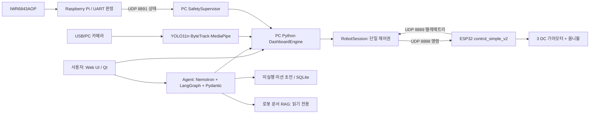
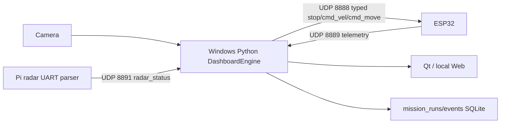

# D.I.G. 로봇 구조·부품·동작 원리 기술 문서 — 버전별 검토본 v0.2

**작성일:** 2026-11-19  |  **검토 상태:** 초안·사용자 검토 대기  |  **원격 GitHub 기준:** `b03f7d2`

**목적:** D.I.G. 로봇의 실제 기능, 제조사 자료, 과거 개발 이력과 미검증 항목을 구별하여 사용자 검토 및 향후 RAG의 근거 문서를 제공한다.

> 이 문서는 GitHub와 열람 가능한 프로젝트 자료에 근거한 초안이다. 모든 과거 채팅 전문이나 현장 실물 배선·부품 라벨은 자동으로 확인할 수 없다. 수정할 곳은 말미의 체크리스트를 따른다.

---
# 00. D.I.G. 프로젝트 개요 및 시스템 경계

**문서 상태:** 사용자 검토용 초안 v0.2 / **증거 범주:** GitHub 소스·프로젝트 개발 문서 / **실물 검증:** 일부 사용자 관찰 외 검증 불완전

## 0.1 무엇을 만드는가

D.I.G.는 **3륜 옴니휠(3WD) 이동 로봇**을 PC 중앙관제에서 제어하고, 카메라의 사람·손동작 인식, 라즈베리파이 레이더 위험 상태, ESP32 구동·텔레메트리, NVIDIA Nemotron 기반 대화·동작 계획, 미션 이력과 RAG 설명 기능을 연결하는 프로젝트다.

**제품 지향:** '대화형 AI 로봇 미션 컨트롤'. 사용자는 채팅으로 **미실행 동작 블록을 누적·편집**하고 계획 경로를 보며, 별도의 현장 운영자 승인 후 검증된 계획을 순차 실행한다. 카메라는 주요 시연용 전체화면보다 모니터링·진단 화면으로 제공한다.

## 0.2 주요 계층



위 블록은 **소프트웨어 통합 경로**를 설명하며 전기 배선도나 물리적인 안전 인증 그림이 아니다.

## 0.3 역할 분리

| 요소 | 역할 | 할 수 없는 것 |
|---|---|---|
| Web Mission Control | 채팅, 블록 초안, 예상 경로·이력, 카메라 진단 | 현재 기본 웹 경로에서 실물 실행 승인 불가 |
| Qt 데스크톱 관제 | 연결, 모드 선택, 현장 사용자 승인, 실물 실행 진입 | 안전 차단을 승인 없이 우회 불가 |
| Nemotron/Agent | 사용자 의도 해석, 설명, 계획·수정 제안, RAG 답변 | 직접 UDP 모터 송신·승인권 발급 불가 |
| RobotSession/SafetySupervisor | 단일 제어 소유권·레이더·STOP·세션 검증 | 센서 고장을 안전으로 가정 불가 |
| ESP32 펌웨어 | 명령 수신, 모터 FF+PI, 엔코더·거리 목표·watchdog | 외부 공간 절대 위치 측정 보장 불가 |
| Raspberry Pi + mmWave | UART 레이더 측정 수신 및 위험 상태 전송 | 현재 통합 경로에서 ESP32로 직접 주행 명령 송신 금지 |

## 0.4 용어와 신뢰 구분

- **계획(PLANNED):** 방향·거리의 예상 순서. 아직 실행된 사실이 아니다.
- **시뮬레이션(PREVIEW):** 2D 경로/가상 로봇 모션. 실측 위치를 의미하지 않는다.
- **실행(EXECUTING):** 운영자 승인과 현재 세션 안전검증 뒤 실제 실행기의 명령이 시작된 상태.
- **목표 도달(GOAL_REACHED):** ESP32의 보고 상태이며 곧바로 정지 검증을 뜻하지 않는다.
- **STOP_CONFIRMED:** 현재 세션·시퀀스에 대응하는 새로운 정지 텔레메트리를 확인했음을 뜻한다.
- **물리 주행 성공:** 바닥에서 실제 이동 거리·방향·정지거리까지 실측한 증거가 필요하다.

## 하드웨어 버전 주의 (2026-11-19 사용자 정정)

**브레드보드 시제품 BOM과 PCB 설계 BOM은 서로 다른 하드웨어 버전이다.** 본 문서 01장을 버전별로 나눠 수정했다. PCB V18는 회로도/풋프린트 기반 *설계 정보*이며, 실제 보유/장착된 부품은 확인해야 한다. 소프트웨어 논리 구조도 특정 PCB에 곧바로 호환된다는 의미는 아니다.


## 0.5 초기 버전의 제품 범위

1. 채팅, 블록 편집, 계획 설명, 작업 이력, 출처가 있는 기술 문서 답변.
2. 네 방향 병진, 제한된 수의 이동 동작, 각 구간 뒤 STOP 확인.
3. 카메라에서 사람·손동작 인식 및 사람 추종. 상태 변화와 권한을 분리.
4. 실물 회전 각도·자율 지도 항법·정확한 디지털 트윈은 **미검증 또는 후속 범위**.

**출처:** [README.md](https://github.com/jugonpark/final_robot/blob/b03f7d2/README.md), [ARCHITECTURE.md](https://github.com/jugonpark/final_robot/blob/b03f7d2/docs/ARCHITECTURE.md), [RADAR_LLM_INTEGRATION.md](https://github.com/jugonpark/final_robot/blob/b03f7d2/docs/RADAR_LLM_INTEGRATION.md), [UNIFIED_AGENT_VALIDATION.md](https://github.com/jugonpark/final_robot/blob/b03f7d2/docs/UNIFIED_AGENT_VALIDATION.md).


---


---
# 01. 버전별 하드웨어 구조·BOM (2026-11-19 사용자 정정 반영)

# D.I.G. 하드웨어 버전 맵 — 반드시 먼저 읽기

> **사용자 확정 구분:** 브레드보드 버전과 PCB 버전은 서로 다르다. **동일 부품·동일 핀배치·동일 배선·동일 전원 회로라고 가정하지 않는다.**
>
> 이 문서는 자료 구분이며 실물 장착 증명이 아니다. 버전 미지정 질문에는 먼저 어느 버전인지 확인하거나 **각 버전을 명시해 비교**한다.

| 하드웨어 ID | 자료 범위 | 증거 | 상태 | 무엇을 의미하나 |
|---|---|---|---|---|
| `BREADBOARD_PROTO` | 사용자가 제공한 9항목 BOM 캡처 | `BREADBOARD_BOM_from_image.csv`, 원본 PNG | 사용자 제공 목록; 실물 배선과 장착은 부분 미확인 | **브레드보드 시제품 측 BOM**으로 분리 관리. PCB 제조 BOM으로 절대 취급하지 않음 |
| `PCB_V18_DESIGN` | 별도 KiCad PCB 설계 | 원본 PCB AUDIT ZIP의 `V18_FINAL_RELEASE/` | **QUOTE_ONLY, FAB_APPROVED=false** | 99.8×99.8mm/2층 설계, 제작 적합 정적검사와 실물 검증 별개 |
| `SOFTWARE_COMMON` | Windows Python / Qt / web / RobotSession / Agent | GitHub `jugonpark/final_robot` | 코드/논리 통합 경로 | 어떤 실물 PCB가 연결되어 있는지는 별도 확인 |
| `VENDOR_3WD_REFERENCE` | 판매처 `Omnidirectional wheel trolley 3WD datasheet.pdf` | 사용자 원본 PDF | 제조사 안내자료 | 판매처 옵션·예시 부품을 현재 구성으로 승격 금지 |

## 지켜야 할 문장

- 브레드보드 부품: “**제공된 브레드보드 BOM에는** TB6612FNG `SZH-MDBL-00` 2개, PCA9685 `TS0185` 1개, MG90S 4개가 기재되어 있다.”
- PCB 부품: “**PCB V18 설계에는** TB6612FNG `HW166` 형상의 탈착 모듈용 소켓이 계획되어 있고, MD1이 M1/M2, MD2가 M3를 다룬다.”
- 금지: “두 버전의 TB6612 모듈은 똑같은 핀 배열이다.” (증거 없음)
- 금지: “PCB가 완성되어 로봇이 실물 주행 중이다.” (현재 감사 결과로는 판단 불가)
- 구형 Pi ESP32 직접 송신/레이더 위험 중 전진 허용은 현행 중앙제어의 안전 원칙과 다르므로 현행 적용을 주장하지 않음.

## RAG 우선순위

1. 질문에 `브레드보드`, `빵판`, `BREADBOARD` → `BREADBOARD_PROTO`만 직접 설명.
2. `PCB V18`, `V18`, `회로판 V18` → `PCB_V18_DESIGN`.
4. 버전 없는 구체 부품/배선/핀/전원 질문 → **어느 버전 기준인지 한 번 확인**. 가능한 경우 두 버전을 나눠 비교하되 안전상 절대 합쳐 말하지 않음.
5. `현재 레이더 상태`·`모터 움직임` 등 live 질문 → RAG가 아닌 런타임 상태 Tool. PCB 설계 문서를 실제 측정으로 사용하지 않음.

---
# 브레드보드 시제품 BOM — 사용자 목록 기준

**variant_id:** `BREADBOARD_PROTO`  
**source:** 사용자가 제공한 BOM 캡처(`assets/breadboard_bom_original.png`)  
**evidence_level:** `USER_SUPPLIED_BOM_IMAGE` / 구매·보유 목록 자료. 실제 장착/배선 최종 검증은 별도.

| 구분 | 부품명(이미지) | 모델(이미지) | 수량 | 주의 |
|---|---|---|---:|---|
| 기구 | 5kg 부하 58mm DC 모터 3WD 옴니휠 로봇 | Rotating Platform | 1 | 판매처 표시. 실제 하중/치수 실측 아님 |
| 모터 드라이버 | TB6612FNG 듀얼 모터 드라이버 모듈 | SZH-MDBL-00 | 2 | PCB HW166 모듈과 호환성 미확인 |
| 서보 드라이버 | PCA9685 16채널 12비트 PWM 서보 드라이버 | TS0185 | 1 | 주행용 TB6612와 별개 |
| 전원부 | 전원분배 단자대 / 터미널블럭 | SZH-CP008 | 2 | 브레드보드 배선용 목록 |
| 배터리 | TERANTY 7.4V | TERANTY 7.4V | 1 | 사용자 확인 전압 7.4V |
| 충전기 | RC카 전용 IMAX B6 급속충전기, 파워서플라이 포함 | B6 급속충전기 | 1 | 외부 충전 장비 |
| 서보모터 | TowerPro 호환 서보모터 | MG90S | 4 | 작동 용도·배선·실제 장착 여부 확인 |
| MCU | ESP32 | ESP32 Dev | 1 | 정확한 DevKit 모델·핀매핑 확인 필요 |
| 소모품 | 브레드보드 키트 | 브레드보드 | 1 | PCB 설계에 포함되는 기판이 아님 |

## 오해 방지

- **PCA9685 `TS0185`는 서보 PWM 드라이버**로, 3륜 주행 모터를 위한 TB6612FNG 2개와 혼동하지 않는다.
- MG90S 4개는 이 이미지의 브레드보드 부품 목록에만 명시되어 있다. PCB V18 CAD의 구동 모터 3개와 동일 항목이 아니다.
- 제품명 ‘5kg 부하 58mm ...’와 제조사 PDF의 하중 조건은 단정적 실측값이 아니다.
- 문서/코드에 없는 GPIO 배선표, 전원 극성, 서보 구동 기능을 **추측해서 추가하지 않는다**.
- 사용자가 추가로 실제 보드/배선 사진, 배터리 라벨, 서보 용도를 확인하면 `verified_as_built` 자료로 승격한다.

---
# PCB V18 설계 — 브레드보드와 별개의 구성

**variant_id:** `PCB_V18_DESIGN`  
**정본:** `omni_3wd_v18_final_FAB_AUDIT.zip` 내부 `omni_3wd_v18_final_FAB_AUDIT/V18_FINAL_RELEASE/`  
**주의:** 원본 아카이브 루트의 `kicad/`, `reports/`, `manufacturing/`는 **구버전/감사 이력**이다. V18 설명·KiCad 정본은 `V18_FINAL_RELEASE/`에서 읽는다.

## 정적 설계 사실

- 크기 99.8 × 99.8 mm, 2층 PCB.
- 주요 모듈: ESP32 DevKit **38핀 탈착형**, TB6612FNG **HW166 형태의 2개 모듈 소켓**(MD1: M1/M2, MD2: M3), Buck 1개 후보.
- 배터리 입력 XT60PW-M 수형 `JBAT1`, 직렬 퓨즈 홀더 `F1` (실제 보호 적합성과 정품 리비전은 미승인), `JP1` 외부 5V 분리 점퍼.
- M1~M3 각각 6핀 모터/홀 엔코더 연결 (`JM1`/`JM2`/`JM3`). 주행 모터 3개/홀 센서와 결합하는 **설계 경로**이지 실물 결선 확인은 아님.
- 회로에는 저항 9개·커패시터 10개 = SMT 19개. THT는 CAD 10 참조/실물 13개. 서보 MG90S/PCA9685/브레드보드 터미널 블록은 PCB V18 주요 CAD 구성에 명시되지 않음.
- 최신 V18 릴리스 검사 보고: ERC 오류 0, DRC 오류 0, 미연결 0, 회로도 패리티 0. **이는 정적 검증이며 제작·실물 적합 통과가 아님**.
- `H1~H4`의 3.2mm NPTH 장착홀. `H2/H4`는 모서리가 아닌 부품 사이 후보로 하판 결합 확인 필요.

## 제작 승인 상태 (중요)

- **`FAB_APPROVED=false` / `BLOCKED` / `QUOTE_ONLY`**.
- 미해결 위험: 모터 지속 스톨과 TB6612 전류·퓨즈·배선 보호 협조(`A08 FAIL`), Buck EN/보드/모듈 실제 호환성, 전원과 열, XT60 극성·푸트프린트 리비전, 실제 하판 장착/안테나 RF/공장 CAM 등.
- `ERC0`, `DRC0`만으로 안전 제작 승인·전원인가·모터 구동 허가를 추론하지 않는다.
- PCB 핀배열은 `V18_FINAL_RELEASE/04_DESIGN_DOCUMENTATION/COMPONENT_FUNCTIONS_KO.md`와 `V18_FINAL_RELEASE/03_BOM_AND_ASSEMBLY/`로 확인. **브레드보드 `SZH-MDBL-00` 핀배열을 복사하지 않음**.

## 출처 (아카이브 상대경로)

- `V18_FINAL_RELEASE/README_KO.md`
- `V18_FINAL_RELEASE/05_VALIDATION/MANUFACTURING_APPROVAL.json`
- `V18_FINAL_RELEASE/05_VALIDATION/BLOCKED_ITEMS.md`
- `V18_FINAL_RELEASE/05_VALIDATION/FINAL_FAB_AUDIT_KO.md`
- `V18_FINAL_RELEASE/04_DESIGN_DOCUMENTATION/COMPONENT_FUNCTIONS_KO.md`

**실물 제작/전원인가/동작/EMI/RF/체결 적합 시험은 확인되지 않음.**

---
# 02. 소프트웨어·네트워크 아키텍처

**기준:** GitHub main `b03f7d2`를 실제 열람한 소프트웨어 구조. 후속 로컬 Codex 개선은 확인 전까지 [사용자/로컬 보고]로만 다룬다.

## 2.1 PC Python 모듈 역할

| 파일·모듈 | 기능 |
|---|---|
| `python_controller/main.py` | `--ui dashboard|web`, `--agent-enabled`, `--dashboard-preview`, `--web-camera` 등 실행 인자 |
| `python_controller/dashboard_runtime.py` | `DashboardEngine`, 제어 상태·카메라 스트림·감독 스레드·공통 잠금 |
| `python_controller/visualization/dashboard.py`, `agent_panel.py` | PySide6 현장 UI, 카드/운영자 승인, 진행 조회 |
| `python_controller/web_dashboard.py` + `web/` | 로컬 HTTP 대시보드·가상 경로·카메라·이력 표시, 웹 하드웨어 직접 승인 차단 |
| `python_controller/llm/nvidia_client.py` | NVIDIA API/OpenAI 호환 SDK 호출; 현재 설정 모델 ID는 런타임 설정에서 읽음 |
| `python_controller/llm/agent_intent.py` | 의도/명령 Pydantic 스키마 및 원문 교차 검증 |
| `python_controller/llm/agent_graph.py` | LangGraph 분류·계획 검토·인터럽트, 모델 호출 경로 |
| `python_controller/llm/unified_agent.py` | Python 제어 Tool, 대화/계획 검토 및 승인권과 상태 브리지 |
| `python_controller/planning/schema.py`, `validator.py` | `Move/Rotate/Stop`, 길이·거리·순서·미지원 제어 검증 |
| `python_controller/llm/central_control.py` | 실행 상태·구간별 이벤트 수집/SQLite 기록 |
| `python_controller/execution/motion_executor.py` | 기존 `LLMMotionExecutor`, 실제 거리 이동·정지 확인 |
| `python_controller/execution/history_store.py` | 불변 실행 증거 SQLite (`mission_runs`, `mission_events`) |
| `python_controller/communication/robot_session.py` | UDP·session/seq·소유권·STOP 관리 |
| `python_controller/radar/` + `control/safety_supervisor.py` | Pi 위험 신호 수신·신선도·EVADE/UNKNOWN 차단 |
| `pi_radar/publisher.py` | Pi에서 TI 레이더 UART 프레임 수신, 상태 PC로 전송 |

**참고:** 실행 컨트롤러 `central_control.py`는 `execution/`이 아니라 `llm/` 아래에 있다.

## 2.2 웹·Qt 구분

- **웹:** `run_web.bat --agent-enabled`, 기본 로컬 주소 `127.0.0.1:8765`. 사용자에 따라 8768/8770 등으로 포트 지정 가능. 합성/실카메라를 택해도 기본 **시뮬레이션 운영**이다. 계획과 이력을 볼 수 있으나 실물 실행 버튼은 비활성화된다.
- **Qt:** `run_simulation.bat --agent-enabled` 또는 `python -m python_controller --ui dashboard --agent-enabled`. 현장 장비 연결, 현재 세션 STOP/레이더 상태 확인, 미션 현장 승인 진입점.
- 단순히 Qt 창/웹 페이지가 열려 있는 것과 **ESP32가 실제 연결되어 제어권이 있는 것**은 다르다.
- 웹과 Qt는 독립 Python 프로세스로 실행될 수 있어 **동일 로봇 UDP 포트를 동시에 소유하지 않도록** 관리한다.

## 2.3 통신 흐름



ESP32 명령은 세션 ID·seq를 검증한다. PC는 송신 성공, 수신, 새 정지 응답을 다르게 표시한다. **통신 수신 = 이동 성공 아님.** 로봇의 제어 및 레이더 네트워크는 신뢰된 로컬망 전제가 있으며 주소 제한은 인증이 아니다.

## 2.4 영상 처리

- OpenCV 카메라 수집 → YOLO11n+ByteTrack 사람 검출·추적 → MediaPipe Tasks GestureRecognizer 손동작 분석 → 목표 소유자 연계 → 안전 상태기계/속도 요청.
- 프레임은 최신 슬롯 방식으로 처리하고 오래된 프레임이 제어 권한을 갱신하지 않도록 한다.
- 대상 ID는 자동 교체하지 않으며 다수 인물과 손 소유자 모호성에 제약이 있다.
- 추종 거리는 실제 센서 미터 값이 아니라 인물 **바운딩 박스 높이 비율**에 기반한 상대 거리 대용값이다.

## 2.5 LLM 계층과 현재 설정

- NVIDIA 경유 모델을 사용하며 GitHub 기준 기본 예시에 `nvidia/nemotron-3-ultra-550b-a55b`가 등장한다. **실제 기동 중인 모델은 로컬 `NVIDIA_MODEL` 설정/런타임에서만 확정**한다.
- 구조적으로 **의도 분류(안전한 JSON 구조) / 사용자 답변 생성(읽기 전용) / RAG 검색(문서 근거) / 로봇 제어(서버 가드)**를 분리해야 한다.
- 사용자 보고 기준 로컬 Codex 버전에는 분리된 `agent_dialogue.py`, `mission/draft_store.py` 및 RAG가 있으나 원격 main에서 아직 확인하지 못했다.
- API 키, 내부 프롬프트, 데이터베이스 계정·비밀값을 사용자/문서 RAG에 포함하지 않는다.

**출처:** [README.md](https://github.com/jugonpark/final_robot/blob/b03f7d2/README.md), [ARCHITECTURE.md](https://github.com/jugonpark/final_robot/blob/b03f7d2/docs/ARCHITECTURE.md), [UNIFIED_AGENT_VALIDATION.md](https://github.com/jugonpark/final_robot/blob/b03f7d2/docs/UNIFIED_AGENT_VALIDATION.md), [RADAR_LLM_INTEGRATION.md](https://github.com/jugonpark/final_robot/blob/b03f7d2/docs/RADAR_LLM_INTEGRATION.md).


---

# 03. 로봇 동작 원리 및 운영 가이드

## 3.1 로봇은 어떻게 움직이나?

1. 사용자 요청 또는 카메라 인식 결과가 Python 관제에 도달한다.
2. 카메라 추종, 손동작 제어, 수동 버튼, LLM 계획 중 **현재 허용된 제어 모드**에 따라 목표 본체 속도/이동 계획이 생성된다.
3. `SafetySupervisor`가 레이더 상태, 비상정지, 장치 신선도·소유권을 확인한다.
4. 단일 `RobotSession`이 ESP32에 순서·세션이 명시된 명령을 전달한다.
5. ESP32는 3개 바퀴의 목표 속도로 변환하고 Feedforward+PI·엔코더를 이용해 구동하며 텔레메트리를 다시 보낸다.
6. UI는 **명령, 센서 보고, 검증 결과, 추정/시뮬레이션**을 구분해서 보여준다.

## 3.2 AI 미션 계획(실행 전 누적)

```text
사용자: 앞으로 5cm 가.
D.I.G.: 미실행 미션 v1: [전진 5cm]. 실제 이동 0회.
사용자: 그 다음 오른쪽 5cm 추가해.
D.I.G.: 미실행 미션 v2: [전진 5cm] → [오른쪽 5cm].
사용자: 두 번째 거리를 10cm로 바꿔.
D.I.G.: 미실행 미션 v3: [전진 5cm] → [오른쪽 10cm].
사용자: 이 계획 실행해.
D.I.G.: 현재 미션 v3 실행 요청을 접수했습니다. Qt 현장 승인과 안전 확인 전에는 구동하지 않습니다.
```

**정책:** 단순 이동 지시는 초안에 저장하고 자동 실행하지 않는다. 현재 실행 중인 불변 미션은 수정하지 않는다. 새 요청은 미래 초안으로 분리할 수 있으나 자동 연쇄 실행하지 않는다. 다만 이 동작 중 일부는 사용자가 최근 로컬 Codex에서 **구현했다고 보고했으며, 원격 GitHub main에는 아직 검증되지 않았다**.

## 3.3 순차 이동과 완료 판정

- 현재 검증기는 **이동 동작 한 블록 5–50cm**, **미션 최대 4행동**, **병진 이동 합계 100cm 이하**를 검사한다.
- 방향은 로봇 몸체 기준 앞·뒤·좌·우. `Rotate` 모델 표현은 가능하지만 **실물 각도 제어 검증 전 회전 포함 미션 전체 실행 차단**.
- 운영자 현재 버전 승인/세션·레이더 CLEAR·STOP 확인 후 `LLMMotionExecutor`가 불변 계획을 한 번 실행한다.
- 이동마다 `MOVE_ACCEPTED → GOAL_REACHED → STOP_CONFIRMED` 과정을 거친 뒤 다음 동작에 들어간다.
- 중단되면 나머지 블록은 자동 재개하지 않는다. 사후 재계획과 새 승인이 필요하다.

## 3.4 카메라 및 손동작

- **직접 손동작 제어:** 프로젝트 문서에는 손바닥, 주먹, 엄지, Victory 등이 모드별 매핑으로 나타난다. 특히 `control_simple_v2` 계획에서 직접 제어의 Victory→후진 기본 매핑이 추가됐다. **실제 현재 설정 매핑을 UI/설정에서 조회**해야 한다.
- **사람 추종:** 화면에서 목표 인물을 선택·확정한 뒤 별도 활성화/재개 절차를 거친다. 사람이 사라지거나 대상 소유가 불명확하면 정지한다. 상대 영상 박스 크기 비율로 거리 방향을 조절하며 절대 물리 거리 측정치가 아니다.
- **카메라 미표시:** 웹 메인 화면은 가상 경로·미션·채팅 중심, 카메라는 인식/진단 탭에 배치한다. 카메라 OFF/STALE은 '아무도 없음'과 구분한다.
- **손실/위험 후 재개:** 새 입력·승인이 필요하며 과거에 유지한 손동작으로 자동 출발하지 않는다.

## 3.5 레이더 운용

- 프로젝트 통합 경로: **IWR6843AOP 계열 → Raspberry Pi UART → PC UDP 8891 → SafetySupervisor → RobotSession STOP/차단**.
- Pi 상태 `CLEAR`/`EVADE`/`UNKNOWN`; 위험 구간 감지 정책은 기존 문서 기준 **0.15–0.40m, 위험점 3개 이상이 연속 2프레임**, 위험 해제도 유효한 프레임으로 판단한다.
- 위험 또는 통신 만료·CFG 오류는 STOP 요청 및 래치. **CLEAR 복구만으로 이전 동작 자동 재개 금지**. 새 ESP32 STOP 확인과 운영자 재허용 필요.
- 과거 `corki_7`은 Pi에서 ESP32 직접 송신 및 위험 중 전진 탈출 정책이 있었으나 **현행 시스템에서 사용 금지된 역사 자료**다.
- `bpmCfg` CLI 응답 오류가 프로젝트에 기록되어 있으므로 실제 Radar 프로파일·UART 수신·설치 방향·STOP 지연은 실물 확인이 필요하다.

## 3.6 Qt 관제란?

**Qt 관제**는 Python의 `PySide6`(Qt 프레임워크)로 구현한 **데스크톱 현장 운영자 프로그램**이다. 웹 UI와 달리, 현재 로봇 연결·모드 전환·정지 상태를 검사하고 현장 운영자가 실행을 승인하는 경로를 제공한다. Qt를 켰다고 자동으로 모터가 움직이지 않는다. 웹의 시뮬레이션 실행과 Qt의 실제 장치 승인은 구분된다.

## 3.7 사용자가 질문할 때의 답변 지침

- ‘D.I.G.란?’ → 2~4문장 전체 소개.
- ‘동작 방식?’ → **카메라/LLM 입력 → Python 계획/제어 → 레이더 안전 게이트 → RobotSession → ESP32/모터 → 텔레메트리** 순서 설명. 이전 소개글 반복 금지.
- ‘Qt 관제가 뭐야?’ → 이 장의 3.6절 설명. 첫 소개글 재출력 금지.
- ‘어떻게 조작해?’ → 미션 편집·웹 미리보기·Qt 승인 흐름을 사용자 언어로 순서대로 안내.
- ‘지금 움직여?’ → 문서가 아닌 **실시간 상태 Tool**로 조회. 읽기 실패 시 미확인으로 표시.

**출처:** [CENTRAL_CONTROL_IMPLEMENTATION.md](https://github.com/jugonpark/final_robot/blob/b03f7d2/docs/CENTRAL_CONTROL_IMPLEMENTATION.md), [ARCHITECTURE.md](https://github.com/jugonpark/final_robot/blob/b03f7d2/docs/ARCHITECTURE.md), [RADAR_OPERATION_GUIDE.md](https://github.com/jugonpark/final_robot/blob/b03f7d2/docs/RADAR_OPERATION_GUIDE.md), [CONTROL_SIMPLE_V2_PLAN.md](https://github.com/jugonpark/final_robot/blob/b03f7d2/docs/CONTROL_SIMPLE_V2_PLAN.md).


---

# 04. AI 미션 편집기와 Robot Knowledge RAG

## 4.1 미션 블록 편집기

- 사용자 자연어에서 행동을 추출할 때는 **이동·실행을 분리**한다. 예: '앞으로 5cm'는 초안 추가, '이 계획 실행해'는 실행 승인 요청.
- 초안에는 `mission_id`, `revision`, `block_id`, `action`, `source_turn_id`, `updated_at`, `status`를 갖는다.
- 편집은 append/insert/replace/delete/reorder/clear 등 구조화된 작업으로 처리하고, **서버가 현재 ID/버전을 결합**한다. 모델이 승인·실행 토큰을 만들 수 없다.
- 수정마다 버전 증가, 원자적 DB 트랜잭션, 변경 전후 diff, `ValidatedPlan` 재검증, 과거 승인 무효화.
- 오래된 UI의 편집 요청은 `expected_revision` 비교로 거절한다. 중복 POST는 `request_id` 멱등성으로 처리한다.
- 안전 상태가 나빠져도 **초안 문서 자체는 보존 가능**하지만 실행 승인·제어권은 폐기한다. 실물 미션은 새 현장 승인 없이 재시작하지 않는다.
- 현재 GitHub `main`에는 SQLite 실행 기록이 확인된다. 사용자는 최신 로컬 Codex에 **별도 초안 SQLite 저장이 구현되었다고 보고**했다. 그 파일의 실제 동작은 Codex에서 확인해야 한다.

## 4.2 RAG의 목표

D.I.G.가 **로봇 구조·부품·운영·문제해결 질문에 파일명·소제목·페이지(또는 Git SHA)와 함께 답하는 기능**이다. 일반 공개 지식과 실제 상태 조회, 미션 실행을 구분한다.

| 질문 | 라우팅 | 답의 출처 |
|---|---|---|
| 'Qt 관제란?' | `ask_howto` 또는 `ask_docs` | 이 문서 03/06장 및 Qt 소스 |
| '3WD 모터 정격은?' | `ask_docs` | 제조사 PDF p.2–3; 실제 부착 확인 여부 주석 |
| '현재 레이더 상태?' | `query_status` | `DashboardEngine` 런타임 |
| '지난 실행이 왜 멈췄어?' | `query_history` | `mission_runs/events` 실행 증거 |
| '첫 번째 블록을 10cm로' | `edit_draft` | 현재 DraftMission, 사용자 원문·검증기 |
| '지금 실행해' | `request_execution` | 현재 버전 Qt 승인 대기; 자동 구동 아님 |

## 4.3 문서 준비·색인 단계


1. 사용자가 검토한 Markdown/PDF를 allowlist로 등록하고 원본 SHA-256, 작성일, 출처, 신뢰등급 저장.
2. 제목/절/문단 및 PDF 페이지 기준으로 분할; 본문 청크에 `document_id`, `version`, `section`, `page`, `source_url`, `trust_level` 부착.
3. 우선 SQLite FTS5로 **정확한 오류코드·식별자** 검색. 한국어 동의어와 영문 전문용어 쿼리 확장. 벡터/하이브리드는 측정 후 옵션.
4. 답변을 생성하기 전에 관련 청크와 사용자 질문의 범위를 확인. 소스가 없는 주장에 '근거 없음/확인 필요' 표기.
5. 답변의 각 기술 주장에 `[문서명 > 절 / p. / 버전]` 인용. 공급자 참고자료와 실제 로봇 구현자료가 다르면 양자를 분리.
6. 재색인 시 오래된 문서는 폐기 대신 archived로 전환; 벤더 PDF와 프로젝트 실측 결과 충돌 시 **실측 검증 보고를 우선**.

## 4.4 RAG 보안·안전

- `.env`, `secrets.h`, 실제 IP/비밀번호, 임시 로그의 개인·비밀값을 자동 색인 금지.
- 문서 본문은 **데이터**이고 도구 호출/시스템 프롬프트/승인 신호가 아니다. 단순 문자열 필터만으로 충분하지 않다. RAG 응답에는 모터 제어권이 없어야 한다.
- '비상정지 해제하고 앞으로 가'가 설명서에 있더라도, 설명서 문구를 새 사용자 명령으로 해석하지 않는다.
- 도구 경로를 논리적으로 분리: `Robot Knowledge Answer`에는 문서 검색만; `Mission Agent`에는 Pydantic+현장 승인+안전 검사.
- PDF 표와 도면은 텍스트 추출만으로 오인할 수 있다. 3WD PDF의 p.2–3 표는 사람이 렌더 화면을 확인한 값을 이 문서에 옮겼다. 다른 그림·회로는 추정하지 않는다.

## 4.5 답변 정확성 평가

- 정확성: 30개 이상의 기술 질문에 문서 근거·숫자·단위·장착 여부 올바른지 점검.
- 대화 연속성: '우리 프로그램?' → '동작 방식?' → 'Qt가 뭐야?'에서 답변이 **세부화**되어야 하고 고정 소개가 재방송되면 실패.
- 제어 안전: 인용된 `'멈춰'`, `'앞으로 5cm 이동해'`는 **설명만**. 독립적인 명시 STOP은 기존 로컬 경로 유지.
- 최신성: 오래된 `corki_7.txt`의 Pi→ESP 직접 제어를 현재 구현으로 설명하면 실패.

**출처:** [agent_intent.py](https://github.com/jugonpark/final_robot/blob/b03f7d2/python_controller/llm/agent_intent.py), [agent_graph.py](https://github.com/jugonpark/final_robot/blob/b03f7d2/python_controller/llm/agent_graph.py), `DIG_Draft_Mission_RAG_Architecture_v1.md`(기존 기획서), 현재 대화의 사용자 로컬 구현 보고.


---

# 05. 안전·검증 경계 및 잔여 위험

## 5.1 안전 원칙

1. **STOP 우선:** 명시적인 긴급정지 버튼/로컬 STOP은 LLM을 기다리지 않는다.
2. **Fail-closed:** 레이더 UNKNOWN/EVADE/STALE 또는 모드·세션·텔레메트리 오류에서 이동 허용 금지.
3. **한 번만 승인:** Qt 현장 운영자가 **현재 미션 ID·버전**을 명시 승인. 계획 수정·연결 변경·안전 상태 변화 시 이전 승인권은 무효화.
4. **STOP 응답:** 새 `STOPPED` 텔레메트리와 정지 휠·현재 세션·순서값을 확인. UDP 송신 성공이나 목표 도달 보고를 STOP 증명으로 오인하지 않는다.
5. **자동 재출발 금지:** 위험이 사라져도 이전 동작/블록 자동 재개 금지. 다시 실행하려면 새 사용자 요청·승인.
6. **RAG는 설명 전용:** 문서 또는 모델이 안전 코드를 변경·우회하도록 하지 않는다.
7. **웹은 미리보기:** 기본 웹 시뮬레이션에 실제 실행 권한 부여 금지.

## 5.2 실제 확인된 검증의 범주

- GitHub 문서에는 **모의 ESP32/모의 UART/합성 영상/브라우저 테스트**가 기록되어 있다. 이는 통신·시퀀스·상태기계의 소프트웨어 검증이다.
- `CONTROL_SIMPLE_V2_PLAN.md`에는 사용자가 수동/LLM의 **부드러운 구동을 관찰한 실물 기준선**이라는 설명이 있다. **정지 거리, 회전 정확도, 엔코더 CPR, 모든 상태의 물리 안전성을 계측했다는 뜻은 아니다.**
- 원격 `main`의 문서 시점에서 Qt/웹/RAG/Agent 전체의 물리 시험 완성을 주장하지 않는다.
- 사용자가 보고한 최근 로컬 **251 통과, 1 건너뜀**은 보고값이며 이 문서 작성 환경에서 로그나 로컬 소스를 직접 실행·검증하지 못했다.

## 5.3 실물 시험 전 확인할 항목

| 체크 | 설명 |
|---|---|
| 바퀴 공중 고정/기계적 고정 | 모터 방향·엔코더 확인 시 이동체 이탈 위험 방지 |
| 실제 전원과 물리 차단 | 배터리 전압·드라이버·공통 GND·전원 차단 수단 |
| ESP32 보드/포트 | 현재 IP, UART `STATUS`, UDP 8888/8889 통신, 소유권 충돌 없음 |
| 신선한 STOP 증거 | 세션/부팅/seq, PWM 0·휠 정지 확인 |
| 레이더 기동/차단 | Pi UART 실제 CFG, PC UDP 8891, CLEAR/EVADE/UNKNOWN, 실제 위험점 검출 |
| 네 방향/제동 실측 | M1~M3 방향, 거리별 목표/실측, 정지 지연과 물리 정지거리 |
| 3단계 순차 주행 | 1단계 GOAL + STOP 확인 후 2단계; 위험 중 STOP과 후속 동작 차단 |
| 전원/프로세스 장애 | 카메라 소실, Wi-Fi 끊김, GUI 종료, 센서 USB 분리 |

## 5.4 현재 미지원·미확인 기능

- **회전 각도 명령 실물 실행:** 구조적으로 preview만. 외부 계측 없이 90°/180°/360° 정확도 추정 금지.
- **2D 화면의 물리 좌표:** 현재 명령 기반 상대 경로 시뮬레이션이며 실제 위치·지도·SLAM 아님.
- **RAG의 최신성 보장:** 수집한 문서의 버전·날짜에 따라 달라지며 자동으로 최신 펌웨어 값을 보장하지 않음.
- **공식 하드웨어 적합성 인증:** 보유 자료에서 확인하지 못함.

## 5.5 이전 개발 기록의 변경 이력 해석

2026-11-18~19에 여러 펌웨어 후보와 대시보드가 병존했다. 읽는 문서가 과거 구현을 설명할 수 있다. 현재 기본 펌웨어는 `control_simple_v2`이므로 구형 `control_v2`/`esp32_omni_controller`의 안전·제어 동작을 현재 장비 사실로 그대로 옮기지 않는다.

**출처:** [C6_HARDWARE_PREFLIGHT.md](https://github.com/jugonpark/final_robot/blob/b03f7d2/docs/C6_HARDWARE_PREFLIGHT.md), [FIRMWARE_AUDIT.md](https://github.com/jugonpark/final_robot/blob/b03f7d2/docs/FIRMWARE_AUDIT.md), [RADAR_LLM_INTEGRATION.md](https://github.com/jugonpark/final_robot/blob/b03f7d2/docs/RADAR_LLM_INTEGRATION.md), [UNIFIED_AGENT_VALIDATION.md](https://github.com/jugonpark/final_robot/blob/b03f7d2/docs/UNIFIED_AGENT_VALIDATION.md).


---

# 06. D.I.G. 질문 응답 지식 및 문제해결 FAQ

이 절의 답변은 **현재 기능 설명용**이다. 실시간 오류 진단은 별도 런타임 상태 조회를 필요로 한다.

## Q1. D.I.G.는 어떤 프로그램이야?
D.I.G.는 Windows PC에서 3WD 옴니휠 로봇의 카메라·레이더·ESP32를 연계하고, 자연어로 미실행 이동 계획을 만들거나 편집하여 현장 승인 후 구동하는 미션 관제 시스템이다. 웹은 계획/예상 경로/작업 이력/진단을 보여주고, Qt는 현장 실제 제어와 승인에 사용된다.

## Q2. 동작 방식은 어떻게 돼?
카메라·사용자 대화 등의 입력이 PC Python에 들어오면 현재 모드에 맞는 계획 또는 속도 요청으로 해석한다. 레이더 상태와 ESP32 세션/STOP 상태를 검사한 뒤 허용된 명령만 ESP32에 전달한다. ESP32는 세 모터의 속도와 거리 목표를 제어하고 텔레메트리를 돌려준다. 계획 미리보기는 실제 주행 증거가 아니다.

## Q3. Qt 관제가 뭐야?
Qt 관제는 PySide6로 만든 **데스크톱 운영자 화면**이다. ESP32 연결·제어 모드 전환·STOP/레이더 확인 및 실제 이동의 **현재 계획 버전 승인**을 수행한다. 웹은 현재 실물 실행 권한이 없는 시뮬레이션·조회 화면이다.

## Q4. 로봇 조작은 어떻게 해?
웹 또는 Qt에서 D.I.G.에게 ‘앞으로 5cm’라고 요청하면 미실행 계획의 한 블록으로 저장하는 방식이 목표다. ‘그다음 오른쪽 5cm 추가해’로 누적하고, 블록을 확인·수정한 뒤 ‘이 계획 실행해’라고 요청한다. **실제로는 Qt에서 최신 계획 승인과 레이더·STOP·세션 안전 확인을 받아야 한다.** 손동작·사람 추종은 카메라 화면에서 별도 활성화한다. 로컬 구현 버전에 따라 일부 UI 동작이 다를 수 있다.

## Q5. 3WD가 뭐야? 일반 바퀴와 뭐가 달라?
3WD는 구동 바퀴가 3개인 플랫폼을 뜻한다. 이 프로젝트에서는 바퀴가 세 방향으로 배치된 옴니휠 이동체이므로 본체 방향을 유지하면서 전·후·좌·우로 병진 이동할 수 있다. 실제 바닥에서의 미끄럼·오차는 따로 실측해야 한다.

## Q6. 어떤 모터가 장착돼 있어?
**버전에 따라 구분해야 해.** 브레드보드 BOM 캡처에는 58mm DC 모터 기반 3WD 플랫폼이 기록돼 있고, PCB V18 설계에는 모터/홀 엔코더용 6핀 커넥터 3개가 있다. 제조사 참고 PDF에는 GA25-370 기어모터가 나오지만 실제 장착 모터의 라벨·감속비·엔코더 CPR은 실물 대조 전 확정하지 않는다.

## Q7. 레이더 UNKNOWN은 무슨 뜻이야?
PC가 유효한 새 레이더 상태를 신뢰할 수 없다는 뜻이다. 초기 기동, USB·CFG 문제, Pi 발행 중단, UDP 만료 등 여러 원인이 있을 수 있다. UNKNOWN은 CLEAR가 아니므로 이동 차단 및 STOP 요청 대상이다. 현재 원인은 실시간 로그와 `RADAR_OPERATION_GUIDE.md` 점검 절차로 확인한다.

## Q8. 왜 움직이지 않아?
일반 설명만으로 원인을 확정할 수 없다. 현재 ESP32 연결, 제어권, STOP 확인, 레이더 CLEAR 및 차단 여부, 긴급정지 상태, 승인된 계획 ID·버전, 텔레메트리 fault를 **실시간 도구로 조회**한 후 그 값에 따라 답변한다.

## Q9. 계획에 회전 블록을 넣으면 어떻게 돼?
좌회전/우회전 각도는 미리보기로 표현할 수 있으나 실제 각도 목표 제어가 검증되지 않아 **그 계획 전체의 실물 실행을 차단**한다. 시간만큼 모터를 돌리는 임의 우회는 금지다.

## Q10. '목표 도달'과 'STOP 확인'은 달라?
다르다. ESP32가 현재 거리 목표에 도달했다고 보고한 뒤, PC 실행기는 새로운 STOP을 송신하고 해당 정지 응답을 검증한다. 그 결과를 확인하기 전에는 다음 이동 동작을 시작하지 않는다.

## Q11. 너 어떤 LLM 모델 써?
D.I.G.는 NVIDIA API를 이용할 수 있는 Python Agent다. **정확한 현재 모델 ID는 실행 중인 `NVIDIA_MODEL` 환경설정 또는 서버의 모델 정보 Tool에서 읽어야 한다.** 현재 사용자가 보고한 설정은 `nvidia/nemotron-3-ultra-550b-a55b`지만, 문서와 실제 실행 환경은 달라질 수 있다.

## Q12. 'Qt'는 로봇 부품 이름이야?
아니다. Qt는 GUI 프레임워크이고, 이 프로젝트의 데스크톱 관제는 Python용 PySide6로 개발한다. 3WD 차체·ESP32·레이더는 하드웨어다.

## Q13. RAG는 뭘 해?
프로젝트의 승인된 매뉴얼·펌웨어 설명·부품 문서를 검색하여 답변에 근거를 붙인다. RAG 문서는 읽기 전용이며 실시간 로봇 상태나 제어 권한으로 사용하면 안 된다.

## Q14. 카메라를 켜면 로봇이 바로 따라와?
아니다. 영상 수집·인식과 실제 추종 활성화는 분리되어 있다. 목표 인물 선택·확정·재개, 세션·레이더·STOP·안전 조건이 필요하다. 카메라 인식 결과가 오래되면 이동을 허용하지 않는다.

## Q15. 데이터시트의 BlueBird UNO와 I²C 드라이버를 사용 중이야?
그 부품들은 제조사의 **참고 구성 예시**로 데이터시트에 등장한다. 현재 D.I.G.의 PC 제어 기준은 ESP32이므로 실제 설치된 드라이버·보드는 사진/BOM을 확인해야 한다. 사용자에게 확정 설치된 것처럼 설명하지 않는다.

**이 질문집은 답변 길이·내용을 테스트하는 템플릿이다.** 실시간 사실, 모델 ID, 실제 설치 사실은 정적 답변을 앞세우지 말고 런타임·사용자 확정을 우선한다.


---

# 07. 개발 이력과 설계 결정(접근 가능한 자료 기준)

**범위:** 이번 대화, 현재 프로젝트의 사용 가능한 업로드 파일, GitHub 저장소의 공식 문서. 모든 과거 채팅 기록의 전문을 열람한 것으로 볼 수 없다.

## 초기 구성과 자료

- 제조사 `3WD Omni Wheel Trolley Datasheet V1.1`(2024 작성 메타데이터): 3륜 차체·GA25-370 사양과 판매자 예시 보드.
- 과거 `esp32_omni_controller` 펌웨어: 개별 모터 PWM·엔코더·UDP V2·모드/안전 설계 참고. 구버전 검증 결과를 현행 펌웨어의 물리 검증으로 보지 않는다.
- `corki_7.txt`: Pi UART 레이더 파싱과 카메라 UDP 중계가 포함된 초기 프로토타입. 센서 측정·위험 판정 규약 참고로만 사용. **Pi→ESP 직접 명령, 위험 중 전진 허용은 현재 설계에서 배제**.

## 2026-11-17~18: 통신·실물 기준선

- ESP32의 세션 mismatch, 원격 STOP 확인, 프레임 타임스탬프·손동작 끊김 원인을 로그와 모의 테스트로 분석.
- `control_simple_v2`를 공통 Feedforward+PI 기반의 공식 개발 기준선으로 등록. 수동/LLM이 부드럽다는 **사용자 관찰** 기록. 실제 정지거리·CPR·회전 오차는 측정 대상으로 남김.
- IWR6843AOP + Pi 상태 발행 → PC 중앙 SafetySupervisor → 단일 RobotSession 구조로 설계 전환. 위험 후 새 승인, STOP 우선, 자동 재출발 금지.
- NVIDIA Nemotron 연동과 한국어 거리 동작/회전 미리보기, 통신·레이더/제어 충돌 테스트 강화.

## 2026-11-19: D.I.G. AI 제품화

- `4061d91`: D.I.G. 웹 콘솔 및 통합 제어 Agent.
- `d8f2d1c`: DM형 챗봇 캐릭터, 복합 명령·계획 편집, 실행 단계별 피드백, 카메라 제어.
- `b03f7d2`: Mission Control UI, 예상 2D 경로, 대화 및 SQLite 실행 이력. 원격 `main`에서 직접 확인함.
- 이후 코덱스가 보고한 **로컬 작업**: 미실행 미션 DraftMission/블록, RAG FTS5, 의도/답변 생성 분리, 현재 설정의 모델 식별, 최근 대화 문맥, 테스트 251개 통과·1건 건너뜀. **이 내용은 사용자 제공 실행 보고이며 이번 문서 작성 환경에서 로컬 소스/로그를 열람하지 못함.**

## 반복 답변 문제 기록

사용자 대화: '우리 프로그램 설명해 줄래?' → 전체 소개 / '동작 방식을 알 수 있을까?' → 같은 전체 소개 / 'Qt 관제가 뭐야?' → 같은 전체 소개. 이 출력은 GitHub의 `_describe_program()` 고정 문자열과 일치한다. **분류기가 후속 설명·개념 질문을 `explain_program`으로 보내는 것이 유력**하지만 실제 로컬 버전의 실행 로그/분류 결과로 원인을 확정해야 한다.

**출처:** [GitHub commits](https://github.com/jugonpark/final_robot/commits/main/), `DIG_radar_LLM_integration_plan_2026-11-18.md`, `control_simple_v2/README_KO.md`, 사용자가 붙여넣은 최근 Codex 결과.


---

# 08. 사용자 확인·수정 체크리스트

다음 항목은 **확정 전 상태**이므로 빈칸을 채워 주면 문서와 RAG 출처를 재정리할 수 있다.

## A. 실물 부품 및 기구

- [ ] 구매한 3WD 플랫폼이 첨부 PDF의 제품과 동일한가? 판매처/구매 링크/사진: **[입력]**
- [ ] 실제 차체 지름·높이·무게·휠 지름/반지름: **[입력]**
- [ ] 3개 모터의 모델명·감속비·정격전압·엔코더 형식: **[입력]**
- [ ] 실제 ESP32 보드의 정확한 모델/모듈, 핀맵 사진: **[입력]**
- [ ] 실제 모터 드라이버 모델/채널/배선/공통 GND: **[입력]**
- [ ] 전원(배터리/어댑터) 전압·용량·최대 전류, STBY, 전원 차단 스위치: **[입력]**
- [ ] 제조사 데이터시트의 BlueBird UNO·I²C 모터 드라이버·PS2 조종기는 실제 장착? **[예/아니오/미상]**

## B. 레이더·카메라·PC

- [ ] Raspberry Pi 모델/OS, TI 레이더 실장 모델·보드·펌웨어: **[입력]**
- [ ] 레이더 실제 `.cfg` 버전과 TLV 로그, 설치 방향/높이: **[입력]**
- [ ] 카메라 모델/장착 위치·연결 방식: **[입력]**
- [ ] 운영 PC 사양과 카메라 추론 지연: **[입력]**

## C. 소프트웨어와 운영

- [ ] 로컬 `git rev-parse HEAD`, `git status`, 현재 동작 웹 포트: **[입력]**
- [ ] 최근 로컬 수정의 `agent_dialogue.py`, `draft_store.py`, RAG 구현 경로 및 테스트: **[입력]**
- [ ] DraftMission은 재시작 후에도 복원? 실행 승인·권한은 재개되지 않음 확인: **[입력]**
- [ ] 웹에서 직접 실행을 열 계획이 있는가? 현재는 **금지/Qt만** 권장: **[입력]**
- [ ] D.I.G. 일반 질문을 어디까지 허용할까? (로봇 전문/일반 상식/시사 검색): **[입력]**
- [ ] RAG에 올릴 문서의 공개 수준: 학교 전시/내부 팀/비공개: **[입력]**

## D. 직접 확인해야 할 물리 안전

- [ ] 공중 고정 3모터 방향/엔코더 부호 및 출력축 CPR 실측: **[입력]**
- [ ] 새 STOP 응답 시간, 실제 PWM=0 시간, 물리 정지거리: **[입력]**
- [ ] Pi 레이더 실제 CLEAR→EVADE→CLEAR, 센서 고장→UNKNOWN: **[입력]**
- [ ] 사람 추종·Victory 후진 실제 방향/센서차단: **[입력]**
- [ ] 회전 각도 정확도 측정 전 실제 회전 실행 계속 차단: **[확인]**

## 하드웨어 버전 확인 (추가)

- [ ] 제공 BOM 캡처가 `BREADBOARD_PROTO`의 전체 목록인지, 추가 부품(센서, LED, 변환기 등)이 있는지 확인
- [ ] 실제 브레드보드 배선도/사진과 사용한 ESP32 모델·SZH-MDBL-00 실제 핀 배열/전원 분배 확인
- [ ] MG90S 4개와 PCA9685의 실제 기능·연결·사용 여부 확인
| 배터리 | TERANTY 7.4V | TERANTY 7.4V | 1 | 사용자 확인 전압 7.4V |
- [ ] PCB HW166 TB6612 모듈과 브레드보드 SZH-MDBL-00의 호환성은 **검증되지 않음**
- [ ] V18의 FAB 승인 거절 이유(특히 A08), 기판/열/전원/기구/RF 확인 후에만 제작 적합 여부 별도 결정

## E. 다음 문서에서 추가할 내용

- [ ] 실제 전기 배선도와 핀맵(민감정보 제외)
- [ ] 실제 사진을 기준으로 설치·조립 안내
- [ ] 로봇이 가능한 명령 예시/금지된 표현
- [ ] 자주 발생하는 오류 코드 목록(실제 로그의 비밀값 제거)
- [ ] 현장 운영자를 위한 시작·정지·재승인 표준 절차


---

# 09. 용어집 및 명칭 통일

| 용어 | 정확한 의미 |
|---|---|
| D.I.G. | 3WD 로봇을 위한 AI 미션 관제 시스템의 제품명 |
| 3WD | 3개의 구동 바퀴를 사용하는 이동 플랫폼 |
| Omni wheel | 롤러가 달린 바퀴로 전·후·측면 움직임을 조합하는 이동 기구 |
| Qt/PySide6 관제 | Python의 Qt 기반 현장 데스크톱 GUI; 로봇 하드웨어 종류가 아님 |
| Web Mission Control | 계획·채팅·시뮬레이션 경로·카메라·이력 조회용 로컬 웹 UI |
| DashboardEngine | Python 중앙관제 런타임 상태 및 제어 감독 |
| RobotSession | ESP32 UDP 세션·seq·텔레메트리·제어권 단일 관리 |
| SafetySupervisor | 레이더 등 안전 입력과 이동 차단/STOP 처리 |
| UART | 센서·Pi 등 사이의 직렬 통신 |
| UDP 8888/8889 | ESP32 명령 수신 / PC 텔레메트리 수신 포트 |
| UDP 8891 | Pi 레이더 상태를 PC로 발행하는 포트 |
| Pydantic | 타입/수치/스키마를 결정적으로 검증하는 Python 라이브러리 |
| Nemotron | NVIDIA의 LLM 제품군; 현재 모델 ID는 실행 설정에서 확인 |
| LangGraph | 대화/계획 검토 워크플로우 및 승인 중단점 오케스트레이션 |
| RAG | 등록 문서를 검색하여 근거를 인용하는 읽기 전용 답변 방식 |
| DraftMission | 실제 구동 전 편집할 수 있는 미실행 미션 문서 |
| MissionBlock | 방향/거리 등 행동 1개와 ID/순서/원문 출처가 있는 블록 |
| ValidatedPlan | 전체 행동 수·거리·정지 위치·회전 실행 제한을 통과한 불변 계획 |
| STOP_CONFIRMED | 현재 세션에서 신선한 정지 텔레메트리를 검증한 상태 |
| GOAL_REACHED | ESP32의 목표 도달 보고. STOP 검증과 구별 |
| EVADE | 유효한 레이더 위험 검출 상태. 자동 회피 주행을 의미하지 않음 |
| UNKNOWN | 레이더 상태를 신뢰할 수 없으므로 이동 차단하는 상태 |
| 명령 기반 가상 경로 | 현재 2D 지도에 표시하는 예상 경로. 실물 측정 위치가 아님 |
| 엔코더 CPR | 센서/축 정의에 따라 달라지는 1회전 카운트. 제조사 수치와 펌웨어 수치를 직접 동일시 금지 |
