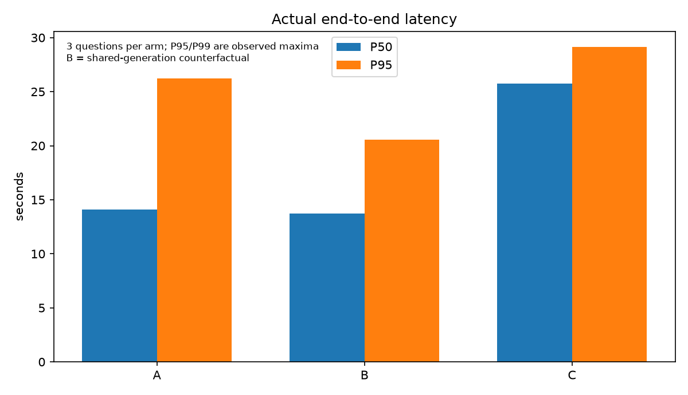
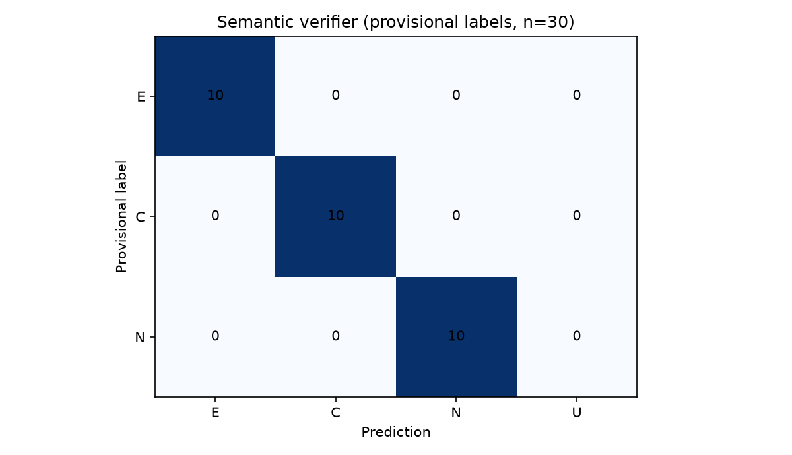

# D.I.G. RAG v3 Phase 2 — 실제 표본 평가 보고서

2026-11-26 (Asia/Seoul). 로컬 `codex/grounded-rag-v3`, v2 기준 `8861848`. [구현·재현 안내](../ROBOT_KNOWLEDGE_RAG_V3_PHASE2.md).

## 1. Executive Summary

실험 도구와 기준선 보존, 질문 후보 120개/semantic pair 180개, 실제 NVIDIA A/B/C 3문항 비교, 실제 verifier 30쌍, 개발 규칙 후보 1건의 재검증을 수행했다. 원본 응답·토큰·호출 시간·실패·gold 오류를 보관했다.

현재 표본에서 C는 부분 답변 2건, 전체 보류 1건이었다. A/B보다 정확하다는 confirmatory 결과는 확보하지 못했다. 최종 출력의 독립 atom 주석과 자연도 평점이 없고 gold 관련성/원자성 오류도 발견돼 Faithfulness·Coverage·Naturalness는 **미측정(null)**으로 남겼다. 이 상태로 Phase 2 품질 목표 달성이나 최적 구성을 선언하지 않는다.

개발 사례에서 시각적 “목표 손 제스처”의 목표를 설계 목표로 간주한 오탐 후보를 확인했다. 격리 규칙 후보+실제 judge에서 통과 claim이 1→2개로 늘었다. 시험 분할 개선이 미입증이므로 운영 기본값은 바꾸지 않았다.

추천 운영 구성은 기존 Phase 1 설정 유지다. voice 목표 3~5초는 이번 C 표본에서 달성하지 못했다. 모델 호출 주변의 클라이언트/로컬 처리 비용과 네트워크 호출이 함께 병목이다. 상세 단계 중 처음 실행에서 측정하지 않은 deterministic/render 시간은 null이며 총 시간의 잔여분을 임의로 모델 추론 시간으로 해석하지 않는다.

## 2. Experiment Environment

| 항목 | 확인값 |
|---|---|
| Python | 3.13.14 |
| CPU 식별 | AMD64 Family 26 Model 104 Stepping 0, AuthenticAMD |
| 논리 CPU | 12 |
| RAM | 16,279,851,008 bytes |
| GPU·NVIDIA 서버 하드웨어 | 미측정 |
| 모델 | `nvidia/nemotron-3-ultra-550b-a55b` |
| Base URL | `https://integrate.api.nvidia.com/v1` |
| 추론 모드·출력 상한 | thinking=false, A/B/C max_tokens=2048; NLI batch=4096 |
| 호출 예산 | 모델 호출 예산 기본 90초, 생성 60% 상한, retry=0 |
| 검색 | 격리 SQLite, FTS, 벡터/BGE off, 임시 DB에서 local tokenizer 부재 시 legacy 청킹 |
| 데이터 | 120 질문, 180 provisional NLI pair; 실제 질문 3개, NLI 실제 30쌍 |
| 원격 요청 | 추론 10 + metadata 1 = 실제 HTTP 11회 |
| 보수적 장부 | 전송 전 실패 예약 1 포함 총 12회, 한도 12회 |
| quota·과금 | API 반환 정보 없음. 무료라고 가정하지 않았으며 사용자 12회 승인 범위만 수행 |

모델 목록 30개가 반환됐다. 모델 목록에 있다는 것만으로 한국어 품질·라이선스·비용·가용 quota를 확정하지 않았다. 독립 모델 D를 선택/실행하거나 무거운 NLI를 설치하지 않았다. 현재 PC의 기존 모델 캐시를 격리 DB에 연결하지 않았으므로 이 결과를 기존 운용 DB/E5 청킹·Hybrid의 재현 결과로 주장하지 않는다.

실제 요청에서 반환된 합계는 입력 38,474 tokens, 출력 1,971 tokens, reasoning 0 tokens다. B의 공유 생성 토큰을 중복 합산하지 않았다. 통화 비용은 산출하지 않았다. [요청 감사](rag_v3_phase2/request_audit.json), [환경](rag_v3_phase2/environment.json), [실험 manifest](rag_v3_phase2/experiment_manifest.json).

## 3. Baseline Comparison

A는 커밋의 실제 v2 코드, C는 현재 v3의 실제 answer_documents 경로다. B는 C가 실제로 생성한 동일 claims와 검색 근거를 인용 존재 검사만 거쳐 조립한다. B는 실험 전용이며 운영에 연결하지 않았다. B의 지연은 공유 생성+인용 검사 시간으로, 별도 독립 HTTP end-to-end 실행은 아니다.

| 지표 | A v2 | B 생성+인용 | C v3 |
|---|---:|---:|---:|
| 실제 동일 질문 | 3 | 3 | 3 |
| Faithfulness / Coverage | 미측정 | 미측정 | 미측정 |
| Naturalness / 의미적 Citation Correctness | 미측정 | 미측정 | 미측정 |
| P50 전체 시간 (초) | 14.08 | 13.75 | 25.76 |
| P95/P99 (초) | 26.24 | 20.57 | 29.14 |
| 귀속 추론 호출 | 3 | 3, C와 공유 | 5 |
| 입력 tokens | 13,046 | 7,325, C에 포함 | 11,449 |
| 출력 tokens | 387 | 1,059, C에 포함 | 1,101 |
| API 오류/timeout 관측 | 0/3 | 공유 생성에서 0/3 | 0/5 호출 |
| 전체 verified 답변 | 해당 없음 | 실험상 미검증 | 0/3 |
| C 답변 형태 | — | — | partial 2, abstained 1 |

표본 3개에서 P95/P99는 관측 최대값이다. 통계적 안정성이나 모집단 지연 보장을 뜻하지 않는다. C의 partial claim은 검증된 일부 사실이지만 질문의 충분한 Coverage를 입증하지 않는다. “verified 0”을 모든 출력이 틀렸다는 뜻으로 해석하지도 않는다.

Raw Copy는 실제 공유 검색 문맥을 대상으로 계산하며 품질 향상의 대체 지표로 사용하지 않는다. 최신 값과 카테고리별 표본 수는 [metrics.json](rag_v3_phase2/metrics.json)에 있다. 실제 표본은 구조/통신/UNKNOWN 세 질문으로, 120개 모든 카테고리를 대표하지 않는다. cloud off의 120개 로컬 기록은 [offline C](rag_v3_phase2/offline_grounded_rag_v3.jsonl)이며 실제 모델 120회 평가가 아니다.

## 4. Semantic Verification Evaluation

개발 분할에서 ENTAILMENT/CONTRADICTION/NEUTRAL 각 10개, 총 30쌍을 한 batch로 보냈다. 정답 라벨은 전송하지 않았다.

| provisional gold \ prediction | E | C | N | U |
|---|---:|---:|---:|---:|
| E | 10 | 0 | 0 | 0 |
| C | 0 | 10 | 0 | 0 |
| N | 0 | 0 | 10 | 0 |

이 30쌍에서 Accuracy/Macro F1은 1.0, 관측 FAR/FRR/UNAVAILABLE은 0이었다. 클래스별 precision/recall도 이 표본에서 1.0이다. 요청 내부 SDK network/create 시간은 약 8.06초였다. 개별 pair 지연·P95는 측정하지 않았다. 모든 pair에 batch 시간을 복제해 30개 독립 지연 표본으로 사용하지 않는다.

**중요한 제한:** 60개 실제 문단에 명시 부정·근거 없는 동일 지연 주장을 붙인 템플릿형 데이터다. 30쌍은 같은 방식으로 만든 provisional label이며 독립 인간 정답이 아니다. 어려운 자연스러운 수치 대상 교환·모호한 예외·간접 인과관계 180개를 실모델로 검증한 결과가 아니다. 일반 한국어 정확도 100%, 실제 FAR=0, 독립 모델보다 우수함을 주장하지 않는다. H2의 생성기/검증기 오류 상관관계는 미검증이다.

[실제 판정](rag_v3_phase2/verifier_results.jsonl), [원본 후보](rag_v3_phase2/semantic_cases.jsonl), [집계](rag_v3_phase2/verifier_metrics.json).

## 5. Hallucination / 오류 분석

- **확정된 인용 오류 차단:** 063의 생성 4개 주장 중 3개가 범위 밖 quote_index를 사용했다. B/C의 서버 인용 확인에서 제외했다. 의미 검증만의 추가 효과로 세지 않는다.
- **근거 관련성 문제:** 061의 통신 질문에 C는 카메라→GUI 처리 경로만 남겼다. 실제 UDP 통신 설명의 충분성을 확보하지 못했다. 가장 자연스러워 보이는 문장을 남긴 것만으로 질문에 답했다고 판단하지 않았다.
- **오탐 후보와 개발 실험:** “목표 손 제스처”가 `DESIGN` 정규식의 “목표”에 걸렸다. 개발 전용 조건부 규칙은 같은 원문·생성문으로 의미 검증을 다시 받아 통과 1→2 claim을 관측했다. 최종 시험셋 개선/새 오류 가능성은 미검증이며 운영 기본값 유지다.
- **Qt 보류:** 생성문에는 PyQt/PySide라는 모호한 바인딩 표현, 파일 경로, 다른 절의 설치/예외 조건이 함께 있었다. Entity·condition·source-text 검사에서 전부 제외됐다. source mismatch와 무관한 조건의 과잉 적용 가능성을 각각 검토해야 한다. 정답 문서에는 PySide6가 명시되므로 정확한 그 근거를 선택하는 작업도 필요하다.
- **근거 절단:** 격리 임시 DB의 legacy 문자 청크가 문장 중간에서 끝난 예를 확인했다. 이것을 설치된 E5 기반 운용 경로의 성능이라고 일반화하지 않는다. 다음 실험은 동일 캐시·chunker 구성으로 고정해야 한다.
- **평가 데이터 오류:** 061의 미리 지정한 UDP 표 검색 문자열이 prose-card 필터에서 제외되어 무관한 provenance 문단으로 fallback됐다. 062의 설치 단락은 바인딩 정답을 완전하게 제공하지 않는다. Gold에 문단 단위 복합 사실도 남아 있다. [gold 감사](rag_v3_phase2/gold_audit.json)에 남기고 자동 Coverage 계산을 중단했다.

원본 gold hash와 출력은 조용히 고치지 않았다. 이후 유효 gold v2를 만들고 새 confirmatory 평가가 필요하다. [파이프라인 기록](rag_v3_phase2/error_analysis.jsonl)과 [개발 후보](rag_v3_phase2/adaptive_candidate.json)를 함께 읽는다. H1의 최종 hallucination 감소는 아직 입증되지 않았다.

## 6. Korean Conversational Quality

| 유형 | 실제 관측 예와 출처 |
|---|---|
| 단순 사실 | 로컬 배터리 템플릿은 7.4V를 문서 범위로 표시. `offline_grounded_rag_v3.jsonl`의 배터리 질문 |
| 기술 구조 | 061 C: “데이터 흐름은 카메라 워커 → 비전 워커 → GUI 상태 머신(50ms QTimer) → 안전 명령 순서…”와 나머지 보류. 사실은 있으나 통신 질문 직접성 부족 |
| 복합 질문 | 로컬 여러 문서 종합 후보는 cloud off에서 대체로 보류. 충분한 자연어 생성 품질의 증거가 아님 |
| 하드웨어 비교 | 로컬 버전 지정 질문은 개별 프로파일 자료/템플릿 또는 확인 요청. V18/V19 자유 생성 실 API 비교는 수행하지 않음 |
| 근거 부족 | 로컬 실측 효율·현재 상태 요청은 보류/확인 요청. API를 쓰지 않은 결과와 실모델 실패를 혼합하지 않음 |
| 후속 질문 | 생략형 입력과 명시적 참조 대상을 기록하고 resolved_question으로 로컬 실행. 실제 다중 턴 모델 대화는 미측정 |

A의 Qt 답변: “Python의 Qt 프레임워크(PyQt/PySide)…4탭 대시보드”처럼 유창하나 바인딩 정확성 검토가 필요하다. B는 같은 C 생성 결과를 여러 문장으로 제공한다. C는 원문과 관련된 사실만 남겨도 대화의 완결성이 낮아질 수 있었다. 자연도는 정답과 분리한 블라인드 검토 양식을 만들었지만 점수를 임의 부여하지 않았다. [블라인드 검토 자료](rag_v3_phase2/blind_review.json).

## 7. Performance Analysis

세 질문 C의 전체 시간은 29.14s / 18.19s / 25.76s다. SDK create 구간의 실제 요청별 시간은 [request_audit](rag_v3_phase2/request_audit.json)에 있다. 예를 들어 061의 create 구간은 A 12.67s, C 생성 10.64s, C judge 1.00s였다. 전체 시간과 차이가 크므로 전체 지연을 원격 모델 추론 탓으로만 돌리지 않는다. 클라이언트 생성/종료·로컬 Python·검증·호스트 부하 등 남은 비용을 후속 계측해야 한다.

생성/semantic wrapper 시간과 검색 시간은 결과 JSONL에 기록했다. 최초 실험에서 별도로 계측하지 않은 deterministic/render 단계는 null로 남겼다. 이후 평가 코드에는 이 계측을 추가했지만 과거 실제 측정값을 새로 만들어 채우지 않았다. API 서버 CPU/GPU/RSS와 실행 중 PC CPU/RSS 시계열도 미측정이다.

C는 검증 전 스트리밍을 하지 않으므로 안전한 일부 답변도 최종 완료 시점에만 노출된다. UI 전송/폴링까지의 첫 답변 시간은 별도 실험이 필요하다. 토큰 수는 SDK usage에서만 취했고 입력 38,474 / 출력 1,971 / reasoning 0을 기록했다.

## 8. Trade-off Analysis

추가 의미/결정론적 검사로 잘못된 지원 연결을 차단했지만 세 질문에서 보류와 긴 지연도 관측했다. Faithfulness 향상이 Coverage 감소를 통해 달성됐는지는 아직 유효 gold/최종 atom 주석이 없어 판정하지 못한다. 원문 복사율이 낮다고 자연도·정확도가 높다고 결론 내리지 않는다.

개발 규칙 후보는 보류 원인 하나를 줄였지만 D(독립 모델)·다른 top-k/근거 예산·Hybrid/BGE·캐시의 실모델 비교는 하지 않았다. 점수형 NLI 확률이 없으므로 임의 confidence와 Risk–Coverage/PR curve를 생성하지 않았다. Pareto frontier도 null이다.

요청된 14개 그래프/표 패널은 [figures](rag_v3_phase2/figures)에서 확인한다. 미측정 축은 숫자 0이 아닌 “Not measured”로 표시했다.

## 9. Recommended Configuration

기존 설정 유지: cloud 기본 off, 구조화 사실 0 LLM 호출, 자유 생성은 원래의 생성+검증, shared 90초, retry=0, BGE 기본 off. 사용자가 설정한 실제 `.env`도 수정하지 않았다.

정확성/속도/균형 후보를 구분해 최적이라고 선정할 근거가 부족하다. 특히 B는 빠르더라도 의미 검증 없는 실험 경로이므로 운영 속도 우선 구성으로 권고하지 않는다. 개발 후보 규칙은 다음 검증·시험 데이터와 올바른/잘못된 설계 표현 모두에서 확인하기 전 적용하지 않는다.

## 10. Regression and Safety

Phase 1 원본 스냅샷 보존과 최신 기준선/신규 단위/전체 회귀 결과는 아래 최종 기록에 기입한다. 공개 문서/합성 데이터만 격리 프로세스와 DB에서 사용했다. 사용자 문서·파일명·파생 요약·이전 비공개 대화는 외부 모델에 보내지 않았다. 실제 로봇/관제/UI를 조작하거나 기존 관제를 재시작하지 않았다.

실험 코드에는 RobotSession/모터 송신 호출이 없다. control_lock·STOP·EStop·승인·lease·프로파일·펌웨어는 수정하지 않았다. 별도 실험 B/규칙 후보는 운영 코드의 기능 토글로 추가하지 않았다. 원격 push/main 병합도 하지 않았다.

## 11. Remaining Limitations

1. 120개 질문은 검토 후보, 180쌍은 템플릿 기반 provisional label이다. 독립 인간 검토와 일부 gold 오류/원자성 보완이 필요하다.
2. 실제 A/B/C 질문은 3개다. 세 질문은 같은 문서 영역에 편중됐고 카테고리별 성능을 추정할 수 없다.
3. 실제 verifier는 쉬운 형식의 개발 30쌍뿐이다. 다른 모델과의 오류 상관관계·어려운 한국어 entailment는 미검증이다.
4. 격리 DB legacy 청킹 조건을 실제 캐시·운영 DB와 같다고 간주할 수 없다. 하드웨어/버전 및 후속 대화의 실제 모델 비교가 추가로 필요하다.
5. 독립 final-output atom 주석이 없어 목표 Faithfulness 95%, Coverage 90%, naturalness 4/5, semantic citation 95%의 달성 여부는 미판정이다.
6. 기록된 실 API 오류/유출/승인 우회 0건은 운영에서의 오류 가능성이 0이라는 보장이 아니다. 실물 성능도 검증하지 않았다.

## 12. Phase 3 Readiness

| 항목 | 상태 |
|---|---|
| reply/speech_text/claims/citations 분리 | Phase 1 인터페이스 유지 |
| 자연스러운 한국어 | 일부 실제 유창한 설명 관측, 독립 평점·충분성 미검증 |
| 첫 답변/완료 지연 | C 18~29초 관측; 일반 음성 목표 3~5초 미달 |
| 실패·보류 안내 | 실제 Qt 질문에서 안내 반환 확인 |
| 취소·오래된 응답 | 기존 generation/worker 회귀로 검증; 실제 Android 연계 미구현 |
| STOP/승인 | 기존 코드·경로 유지, 기존 테스트 회귀 |
| 파일명 없는 음성 답변 | 실제 생성이 .py 경로를 넣는 사례 발견. C에서는 다른 검사로 제거됐으나 모든 파일명 차단을 보장하지 않으므로 추가 점검 필요 |
| Android/Voice Gateway/STT/TTS | 이번 Phase에 구현하지 않음 |

Phase 3용 데이터 인터페이스는 있으나 실제 음성 대화 품질과 응답 시간의 제품 준비 완료를 선언하지 않는다.

## 최종 검증 기록

Phase 1 기능 기준선은 **21 passed, 13 subtests**, 전체 회귀는 **364 passed, 1 skipped, 2 deselected, 471 subtests**였다. 제외한 2개는 이전과 동일한 로컬 비밀 파일/원본 아카이브 환경 검사와 UDP 포트 점유 환경 검사다. 기존 기대를 완화하지 않았다. 전체 회귀 뒤 추가한 평가 도구의 final-output/데이터 hash/민감 입력 검사 등은 **7 passed**로 별도 확인했다. 테스트 시점이 다른 수를 합쳐 독립 시험 수로 표현하지 않는다.

추가 privacy 테스트는 JSON 직렬화된 메시지에서 민감 문자열 검색만 하면 줄 시작 패턴을 놓칠 수 있음을 드러냈다. 평가 전용 전송 가드를 메시지/중첩 JSON의 실제 문자열까지 검사하도록 고쳤고 전송 및 예산 예약 전 차단을 확인했다. 실제 전송한 자료는 고정된 공개 프로젝트 문서였고 사용자 비밀 문서는 입력하지 않았다. 이 수정은 운영 정책을 약화시키지 않는다.

`git diff --check`, JavaScript 구문 검사와 금지 영역 diff를 확인했다. 실행/통신/펌웨어/프로파일/승인/STOP 코드 변경은 없었다. 실제 관제 재시작과 실물 구동, 원격 push 및 main 병합은 하지 않았다. 측정하지 않은 품질 목표는 계속 미측정으로 유지한다.
