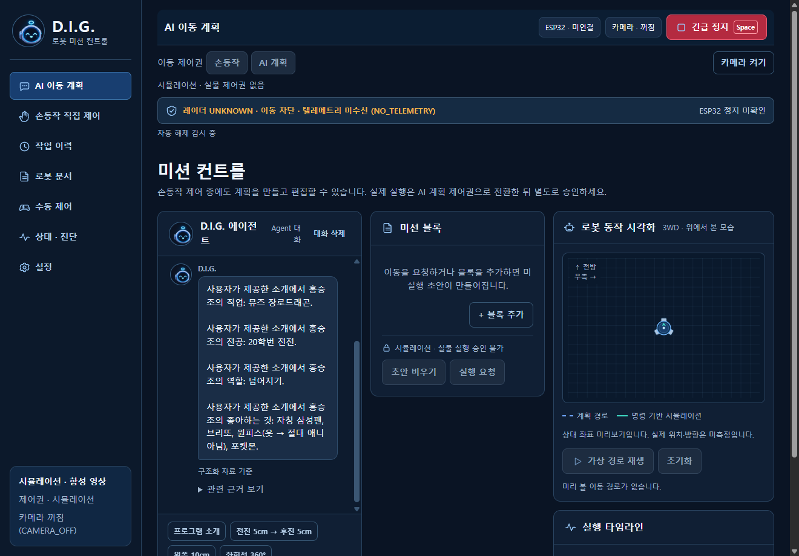
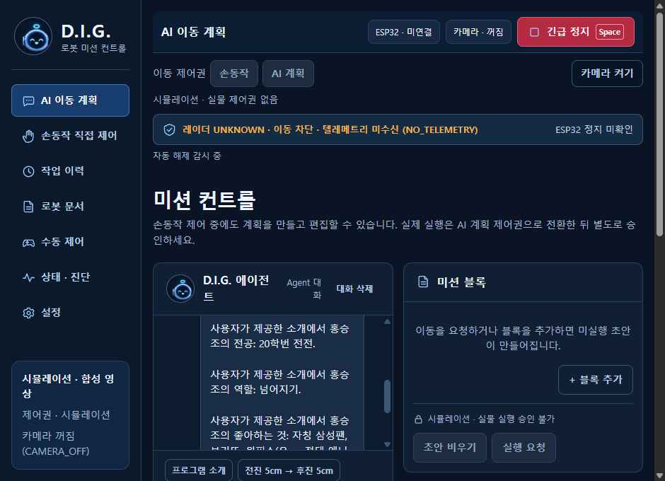
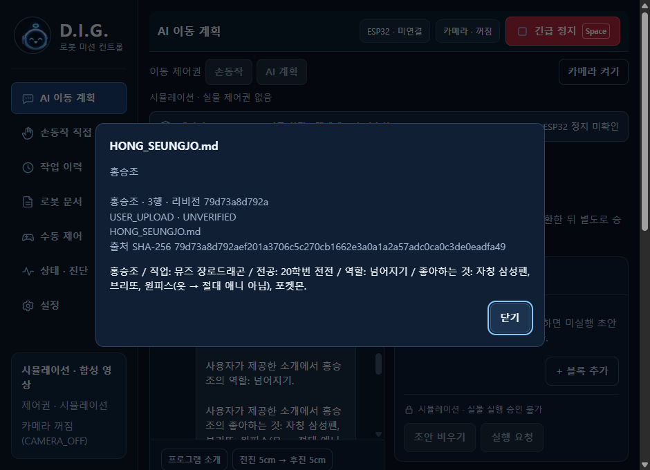
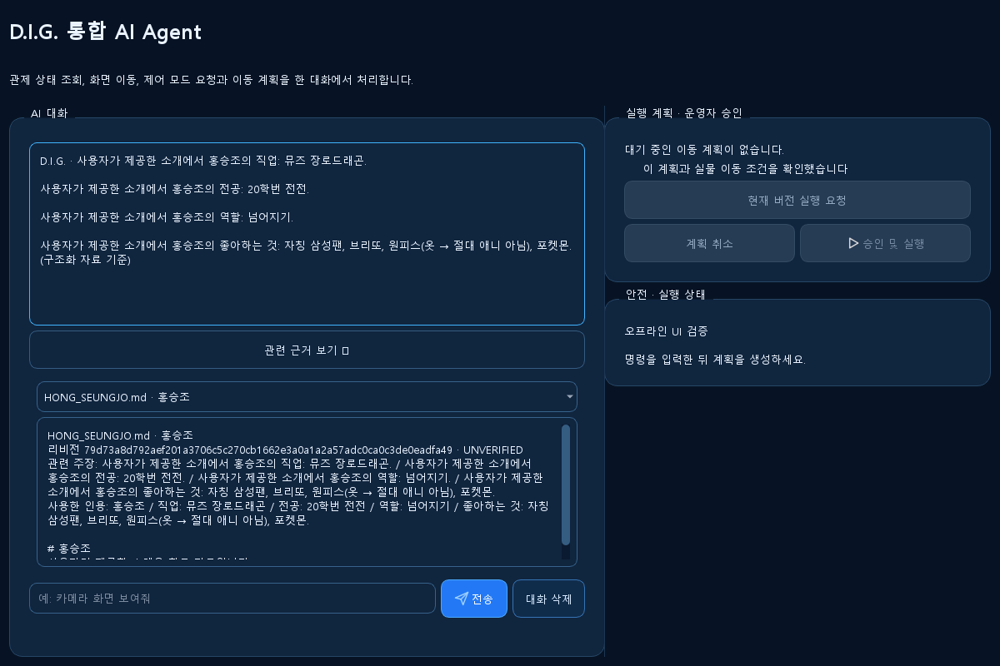

# RAG v3 Phase 1 검증 기록

날짜: 2026-11-26 (Asia/Seoul). 작업 기준 `8861848`, 로컬 브랜치 `codex/grounded-rag-v3`. 코드·설계 상세는 [RAG v3](../ROBOT_KNOWLEDGE_RAG_V3.md).

## 실행 범위와 증거

실물 로봇·실 카메라를 사용하지 않았다. 기존 실행 중인 관제를 재시작하지 않았다. 실제 NVIDIA API를 호출하거나 사용자 문서를 새로 외부 전송하지 않았다. 생성/의미 검증 테스트는 mock 응답 계약 및 결정론적 방어 검증이다. 실제 한국어 모델 정확도의 증거가 아니다.

| 검사 | 결과/산출물 |
|---|---|
| 기존 RAG/Agent/프로파일 기준선 | 80 passed, 1 skipped, 154 subtests — [baseline.log](rag_v3/baseline.log) |
| 최초 신규 red | 3 failed: 신규 모듈/응답 상태가 없음을 확인 후 구현 |
| 중간 관련 회귀 | 98 passed, 1 skipped, 166 subtests, 기존 모의 STOP 대기 테스트 1개 시간 초과 |
| STOP 단독 재검사 | 1 passed, 2.77s — [stop-recheck.log](rag_v3/stop-recheck.log); 안전 코드나 제한시간 변경 없음 |
| 최종 전체 회귀 | 358 passed, 1 skipped, 2 deselected, 470 subtests, 569.24s — [full-regression.log](rag_v3/full-regression.log) |
| 최종 신규·통합 집중 검사 | 23 passed, 12 subtests, 258.00s — [final-confirm.log](rag_v3/final-confirm.log) |
| 마지막 수치 결합 보완 검사 | 1 passed, 10 subtests, 27.53s — [binding-final.log](rag_v3/binding-final.log) |
| Web | 실제 임시 Chrome, 1320×920/940×680, 접힘→펼침→원문 dialog, JS 예외 0, ESP32 세션 없음, CAMERA_OFF — [browser.json](rag_v3/browser.json) |
| Qt | offscreen 위젯 검사: 출처 기본 접힘, 상태 구분, source 선택/원문 확인. 기존 승인/STOP UI 회귀 포함 |
| 정적 검사 | `node --check python_controller/web/app.js`, `git diff --check` |
| 금지 영역 | 기준 커밋 대비 control/communication/execution/dashboard_runtime/config/firmware 변경 없음; 하드웨어 프로파일 파일 변경 없음 |

전체 회귀의 환경 제외는 기존 로컬 `secrets.h` 존재·원본 개인 ZIP을 검사하는 provenance 테스트와 UDP 포트 점유 환경 테스트 2개다. 파일을 삭제하거나 비밀 내용을 읽지 않고 제외했다. 나머지 테스트는 기존 fake/mock 장치를 사용한다.

## 요구 사례 매핑

| 사례 | 검사와 한계 |
|---|---|
| T01 정상 설명 | `test_T01_verified_claims_render_without_raw_chunk_or_markers`; 서버 ID 재부여, mock ENTAILMENT를 거친 자연어 claim |
| T02 없는 출처 | `test_T02_T03_invalid_ids_indices_and_quote_text` |
| T03 없는 인용 | 범위 밖 인덱스/임의 quote 필드 거절, 서버 원문 후보 재사용 |
| T04 무관한 주장 | 실제 인용이 있어도 mock NEUTRAL이면 제외; 실제 judge 정확도 측정 아님 |
| T05 10→100cm | 수치·대상 결합 검사, unsupported quantity 거절 |
| T06 부품·전압 혼동 | ESP32 5V/모터 12V 교환, V→A 변경 거절 |
| T07 V18/V19 혼합 | 서로 다른 프로파일의 supports를 단일 claim으로 결합할 수 없음 |
| T08 UDP→Bluetooth | 부품/프로토콜 식별자 집합 검사 및 judge 경로 |
| T09 설계→실측 | 설계 한정 누락 거절 |
| T10 안전 성능 | 근거 없는 “항상 안전” 거절 |
| T11 Prompt Injection | 지시문 필터와 read-only Agent 검사, 실행 함수 호출 0 |
| T12 API Timeout | unavailable/abstained; 원문 fallback 없음 |
| T13 사용자 문서 | 프로젝트·사용자 혼합 검색에서 외부 complete 호출 0 |
| T14 일부 통과 | 유효 claim만 partial, rejected 사실은 reply에 없음 |
| T15 전부 실패 | abstained, verified 표시 없음 |
| T16 원문 복사 | 긴 연속 원문 복사 거절, 짧은 정확 기술어는 별도 처리 |
| T17 명시 원문 | citation_only, 기존 원문 열람 유지, speech_text 비움 |
| T18 관련성만 있는 문서 | 검색된 citation이 있어도 설명은 abstained |
| T19 검증기 장애 | missing/timeout/UNAVAILABLE 모두 통과하지 않음 |
| T20 최종 새 사실 | render 계약과 다른 reply 전체 거절 |
| T21 출처 충돌 | 같은 인물의 서로 다른 직업은 conflicting/clarification; 자유 문장 충돌은 judge에 별도 context로 제공 |
| T22 현재 상태 | 문서로 현재 주행·연결 상태를 단정하지 않음 |
| T23 STOP 중 RAG | Agent 통합 worker 대기 중 lock 획득·emergency 가능, 늦은 답변 폐기 |
| T24 승인 | 위 검사에서 approve/run 호출 없음 + 기존 미션 승인/리비전/STOP 회귀 유지 |
| T25 출처 접힘 | 실제 브라우저 details.open=false, Qt 출처 박스 hidden |
| T26 cloud=0 | 외부 호출 0, 일반 원문 덤프 없음 |
| T27 파생 자료 | 전체 검색 scope 기준 privacy 검사, 사용자 파생 요약도 judge로 전송하지 않음 |
| T28 부정/예외 | 부정·때만·비교 방향 변경 거절 |
| T29 검증 전 스트리밍 | 문서 worker 대기 중 partial_reply 빈 문자열, 일반 채팅 스트리밍은 기존 회귀 유지 |
| T30 긴 부품명 | 긴 정확 식별자는 보존, 10cm=0.1m 명시적 단위 변환 허용 |

추가 검사: 모델 자신이 선언한 verified/confidence/approved 필드 거절, 문서 철회, judge 출력 순서·형식, 2회 공유 deadline과 3번째 호출 금지, verifier off일 때 생성 생략, 주석 없는 faithfulness=null, 사실 0개일 때 faithfulness를 1로 만들지 않음, Coverage=0, 명시 인용 Copy Rate 제외.

## 성능 및 비교 예시

[measurements.json](rag_v3/measurements.json)은 격리 DB의 합성 자료만 사용한다. v2 커밋의 answer.py를 임시 모듈로 읽어 동일 자료에서 실행했다. 템플릿 10회 P50 11.405ms/P95 154.79ms, 보류 10회 P50 14.705ms/P95 94.19ms. 표본 10개의 P95는 관측 최대값이며 실시간 상한이 아니다.

mock_grounded는 생성과 판정을 mock한 통합 예시다. unannotated_metrics의 faithfulness/relevance/수치·entity·version accuracy/naturalness는 null이다. 실제 Nemotron/NLI의 한국어 성능·토큰·CPU/RSS·대형 모델 지연 개선은 미측정이다. 평가값을 model self-report에서 정답으로 승격하지 않는다.

## 화면









Qt 캡처는 mock view를 이용한 offscreen 렌더링이다. 초기 offscreen 기본 폰트의 한글 대체 문자가 확인되어 검증 스크립트에서 Windows 맑은 고딕을 명시 로딩하고 기존 D.I.G. stylesheet를 적용해 다시 확인했다. 제품의 폰트/테마 정책은 변경하지 않았다.

## 재현 명령

```powershell
.\.venv\Scripts\python.exe -X utf8 -m pytest tests/test_knowledge_v3.py -q
.\.venv\Scripts\python.exe -X utf8 -m pytest tests -q --deselect=tests/test_firmware.py::FirmwareTests::test_reference_provenance_and_no_copied_credentials --deselect=tests/test_llm_execution.py::ExecutionTests::test_motion_denied_without_approval_or_exclusive_port
node --check python_controller/web/app.js
git diff --check
```

Phase 2 정답 주석/실험군별 실행은 `knowledge.answer_metrics` 인터페이스를 사용한다. 전체 A/B/C 실험은 이번 Phase에서 수행하지 않았다. 실물 정지·제동 성능·센서 신뢰성은 이 결과로 입증되지 않는다.

## 최종 갱신

전체 회귀가 통과한 뒤의 추가 보완(긴 식별자 복사 오탐 제외, 명시적 원문 speech 분리, 비교 한쪽만 확인한 partial 표시)은 최종 23개 집중 검사에서 재확인했다. 마지막으로 한 근거 절에 서로 다른 전압이 함께 있어 대상 결합이 모호하면 보류하도록 한 변경은 10개 방어 subtest에서 확인했다. 최신 프로덕션 변경 후 필요한 해당 검사는 모두 통과했다. 테스트 실행 시각이 다른 수를 더해 독립 시험 수로 표현하지 않는다.

`git diff --check`와 JavaScript 구문 검사가 통과했다. 금지 영역은 기준 커밋 대비 변경이 없었다. 이번 UI 검증용 프로세스만 종료했고 기존 관제 프로세스는 종료하거나 재시작하지 않았다. 원격 push와 main 병합은 하지 않았다.
