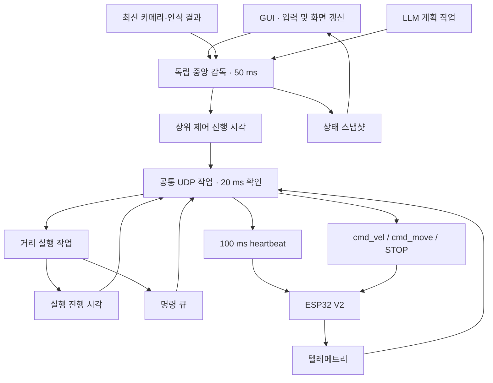

# Watchdog 분리·엔코더 복구 구현 결과

이 문서는 초기 V2 시험 설정을 기록합니다. 현재 후보의 적용 정책과 변경 내역은 [저속 구동 중 엔코더 급변 처리](../ENCODER_TOLERANT_DRIVE.md)에 있습니다.

2026-11-18에 PC 중앙제어 코드와 별도 ESP32 후보를 수정했습니다. 실제 보드에는 업로드하지 않았으며 실물 모터 시험은 수행하지 않았습니다.

## 적용 범위

| 영역 | 구현 |
| --- | --- |
| 공통 통신 | RobotSession의 전용 통신 작업이 모든 UDP 송수신과 seq를 소유 |
| 거리 실행 | 실행기는 큐로 목표 등록·STOP을 요청하고 텔레메트리를 구독 |
| Heartbeat | 전용 통신 작업에서 100 ms 주기로 송신 |
| V2 통신 감시 | ESP32 heartbeat 수신 600 ms 만료 |
| V2 속도 명령 | heartbeat와 독립적으로 cmd_vel 300 ms TTL |
| 상위 제어 | 중앙 감독과 거리 실행 작업의 진행 시각을 각각 600 ms로 감시 |
| 직접 버튼 | GUI 생존 250 ms 확인과 누름·해제 입력 유지 |
| 영상 입력 | 유효한 새 인식을 사용하며 이전 입력을 heartbeat로 연장하지 않음 |
| 오류 복구 | Fault가 남아 있어도 출력 정지를 따로 확인, 재부팅 후 정지 동기화 |
| 시험 정책 | STRICT 또는 FILTERED_TEST를 정지 상태에서 설정하고 장치 응답으로 확인 |

PC의 V2 피드백 유효시간은 800 ms이며, 거리 실행기의 별도 피드백 timeout 설정도 적용됩니다. 통신 송신 유지, 응답 수신 나이, 속도 입력 수명, 상위 제어 진행 시각은 각각 다른 조건입니다.

## 실제 동작 흐름

GUI는 감독 작업의 스냅샷을 표시합니다. LLM 추론, 카메라 인식, GUI 렌더링이 통신 작업의 소켓을 직접 사용하지 않습니다. 중앙 감독이나 거리 실행 작업이 진행 시각을 갱신하지 못하면 heartbeat 작업이 STOP으로 전환합니다.

기존 소켓을 거리 실행기에 빌려주는 방식은 큐 기반으로 바꿨습니다. 같은 연결과 session_id를 유지하며 각 실제 전송의 seq는 공통 작업에서 생성합니다. 거리 목표 재전송은 새 seq와 같은 motion_id·execution_token·목표 내용을 사용해 진행률을 초기화하지 않습니다.

CLI의 기본 실제 실행 경로도 내부 RobotSession을 사용합니다. 사용자 지정 모의 socket_factory와 기존 독립 실행기 테스트 경로는 유지했습니다. CLI의 dry-run과 기존 EXECUTE·READY 입력은 그대로 적용됩니다.

## 펌웨어 협상과 기존 장치

수정 후보는 다음 스케치입니다.

`esp32_firmware/candidates/control_v2/control_v2.ino`

PC는 처음에 STOP으로 연결을 확인합니다. 장치가 protocol_version 2와 100/600/300 ms 설정을 보고하면 protocol_version 2가 포함된 새 STOP을 보내 협상합니다. 그 순서 번호의 응답을 확인한 뒤 이동을 허용합니다.

기존 펌웨어가 V2 필드를 보고하지 않으면 기존 300 ms 규칙을 사용합니다. PC 화면의 설정만 600 ms로 바뀌었다고 간주하지 않습니다. 이전 장치에는 새 엔코더 시험 정책을 활성화할 수 없습니다.

## 이동 허용과 정지

V2 heartbeat에는 controller_alive, motion_permit, motion_id, execution_token이 포함됩니다. 유효한 명령이 새 실행 토큰을 등록하고, heartbeat가 해당 실행의 유지 여부를 알립니다.

- 거리 목표를 끝내거나 STOP을 받으면 해당 토큰은 종료됩니다.
- 같은 토큰의 지연 명령·heartbeat로 완료·취소된 목표를 다시 시작할 수 없습니다.
- cmd_vel은 heartbeat가 계속 와도 새 속도 명령이 300 ms 안에 도착해야 합니다.
- cmd_move는 heartbeat를 받으며 ESP32에서 목표를 추적합니다. 새 이동 명령을 계속 받을 필요가 없습니다.
- 속도·거리·입력·세션의 조건이 유효할 때만 새 명령을 실행합니다.

100/600 ms는 시험 후보 설정입니다. 600 ms는 마지막 heartbeat 수신부터 만료를 판정하는 기준이며, 실제 PWM 차단과 바퀴 정지까지의 지연을 검증한 수치가 아닙니다.

## 엔코더 시험 정책

후보 펌웨어는 STRICT로 부팅합니다. 테스트·진단의 **엔코더·복구** 화면에서 정지 상태를 확인한 뒤 FILTERED_TEST를 선택할 수 있습니다. 장치가 보고한 encoder_policy가 적용 결과의 근거입니다.

| 조건 | FILTERED_TEST의 처리 |
| --- | --- |
| 거리 목표가 아닌 저속 구동에서 단발 이상 | 해당 샘플 제외, 한 제어 틱 동안 기존 제한 출력 유지, PID·적분·오도메트리 갱신 생략 |
| 최근 10틱에서 두 번째 이상 | 현재 명령 정지 및 토큰 종료 |
| 정지 상태에서 정상 샘플 10개 확보 | 복구 가능한 엔코더 오류 해제, 다음 새 입력 대기 |
| 거리 목표 중 이상 | 현재 목표 중단, 잘못된 거리 완료 판정 차단 |
| STRICT에서 오류 | 즉시 래치, 정상 샘플과 명시적 복구 절차 필요 |

반복 판정의 10틱과 복구 샘플 10개는 시험 후보 값입니다. 실제 엔코더 신호 특성에 맞는지는 실측이 필요합니다. 이번 구현에서는 정책 선택을 UI에 제공하며 개별 횟수의 동적 변경은 제공하지 않습니다.

첫 이상에서 바퀴 마스크, 실제 dt, 임계값, 직전·현재 카운트, 변화량, 직전 PWM을 저장합니다. 최근 8개 샘플은 고정 크기 RAM 버퍼에 보관하며 첫 Fault에서 유지합니다. 텔레메트리에는 원인 분석용 요약 필드를 보냅니다.

핀, CPR, PID, 바퀴 보정 및 기존 출력 한도는 참조값을 유지했습니다. signed 엔코더 카운터의 오버플로 경로는 unsigned/modular 차이 계산으로 바꿨습니다.

## PC 복구와 표시

출력 정지 확인과 구동 준비를 분리했습니다. 같은 세션·부팅에서 새 STOP 이후의 유효한 응답이 명령·PWM 0과 정지 속도를 보고하면, Fault가 남아 있어도 출력 정지는 확인할 수 있습니다.

재부팅 시 현재 입력과 LLM 실행을 취소하고 STOP 전용 동기화로 전환합니다. 새 부팅의 응답이 확인되면 session_lost를 해제하며, 이전 부팅에서 지연된 응답은 폐기합니다. 이전 이동은 재시작하지 않습니다.

STRICT의 엔코더 오류는 장치가 정상 샘플 10개와 출력 정지를 보고하는 경우 복구 버튼에서 reset_fault와 후속 STOP을 순서대로 요청합니다. V2 진단을 지원하지 않는 기존 장치에서는 신호 회복을 확인할 수 없다는 메시지를 표시합니다.

모드 전환과 버튼 활성화는 출력 정지뿐 아니라 세션·구동 준비도 함께 확인합니다. 통신 이상이 있을 때 손동작 화면이 중립 손동작만 기다리는 것처럼 표시하지 않도록 수정했습니다.

## 모드 격리

기존 Mode Guard 후보의 처리를 control_v2에도 반영했습니다. ESP32 MANUAL_TEST에서 UDP 이동·heartbeat·reset·정책 변경은 수락 전에 거절합니다. UDP STOP은 수동 PWM을 끄면서 기존 세션·송신자 주소·Fault와 발생 시각을 보존합니다. 시리얼 명령은 기존 진입 경로를 사용합니다.

## 빌드와 검증

아래 956,767바이트 빌드는 초기 V2 기준선입니다. 이후 Fault 상태에서 최신 엔코더 속도를 보고하도록 후보를 수정했습니다. 새 후보와 실물 시험 기록은 [공중 바퀴 시험](BENCH_TURN_20261118.md)에 있습니다.

- 범용 ESP32 Dev Module 타깃 `esp32:esp32:esp32`에서 후보 빌드를 통과했습니다.
- 최종 flash 사용량은 956,767 bytes, RAM은 50,044 bytes입니다.
- 컴파일한 13개 소스의 SHA-256을 후보 폴더와 대조했습니다.
- 이진 파일 SHA-256은 `59c6cc08b7adf5cd4836b22addcbd4972bb7d3db9ea6c730337722ca8c109eb0`입니다.
- C++ 실제 헬퍼의 compile-time assertion으로 시계 rollover, 정확한 만료 경계, 카운트 rollover, 단발·반복 이상 판정을 검사했습니다. 이는 MCU 동작을 실행한 결과는 아닙니다.
- 모의 V2 장치와 실제 Python 통신·실행 코드로 30 cm 목표의 가상 시간 6초 실행과 두 번째 목표의 다른 토큰 사용을 확인했습니다.
- heartbeat 독립 송신, 상위 감독·실행 작업의 각각 만료, 속도 TTL, Fault 상태 정지 확인, 재부팅 복구, 이전 패킷 차단, 다른 토큰 완료 응답 차단을 검사했습니다.
- GUI는 합성 입력으로 검사하고, 일반 dashboard-preview 진입점에서 감독 스레드의 기동·종료를 확인했습니다.

전체 회귀 테스트는 **161개 통과, 실패·건너뜀 0개**였습니다. 기존 140개와 추가 21개를 실행했으며, 원본 펌웨어 및 ZIP 해시 검사도 포함했습니다. 기존 로컬 secrets.h는 유지하고 자격 증명을 제외한 격리 사본에서 시험했습니다. 원시 출력은 `.tmp/watchdog-encoder-fix/regression.txt`에 있습니다.

빌드 결과는 `.tmp/control-v2/compile.log`, `source_hashes.json`, `output/`에 있습니다. 빌드 전용 임시 스케치에만 dummy secrets.h를 사용했습니다. 기존 자격 증명을 후보에 복사하지 않았습니다.

## 변경 파일

| 범위 | 파일 |
| --- | --- |
| 공통 통신 및 복구 | communication/robot_session.py, esp32_udp.py, timing.py |
| 상태 감독 및 GUI와 분리 | dashboard_runtime.py |
| 거리 실행과 피드백 | execution/motion_executor.py, llm_telemetry.py |
| LLM 작업 진행 감시 | llm/central_control.py |
| 텔레메트리 필드 | diagnostics.py |
| 복구·정책 화면과 정확한 상태 | visualization/dashboard.py, follow_control.py, natural_control.py, korean.py |
| 별도 펌웨어 후보 | esp32_firmware/candidates/control_v2/ |
| 추가 시험 | test_control_v2_firmware.py, test_recovery_ui.py, test_watchdog_and_recovery.py, test_v2_goal_transport.py |
| 기존 모의 장치 수정 | test_robot_session.py에서 같은 목표 재전송의 실제 멱등 동작 반영 |

위 Python 경로는 python_controller 아래, 시험 경로는 tests 아래입니다.

## 미검증 사항과 적용 단계

실제 NVIDIA API 호출, 실물 Wi-Fi 지연과 패킷 유실, 바퀴·엔코더 신호, 실제 STOP 지연, 물리적 주행 거리 및 새 후보의 실물 회귀는 미검증입니다. 이 후보로 ENCODER_JUMP의 물리 원인이 해결됐다고 판단할 수 없습니다.

기존 보드에는 여전히 기존 펌웨어의 동작이 적용됩니다. 소프트웨어 검토와 후보 빌드가 완료된 상태이며, 보드 업로드 및 실물 시험은 사용자 승인 후 별도로 진행해야 합니다.

승인 후에는 [C6 시험 절차](../C6_HARDWARE_PREFLIGHT.md)를 기준으로 아래 순서로 V2 동작을 확인합니다.

| 확인 순서 | 관찰할 정상 결과 |
| --- | --- |
| 보드 모듈·FQBN·이미지 확인, 모터 전원 분리 상태의 STOP 동기화 | 동일 session_id와 boot_id에서 V2 및 100/600/300 ms 설정을 보고하고 새 STOP 순서 번호가 확인됨 |
| 저속 직접 입력과 버튼 해제 | 버튼 해제 STOP 이후 명령과 PWM이 0, 바퀴 정지까지 별도 실측 |
| 속도 갱신 중단과 heartbeat 유지 | 마지막 유효 cmd_vel 수신 후 300 ms에 만료 판정, 기존 명령 재개 없음 |
| 저속 거리 목표와 heartbeat | 목표 한 건을 등록한 뒤 같은 motion_id와 실행 토큰으로 완료를 보고하고 물리 거리를 실측 |
| 통신 상실과 복구, 엔코더 상태 확인 | 마지막 유효 heartbeat 수신 후 600 ms에 만료 판정, 복구 후 새 입력 대기, 엔코더 오류와 통신 오류 구분 |

[C6 기록 양식](../c6_trial_log.example.json)에 PC heartbeat 송신 간격과 ESP32 수신 간격의 측정 출처를 따로 기록합니다. ESP32의 heartbeat_age_ms는 텔레메트리 생성 시점의 수신 나이입니다. 이 값만으로 수신 간격이나 PWM 차단 시각을 복원할 수 없으므로 해당 실측을 확보하지 못하면 값은 비워 둡니다.
